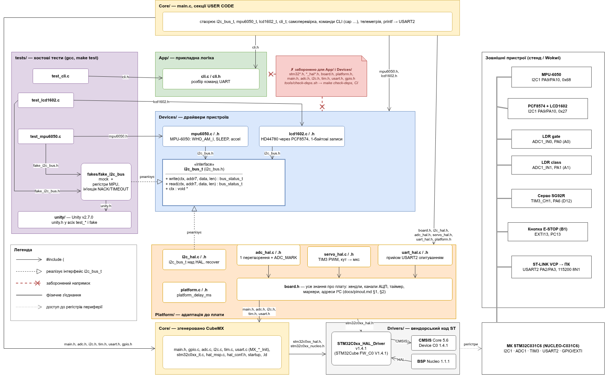

# Архітектура прошивки Warehouse Sorter (ЛР2)

Документ описує структуру прошивки: поділ коду на шари, правила залежностей між ними та спосіб їх автоматичної перевірки, доступ драйверів до шини, організацію збірки й тестів, а також зафіксовані версії інструментів і бібліотек.



*Рисунок — діаграма компонентів. Стрілки показують напрямок `#include`, підписи — заголовки, що підключаються. Джерело: [`lab_2/img/components.drawio`](lab_2/img/components.drawio).*

## 1. Шари проєкту

Прошивка поділена на п'ять шарів; окремо від прошивки існує шар хостових тестів.

| Шар | Каталог | Вміст | Від чого залежить |
|---|---|---|---|
| Core | `firmware/Core/` | Код, згенерований STM32CubeMX: ініціалізація периферії (`MX_*_Init`), обробники переривань, `main.c`. Власний код — лише в секціях `USER CODE` | HAL, Platform, Devices, App |
| Drivers | `firmware/Drivers/` | Вендорський код ST: HAL, CMSIS, BSP Nucleo. Не редагується | — |
| Platform | `firmware/Platform/` | Адаптація до плати: `board.h` і обгортки над HAL (`i2c_hal`, `adc_hal`, `servo_hal`, `uart_hal`, `platform`). Реалізує інтерфейс шини для драйверів | HAL, `Devices/i2c_bus.h` |
| Devices | `firmware/Devices/` | Драйвери пристроїв (`mpu6050`, `lcd1602`) та інтерфейс шини `i2c_bus.h` | лише стандартна бібліотека C |
| App | `firmware/App/` | Прикладна логіка. Наразі — модуль `cli` (розбір текстових команд) | стандартна бібліотека C; дозволено Devices |
| tests | `tests/` | Хостові тести на Unity і тестовий двійник шини `fake_i2c_bus`. Збираються звичайним `gcc`, у прошивку не потрапляють | App, Devices |

На поточному етапі шар App не викликає Devices: модуль `cli` лише розбирає рядки, а звернення до пристроїв виконує `main.c` (див. розділ 6).

### Відповідальність файлів

| Файл / каталог | Шар | Призначення |
|---|---|---|
| `Core/Src/main.c` | Core (USER CODE) | Composition root: створення об'єктів шини й пристроїв, самоперевірка, головний цикл CLI, телеметрія, команди `cap …` |
| `Core/Src/{gpio,adc,i2c,tim,usart}.c` | Core (CubeMX) | `MX_*_Init` і `HAL_*_MspInit` (тактування, піни), хендли `hadc1`, `hi2c1`, `htim3`, `huart2` |
| `Core/Src/stm32c0xx_it.c`, `stm32c0xx_hal_msp.c` | Core (CubeMX) | Обробники переривань (SysTick, `EXTI4_15` для кнопки E-STOP); `HAL_MspInit` — тактування SYSCFG і PWR |
| `Platform/board.h` | Platform | Єдине місце знань про плату: піни, хендли, канали АЦП, I²C-адреси |
| `Platform/{i2c,adc,servo,uart}_hal.{h,c}` | Platform | Обгортки над HAL: шина I²C з відновленням після збою, читання АЦП з маркером, ШІМ серво, неблокувальний прийом UART |
| `Platform/platform.{h,c}` | Platform | Системні сервіси для драйверів, зокрема `platform_delay_ms` |
| `Devices/i2c_bus.h` | Devices | Інтерфейс шини I²C: структура з вказівниками на функції `write`/`read` і контекстом |
| `Devices/mpu6050.{h,c}` | Devices | Драйвер акселерометра MPU-6050: перевірка `WHO_AM_I`, вихід зі SLEEP, читання прискорення, перерахунок у mg |
| `Devices/lcd1602.{h,c}` | Devices | Драйвер LCD 16×2 (HD44780) через розширювач PCF8574; усі записи — по 1 байту |
| `App/cli.{h,c}` | App | Розбір команд `help`, `stream`, `cap …`. Не звертається до заліза й нічого не друкує |
| `tests/fakes/fake_i2c_bus.{h,c}` | tests | Тестовий двійник шини I²C (режими mock і fake, див. розділ 3) |
| `tools/check-deps.sh` | збірка | Автоматична перевірка правил залежностей |
| `firmware/app.mk` | збірка | Надбудова над згенерованим `Makefile`: власні каталоги, `-Os`, `-Wextra -Werror` |

## 2. Правило залежностей

Принцип: код вищого рівня не залежить від апаратури.

- **App і Devices** не включають заголовки HAL, CubeMX і Platform; вони використовують лише стандартну бібліотеку C та `i2c_bus.h`. App може включати Devices, зворотний напрямок заборонений.
- **Platform** реалізує інтерфейс, оголошений у Devices: Platform включає `i2c_bus.h`, а не навпаки. Platform не включає App.
- **Core (`main.c`)** знає про всі шари: тут створюються конкретні об'єкти і передаються один одному.
- **tests** включають App і Devices та ніколи не включають HAL або CubeMX.

### Автоматична перевірка

1. **`tools/check-deps.sh`** (`make check-deps`) шукає у `firmware/App/` і `firmware/Devices/` заборонені `#include`: `stm32*`, `*_hal*`, `board.h`, `platform.h`, `main.h`, `i2c.h`, `adc.h`, `tim.h`, `usart.h`, `gpio.h`, а також включення заголовків App/ з Devices/ і Platform/. При порушенні скрипт виводить `файл:рядок` і завершується з кодом 1.
2. **CI (GitHub Actions)** запускає `make check-deps`, `make build` і `make test` на кожен push і pull request.
3. **Хостова збірка тестів.** Include-шляхи тестової збірки не містять `firmware/Core/` і `firmware/Drivers/`, тому включення заголовка HAL у драйвер або прикладний модуль призведе до помилки компіляції в `make test`.

## 3. Доступ драйверів до шини I²C

Драйвер не викликає `HAL_I2C_Master_Transmit` напряму. Він отримує структуру шини з `Devices/i2c_bus.h`:

```c
typedef enum {
    BUS_OK = 0,
    BUS_ERR_NACK,
    BUS_ERR_TIMEOUT,
    BUS_ERR_OTHER
} bus_status_t;

typedef struct {
    bus_status_t (*write)(void *ctx, uint8_t addr7, const uint8_t *data, size_t len);
    bus_status_t (*read)(void *ctx, uint8_t addr7, uint8_t *data, size_t len);
    void *ctx;
} i2c_bus_t;
```

- **Драйвер** (`Devices/mpu6050.c`, `Devices/lcd1602.c`) викликає `bus->write(...)` і `bus->read(...)` і не знає, що за ними стоїть.
- **На платі** (`Platform/i2c_hal.c`) `write`/`read` обертають `HAL_I2C_Master_Transmit`/`HAL_I2C_Master_Receive`, перетворюють статус HAL на `bus_status_t`, а після помилки відновлюють периферію (`HAL_I2C_DeInit` + `MX_I2C1_Init`). У `ctx` зберігається вказівник на `I2C_HandleTypeDef`.
- **У тестах** (`tests/fakes/fake_i2c_bus.c`) підставляється та сама структура з двома режимами:
  - **mock** — заздалегідь задана послідовність очікуваних транзакцій (тип, адреса, байти); тест падає на першій розбіжності. Перевіряє, *що саме* драйвер надсилає на шину, наприклад послідовність ініціалізації HD44780 або 4 записи `4D 49 3D 39` для символу `C`;
  - **fake** — модель регістрів пристрою з можливістю ін'єкції помилок (NACK, тайм-аут на N-й транзакції). Перевіряє *результат* роботи драйвера, наприклад вихід MPU-6050 зі SLEEP з другої спроби.

**Затримки.** Ініціалізація HD44780 потребує пауз. Драйвер `lcd1602` не викликає `HAL_Delay`, а отримує функцію затримки як параметр `lcd1602_init(..., platform_delay_ms)`; у тестах передається порожня функція.

## 4. Знання про плату: `Platform/board.h`

Усі апаратно-залежні константи зібрані в одному файлі, який відповідає таблиці з [`pinout.md`](pinout.md) §1. Ці значення більше ніде в коді не дублюються. Зміна розкладки виводів у CubeMX вимагає змін лише в `board.h`; драйвери й прикладна логіка не змінюються.

| Макрос | Значення | Призначення |
|---|---|---|
| `BOARD_I2C`, `BOARD_I2C_REINIT` | `hi2c1`, `MX_I2C1_Init` | Шина I²C1: PA9 — SCL, PA10 — SDA |
| `BOARD_ADC`, `BOARD_ADC_CH_GATE`, `BOARD_ADC_CH_CLASS` | `hadc1`, канали 0 і 1 | Фоторезистори gate і class (PA0, PA1) |
| `BOARD_SERVO_TIM`, `BOARD_SERVO_CH` | `htim3`, канал 1 | ШІМ серво (PA6) |
| `BOARD_UART` | `huart2` | Консоль через ST-LINK VCP (PA2/PA3) |
| `BOARD_LED_MARK_PORT/PIN` | `LED_MARK` (PA5) | Світлодіод LD4; маркер команд `cap …` для логічного аналізатора |
| `BOARD_ADC_MARK_PORT/PIN` | `ADC_MARK` (PA15) | Маркер перетворення АЦП для логічного аналізатора |
| `BOARD_ESTOP_PIN` | `ESTOP` (PC13) | Кнопка аварійної зупинки (EXTI, спадний фронт, підтяжка вгору) |
| `BOARD_MPU_ADDR`, `BOARD_LCD_ADDR` | `0x68`, `0x27` | I²C-адреси MPU-6050 і PCF8574 |
| `BOARD_SERVO_MIN_US`, `BOARD_SERVO_MAX_US` | 1000, 2000 | Межі імпульсу серво (0° і 180°), підтверджені записом аналізатора |

## 5. Робота з CubeMX і збірка

### Чому не редагується згенерований `Makefile`

CubeMX перезаписує `firmware/Makefile` під час кожної генерації коду з `firmware.ioc`; секцій для користувацьких змін у ньому немає. Тому власна збірка винесена в `firmware/app.mk` (виклик `make -f app.mk`), який:

- підключає згенерований `Makefile` через `include`;
- додає каталоги `Platform/`, `Devices/`, `App/` до вихідних файлів і шляхів пошуку заголовків;
- задає оптимізацію `-Os`;
- вмикає `-Wextra -Werror` для власного коду.

Кореневий `Makefile` запускає цю збірку в Docker-контейнері (`make build`).

### Секції USER CODE

У файлах, згенерованих CubeMX, власний код розміщується лише між коментарями `USER CODE BEGIN` і `USER CODE END`; решта файлу під час повторної генерації перезаписується.

**Кінці рядків.** Після повторної генерації в коміті `679124e` файл `main.c` перейшов на CRLF, і diff охопив увесь файл. Щоб уникнути таких змін, файли в `Core/` редагуються зі збереженням CRLF.

## 6. Composition root (`main.c`)

`main.c` виконує роль точки збирання (composition root):

1. **Створює статичні об'єкти:** контекст і структуру шини I²C, структури MPU-6050, LCD і CLI.
2. **Зв'язує їх:** ініціалізує шину (`i2c_hal_bus_init`) і передає її драйверам.
3. **Виконує самоперевірку** (`selftest_run`): ідентифікація MPU-6050 і LCD, читання обох каналів АЦП, встановлення серво в 90°; результат — рядки `SELFTEST` у UART і підсумок на LCD.
4. **Виконує головний цикл:** опитує UART, передає символи в `cli`, виконує команди `cap …`, раз на секунду надсилає телеметрію (якщо ввімкнено `stream on`).

### Логіка, що тимчасово розміщена в `main.c`

Форматування телеметрії, рядків самоперевірки та виконання команд `cap …` зараз знаходяться в `main.c`, оскільки використовують `HAL_GetTick`, `printf` і керування маркерними виводами. Щоб перенести цю логіку в App/, потрібні абстракції сервісів часу, логування та маркерів; це заплановано на наступні лабораторні роботи.

## 7. Модулі HAL (`stm32c0xx_hal_conf.h`)

Увімкнено лише модулі, без яких проєкт не збирається або не працює. Мета — явна й зрозуміла конфігурація; на розмір Flash невикористані модулі не впливають, бо лінкер з `--gc-sections` викидає код, який не викликається.

| Модуль | Навіщо |
|---|---|
| ADC, I2C, TIM, UART, GPIO, RCC, CORTEX | Використовуються в коді (сумарно ≈10,5 КБ у ELF) |
| FLASH | Потрібен макрос `FLASH_LATENCY_1` для роботи на 48 МГц |
| DMA | Хендли ADC, TIM і UART містять поле типу `DMA_HandleTypeDef`; без модуля збірка не проходить (0 Б у ELF) |
| EXTI | Тип `EXTI_HandleTypeDef` потрібен заголовку BSP Nucleo, що включається з `main.h` (0 Б у ELF) |
| PWR | Не використовується (0 Б у ELF). CubeMX додає його в конфігурацію автоматично; ручне вимкнення зникне при наступній генерації |

Решта модулів у `stm32c0xx_hal_conf.h` закоментовані.

## 8. Прапорці компіляції і використання пам'яті

### Прапорці

- **Власний код** (`Platform/`, `Devices/`, `App/`, `main.c`): `-Wall -Wextra -Werror`, збірка без жодного попередження.
- **Вендорський і згенерований код** (`Drivers/`, решта `Core/`): прапорці CubeMX (`-Wall`). Цей код не редагується, тому посилення прапорців для нього не має практичного сенсу.
- **Хостові тести:** `-O0 -g --coverage` для вимірювання покриття.

### Використання пам'яті (Flash 32 КБ, RAM 12 КБ)

| Оптимізація | text (Flash) | Заповнення Flash | data + bss (RAM, статично) |
|---|---|---|---|
| `-Og` (за замовчуванням у згенерованому `Makefile`) | 28 616 B | 87,3 % | 2 208 B |
| `-Os` (`app.mk`) | 26 496 B | 80,9 % | 2 208 B |

`-Os` економить 2 120 B (7,4 %). У Flash записуються text + data = 26 608 B, запас становить близько 6 КБ. Значення RAM враховують лише статичні дані; стек і купа задаються в скрипті лінкера окремо.

## 9. Версії інструментів і бібліотек

| Компонент | Версія |
|---|---|
| STM32CubeMX | 6.18.1 |
| STM32Cube FW_C0 | V1.4.1 |
| HAL / CMSIS Device / CMSIS Core / BSP Nucleo | 1.4.1 / 1.4.1 / 5.6 / 1.1.1 |
| Unity | v2.7.0 (`tests/unity/`, коміт тегу і SHA-256 архіву — у `tests/unity/VERSION`) |
| Базовий образ Docker | `ubuntu:22.04@sha256:…` (digest — у `docker/Dockerfile`) |
| arm-none-eabi-gcc | 10.3.1 (пакет `15:10.3-2021.07-4`) |
| binutils / newlib | 2.38 / 3.3.0 |
| gcc (хостові тести) / make / gcovr | 11.4.0 / 4.3 / 5.0 |
| sigrok-cli / PulseView | 0.7.2 / 0.4.2 |
| Wokwi для VS Code | 4.0.1 |

Версії пакетів у `docker/Dockerfile` зафіксовані явно, тому повторна збірка образу дає той самий набір інструментів.

## 10. Відмінності від орієнтовної структури з методички (п. 3.4)

- **Немає каталогу `Middlewares/`.** Проєкт не використовує RTOS і сторонніх бібліотек, окрім Unity, яка потрібна лише тестам і лежить у `tests/unity/`.
- **Інтерфейс шини `i2c_bus.h` розміщено в Devices/.** Інтерфейс належить споживачеві (драйверу), а Platform його реалізує. Завдяки цьому драйвери компілюються й тестуються без Platform і HAL.
- **Частина прикладної логіки поки в `main.c`.** У App/ винесено лише те, що вже не залежить від апаратури (`cli`); решта буде перенесена після введення абстракцій сервісів (розділ 6).
- **Збірка через `app.mk`.** Згенерований `Makefile` не редагується, тому проєкт можна повторно генерувати з CubeMX без втрати власних налаштувань збірки.