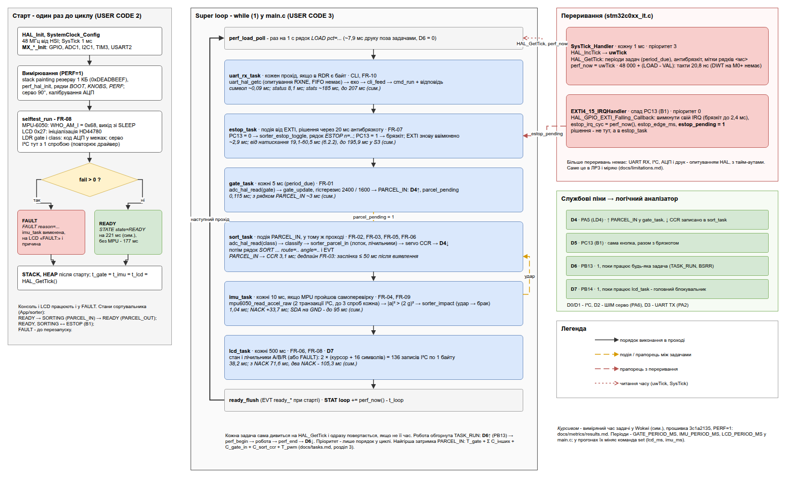
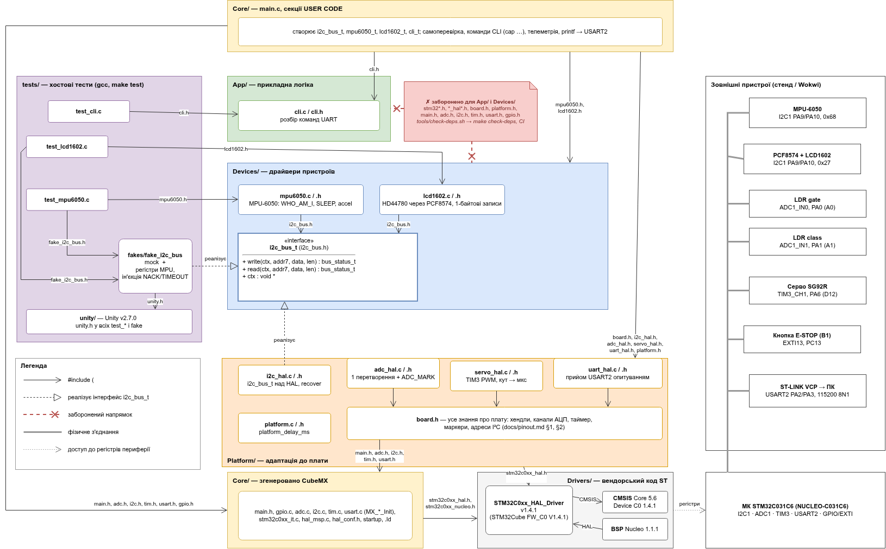
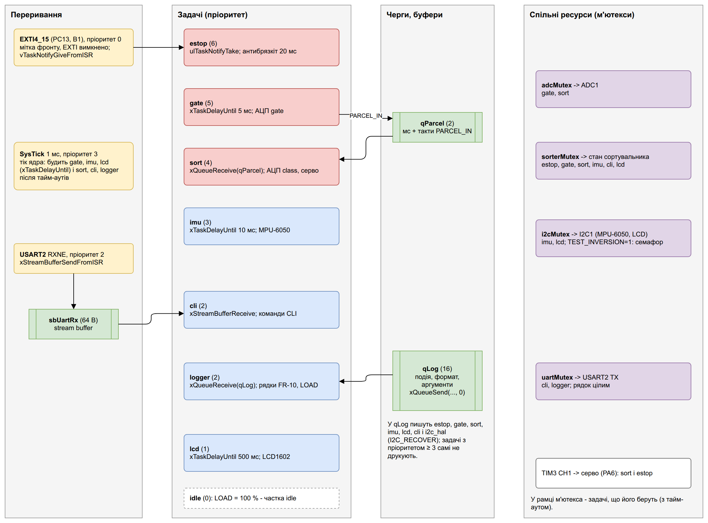

# Архітектура прошивки Warehouse Sorter (ЛР3)

Тут описано, як влаштована прошивка після ЛР3: головний цикл super loop, задачі з періодами й дедлайнами, переривання, шари і модулі, службові піни для аналізатора, збірка. Шари і правило залежностей лишилися з ЛР2, нове - сам цикл, логіка продукту в App/ і вимірювальний модуль. Числа часу - симуляційні (Wokwi, форма B), прошивка `3c1a2135`, збірка `PERF=1`, детально - docs/metrics/results.md.



*Рисунок 1 - Super loop: старт, задачі в порядку виклику, переривання і службові піни. Джерело: [`lab_3/img/superloop.drawio`](lab_3/img/superloop.drawio).*

## 1. Головний цикл

Прошивка - super loop без RTOS і без свого перемикання контексту. Після старту і самоперевірки `main()` крутиться в `while (1)` (секція `USER CODE 3`) і по черзі викликає задачі:

```
perf_load_poll -> uart_rx_task -> estop_task -> gate_task -> sort_task -> imu_task -> lcd_task -> ready_flush -> знову
```

Кожна задача - це `static void xxx_task(void)` у `main.c`. Вона сама дивиться на `HAL_GetTick()` (періодичні - через `period_due` з `App/period.c`) або на прапорець події. Якщо не її час, вона одразу повертається. Якщо час - робить роботу до кінця і тільки тоді віддає керування. Пріоритетів немає: їх заміняє порядок у циклі.

Чому саме такий порядок:

- **uart_rx_task першою.** USART2 на C031 без FIFO, байт лежить лише в RDR, тож чим раніше в проході його забрати, тим менше втрат (обмеження 3 у docs/limitations.md).
- **estop_task перед gate і sort.** Якщо натискання і посилка припали на один прохід, стан E-STOP перемкнеться раніше, і посилку буде пропущено (`SORT_SKIP`), а не відсортовано.
- **sort_task одразу за gate_task.** Посилку, яку gate_task побачила в цьому проході, sort_task обробляє в тому ж проході, без жодної задачі між ними. Тому від виявлення до запису CCR виходить 3,1 мс (лічильник `parcel_latency`), і сусідні задачі на це не впливають.
- **lcd_task останньою.** Це найдовша операція (38,2 мс), тож перед нею вже відпрацювало все важливіше.

Найгірша затримка реакції на посилку (контрольне питання 1, виведення - docs/tasks.md, розділ 3):

```
L_max = T_gate + (C_uart + C_estop + C_imu + C_lcd) + C_gate_in + C_sort_ccr + T_pwm
```

Тобто період gate, по одному найгіршому виконанню кожної іншої задачі, власний шлях реакції і до 20 мс, поки нова ширина вийде з ШІМ (preload CCR). У простої з перемальовкою LCD це 62,8 мс, у S3 з відповіддю `stats` - 235,5 мс, а вимога FR-03 - 50 мс.

## 2. Задачі

| Задача | FR | Коли запускається | Дедлайн | Що робить і що блокує | Час (сим.) |
|---|---|---|---|---|---|
| `uart_rx_task` | CLI, FR-10 | кожен прохід, якщо в RDR є байт | немає | ехо, `cli_feed`, виконання команди з друком відповіді через `HAL_UART_Transmit` | символ ~0,09 мс, `status` 8,1 мс, `stats` ~185 мс (до 207 мс) |
| `estop_task` | FR-07 | подія від EXTI + 20 мс антибрязкоту (`ESTOP_DEBOUNCE_MS`) | у PRD не задано | читає PC13: 0 - перемикає стан E-STOP і друкує `ESTOP`, 1 - брязкіт відпускання; вмикає EXTI знову | ~2,9 мс, з рядками `EVT` - до 13,3 мс; від натискання 19,1-60,5 мс (6.2.2), до 195,9 мс у S3 |
| `gate_task` | FR-01 | кожні 5 мс (`GATE_PERIOD_MS`) | через FR-03 | `adc_hal_read` gate, поріг з гістерезисом 2400 / 1600; на PARCEL_IN - LD4 (D4) і прапорець для sort | 0,115 мс; з рядком `PARCEL_IN` ~3 мс |
| `sort_task` | FR-02, FR-03, FR-05, FR-06 | подія PARCEL_IN, у тому ж проході | FR-03: заслінка ≤ 50 мс після виявлення | АЦП class, клас, лоток, лічильники, запис CCR серво, LD4 вниз; потім рядок `SORT` і `EVT` | до CCR 3,1 мс від PARCEL_IN, разом 16,9-18,3 мс |
| `imu_task` | FR-04, FR-09 | кожні 10 мс (`IMU_PERIOD_MS`), якщо MPU пройшов самоперевірку | через FR-05 | читання прискорення (2 транзакції I²C, до 3 спроб кожна), |a|² > (2 g)² - прапорець удару | 1,04 мс; з NACK +33,7 мс, SDA на GND - до 95 мс |
| `lcd_task` | FR-06, FR-08 | кожні 500 мс (`LCD_PERIOD_MS`) | немає | стан і лічильники A/B/R (або причина FAULT): 34 команди HD44780 = 136 записів I²C по 1 байту | 38,2 мс; з NACK 71,6 мс |

Поза задачами в циклі ще дві речі, обидві лише в `PERF=1`: `perf_load_poll` раз на секунду друкує рядок `LOAD` (~7,9 мс, D6 у цей час 0), а `ready_flush` один раз після старту друкує `EVT ready_*`.

Періоди задач можна міняти без перезбирання командою `set` (`lcd_ms`, `imu_ms`, `lcd_chars`, `log`, docs/perf.md, розділ 5) - так я шукав точку зламу в 6.2.5.

Самоперевірка (FR-08) іде один раз до циклу і триває довше за будь-яку задачу: `STATE state=READY` на 221 мс від скидання. Якщо хоча б один пристрій FAIL, сортувальник переходить у FAULT до перезапуску: imu_task не запускається, на LCD «FAULT:» і причина, консоль працює (docs/metrics/results.md, 3.9).

Стани сортувальника (`App/sorter.c`): READY -> SORTING на PARCEL_IN, назад на PARCEL_OUT; з READY і SORTING у ESTOP і назад за B1; FAULT - лише після самоперевірки.

## 3. Переривання

| Переривання | Пріоритет | Що робить | Навіщо |
|---|---|---|---|
| `SysTick_Handler`, кожну 1 мс | 3 (`TICK_INT_PRIORITY`) | `HAL_IncTick`: `uwTick`++ | час для всього циклу: `HAL_GetTick` для періодів задач, антибрязкоту і міток `<мс>` у рядках FR-10; основа лічильника тактів `perf_now` |
| `EXTI4_15_IRQHandler`, спад PC13 (B1) | 0 | `HAL_GPIO_EXTI_Falling_Callback`: вимикає свій IRQ, запам'ятовує `estop_irq_cyc = perf_now()`, `estop_edge_ms` і ставить `estop_pending` | не пропустити натискання між проходами циклу; виміряти затримку від першого фронту |

Чому в ISR кнопки так мало. Кнопка Wokwi брязкотить до 2,4 мс і дає до ~200 фронтів на перехід (журнал, проблема 14). ISR лише фіксує перший фронт і вимикає себе, а рішення «натискання чи брязкіт» приймає estop_task через 20 мс за рівнем піна. Так в ISR немає ні HAL з тайм-аутом, ні `printf`. Ціна - рішення залежить від циклу: натискання, коротше за блокування циклу, губиться (обмеження 5).

Спільні дані ISR і циклу - лише ці три змінні E-STOP і `uwTick`. Як вони захищені (ISR вимикає свій EXTI до кінця обробки, `perf_now` читає `uwTick` і `SysTick->VAL` у критичній секції) - docs/limitations.md, обмеження 9.

Решта периферії працює без переривань, опитуванням HAL: UART RX (`uart_hal_getc` дивиться RXNE), UART TX (`HAL_UART_Transmit`), I²C (`HAL_I2C_Master_Transmit/Receive` з тайм-аутом 5 мс), АЦП (`HAL_ADC_PollForConversion`). Це я лишив навмисно: ЛР3 якраз про те, де super loop з блокувальними викликами перестає встигати (docs/tasks.md, docs/limitations.md).

## 4. Шари і модулі



*Рисунок 2 - Шари і залежності (стан ЛР2). Стрілки показують напрямок `#include`. Нові модулі ЛР3 лягли в ті самі шари і за тими самими правилами, їх перелік - у таблиці нижче.*

| Шар | Каталог | Що там | Від чого залежить |
|---|---|---|---|
| Core | `firmware/Core/` | код CubeMX (`MX_*_Init`, обробники переривань) і `main.c`: задачі super loop, самоперевірка, команди CLI, друк рядків FR-10, вимірювання. Свій код - лише в секціях `USER CODE` | HAL, Platform, Devices, App |
| Drivers | `firmware/Drivers/` | HAL, CMSIS, BSP Nucleo від ST, не редагується | - |
| Platform | `firmware/Platform/` | `board.h` і обгортки над HAL | HAL, `Devices/i2c_bus.h`, арифметика `App/perf.h` |
| Platform/superloop | `firmware/Platform/superloop/` | ЛР4: лише `ARCH=superloop` - обробники SVC, PendSV, SysTick (`HAL_IncTick`) і лічильник тіків для `perf_now` (`uwTick`) | HAL |
| Platform/rtos | `firmware/Platform/rtos/` | ЛР4: лише `ARCH=rtos` - `FreeRTOSConfig.h`, база часу (SysTick - ядро, HAL - TIM17), хуки і діагностика ядра | HAL, FreeRTOS |
| Tasks | `firmware/Tasks/` | ЛР4: сім задач FreeRTOS, черги, м'ютекси, обробник USART2, рядки `TASK`/`MTX`/`LOGQ` (`sorter_tasks.c`); `app_task.c` - лише для тестових збірок ядра (розділ 10) | App, Devices, Platform, FreeRTOS |
| Middlewares | `firmware/Middlewares/FreeRTOS/` | ЛР4: ядро FreeRTOS-Kernel V11.3.3, сабмодуль, не редагується | - |
| Devices | `firmware/Devices/` | драйвери пристроїв та інтерфейс шини | лише стандартна бібліотека C |
| App | `firmware/App/` | логіка продукту і вимірювань без заліза | стандартна бібліотека C, Devices |
| tests | `tests/` | хостові тести на Unity, `fake_i2c_bus` | App, Devices |

У ЛР4 обидві прошивки збираються з одного дерева (`make build ARCH=superloop|rtos`, docs/rtos-design.md). Що в архітектурах різне, лежить у `Platform/<arch>/`, і `app.mk` бере з двох каталогів лише один, а `Tasks/` і ядро - лише для `rtos`.

Модулі:

| Модуль | Шар | Що робить | ЛР |
|---|---|---|---|
| `gate` | App | FR-01: поріг АЦП з гістерезисом (2400 / 1600), події PARCEL_IN / PARCEL_OUT | 3 |
| `classify` | App | FR-02: клас за кодом АЦП class: A ≤ 1300, B ≥ 2700, між ними UNKNOWN | 3 |
| `impact` | App | FR-04: |a|² > (2000 mg)², без кореня; `impact_isqrt` - лише для рядка `IMPACT` | 3 |
| `sorter` | App | FR-03, FR-05, FR-06, FR-07: стани, рішення про лоток і кут, лічильники | 3 |
| `health` | App | FR-08 і READY: оцінка кожного пристрою при старті (OK / WARN / FAIL) і правдоподібність АЦП | 3 |
| `period` | App | `period_due`: «настав час» з беззнаковою різницею, переживає переповнення `HAL_GetTick` | 3 |
| `perf` | App | арифметика вимірювань: такти в мкс, min/avg/max, джитер, пропуски, гістограма, завантаження | 3 |
| `memmark` | App | stack painting: пошук найглибшого зіпсованого слова | 3 |
| `lcdfmt` | App | рядки LCD без `snprintf` (-1,3 КБ флешу) | 3 |
| `cli` | App | розбір команд (`status`, `stats`, `set`, `hist`, ...); нічого не друкує | 2, 3 |
| `perf_hal` | Platform | `perf_now` на SysTick, `perf_now_us64`, службові піни PB13, PB14 | 3 |
| `mem_hal` | Platform | межі резерву стека зі скрипту лінкера і поточний SP для stack painting | 3 |
| `i2c_hal` | Platform | `i2c_bus_t` над HAL: тайм-аут 5 мс, до 3 спроб з переініціалізацією (FR-09), рядок `I2C_RECOVER` | 2, 3 |
| `adc_hal`, `servo_hal`, `uart_hal`, `platform` | Platform | АЦП одним перетворенням, кут серво -> CCR, неблокувальний `getc`, `platform_delay_ms` | 2 |
| `mpu6050`, `lcd1602`, `i2c_bus.h` | Devices | драйвери і інтерфейс шини, без змін з ЛР2 | 2 |

Логіку, якій не потрібне залізо, я виносив в App/ і покривав тестами на хості: `make test` - 161 тест, 0 збоїв. У `main.c` лишилося те, що торкається HAL, `printf` і пінів: самі задачі, друк рядків, вимірювання. Через це `main.c` виріс до 1 640 рядків, і нова задача торкається там ~17 місць (обмеження 8).

### Правило залежностей

Як і в ЛР2: App і Devices не включають заголовки HAL, CubeMX і Platform, App може включати Devices, навпаки - ні. Platform реалізує інтерфейс `i2c_bus.h` з Devices. `main.c` знає всі шари і зшиває їх (composition root). У ЛР4 додалося: App і Devices не включають ще й FreeRTOS і `Tasks/` (їх тестують на хості), Platform поза `Platform/rtos/` теж не бачить FreeRTOS, а `Tasks/` може все. `main.c` бачить лише `rtos_hal.h` і `app_task.h`, без заголовків ядра. Перевіряє це `tools/check-deps.sh` (`make check-deps`, і в CI): при забороненому `#include` він друкує `файл:рядок` і виходить з кодом 1. Нові модулі ЛР3 правило пройшли без винятків: усе, що читає такти або піни, лежить у Platform (`perf_hal`, `mem_hal`), а в App - лише арифметика над числами.

Драйвер бачить шину лише як структуру з `write`, `read` і `ctx` (`Devices/i2c_bus.h`). У прошивці її заповнює `Platform/i2c_hal.c`, у тестах - `tests/fakes/fake_i2c_bus.c`. У збірці `PERF=1` `main.c` ставить між драйвером і `i2c_hal` ще одну обгортку (`meas_write`, `meas_read`), яка міряє кожну транзакцію (`STAT i2c_xfer`), - драйвери про це не знають.

## 5. Службові піни і канали аналізатора

| Канал | Пін | Хто пише | Що видно |
|---|---|---|---|
| D0, D1 | PA9, PA10 | I2C1 | транзакції I²C; пачка ~38 мс раз на 500 мс - LCD |
| D2 | PA6 | TIM3_CH1 | ШІМ серво, нова ширина після рішення sort_task |
| D3 | PA2 | USART2_TX | кожен рядок журналу і відповідь - теж блокування циклу |
| D4 | PA5 (LD4) | gate_task ↑, sort_task ↓ | ширина - PARCEL_IN -> CCR; від D4↑ до нової ширини на D2 - FR-03 від виявлення |
| D5 | PC13 (B1) | кнопка | натискання разом з брязкотом, який прошивка не бачить |
| D6 | PB13 | `TASK_RUN` | 1, поки працює будь-яка задача: ширина - час задачі, найдовший інтервал між фронтами - «дірка» в циклі |
| D7 | PB14 | `lcd_task` | 1, поки перемальовується LCD |

PB13 і PB14 налаштовує `perf_hal_init` (у `.ioc` їх немає, чому - docs/pinout.md, розділ 1), а пише в них цикл через BSRR однією інструкцією (`BOARD_PROBE_ON/OFF`, `board.h`). Каналів у Wokwi 8, тож D5 у ЛР3 перейшов з маркера АЦП (PA15) на кнопку. У прогонах `wokwi-cli` каналів D0, D1 і D3 немає, інакше Wokwi не віддає запис (docs/captures/README.md).

## 6. Збірка

Згенерований `Makefile` не редагується, свою збірку додає `firmware/app.mk`: каталоги Platform/, Devices/, App/, `-Os`, `-Wextra -Werror` для свого коду, `-fstack-usage -Wstack-usage=512`, `-Wl,--print-memory-usage` і git-хеш у банері `BOOT`. Кореневий `Makefile` запускає все в Docker.

| Збірка | Що вмикає | Flash / RAM |
|---|---|---|
| `make build` (`PERF=1`) | продукт + вимірювання: `stats`, `load`, `hist`, `stack`, `heap`, `set`, `EVT`, службові піни | 31 060 B (94,8 %) / 3 288 B (26,8 %) |
| `make build PERF=0` | лише продукт | 25 672 B (78,3 %) / 2 352 B |
| `make build TEST_I2C_FAULT=1` | + читання відсутньої адреси 0x69 раз на секунду (6.2.4) | 31 196 B (95,2 %) / 3 288 B |
| `make build LAB2_CAP=1` | harness ЛР2 (`cap ...`), PERF сам вимикається | 28 420 B (86,7 %) / 2 360 B |

RAM включає резерв купи 512 B і стека 1 024 B зі скрипту лінкера (з ЛР5 резерв купи 0, docs/qp-design.md, крок 2). Разом `LAB2_CAP=1 PERF=1` у 32 КБ не влазить, і `app.mk` зупиняє таку збірку зрозумілою помилкою (журнал, проблема 21). CI на кожен push збирає всі чотири варіанти, ганяє `make check-deps`, `make test`, `make coverage` і тести скриптів `tools/`.

Інші цілі: `make stack-usage` (найбільші кадри з `.su`), `make stack-graph` (найглибший ланцюжок викликів за дизасемблером, разом з HAL, newlib і перериваннями), `make map-summary` (flash і RAM за модулями з map-файла), `make tools-test`. Секції `USER CODE` і CRLF у файлах `Core/` - як у ЛР2 (журнал, проблема 12).

### Модулі HAL

Увімкнено ADC, I2C, TIM, UART, GPIO, RCC, CORTEX (використовуються), FLASH (`FLASH_LATENCY_1` для 48 МГц), DMA і EXTI (лише типи для хендлів і BSP, 0 B у ELF), PWR (CubeMX додає сам). Решта в `stm32c0xx_hal_conf.h` закоментована. DMA і переривання UART/I²C у ЛР3 не використовуються (розділ 3).

## 7. Інструменти на хості

| Скрипт | Навіщо |
|---|---|
| `tools/run_scenario.py` | прогін сценарію з `tools/scenarios/*.yaml` через RFC2217 Wokwi (VS Code) або `wokwi-cli` без вікна, лог у `docs/metrics/` |
| `tools/stats_table.py` | таблиця S1-S3 і блоків 6.2.5 з рядків `STAT`, `LOAD`, `STACK`, `HEAP` |
| `tools/evt_latency.py` | затримки за мітками `EVT t_us` (n, min, медіана, max, p99) |
| `tools/vcd_timing.py`, `tools/vcd_window.py` | затримки і ширини імпульсів з VCD аналізатора, вирізання вікна |
| `tools/stack_usage.py`, `tools/stack_graph.py`, `tools/map_summary.py` | статичний стек: кадри функцій з `.su` і глибина за графом викликів з дизасемблера; розподіл пам'яті |
| `tools/wokwi/gen_actions.py` | файли дій `wokwi-cli` для сценаріїв кроку 5 |

## 8. Версії

| Компонент | Версія |
|---|---|
| STM32CubeMX / STM32Cube FW_C0 | 6.18.1 / V1.4.1 (HAL і CMSIS Device 1.4.1, CMSIS Core 5.6, BSP 1.1.1) |
| arm-none-eabi-gcc, binutils, newlib | 10.3.1 (`15:10.3-2021.07-4`), 2.38, 3.3.0 - образ `stm32-build:gcc10`, версії зафіксовані в `docker/gcc10/Dockerfile`; образ з 14.2.1 (`docker/Dockerfile`) - лише для порівняння (journal.md, проблема 79) |
| Unity / gcc для тестів / gcovr | v2.7.0 / 11.4.0 / 5.0 |
| Wokwi для VS Code / `wokwi-cli` | 4.1.0 / 0.27.1 |
| sigrok-cli / PulseView | 0.7.2 / 0.4.2 |
| Python (скрипти `tools/`) | 3.14 |

## 9. Відмінності від структури з методички

- **`Middlewares/` - лише ядро FreeRTOS і лише для `ARCH=rtos`.** ЛР3 - bare metal (методичка, розділ 3), прошивку ЛР3 збирає `make build` (`ARCH=superloop`) або тег `lab3`. Ядро - сабмодуль, а не CubeMX: для C0 у CubeMX модуля FREERTOS немає (docs/rtos-design.md, розділ 2).
- **Інтерфейс шини в Devices/.** Інтерфейс належить споживачеві, Platform його реалізує, тому драйвери тестуються без HAL.
- **Задачі - у `main.c`, а не окремими модулями.** Їм потрібні HAL, `printf` і піни, а абстракцій часу, журналу і маркерів для App/ я не вводив. Логіку всередині задач винесено в App/ і покрито тестами.
- **Збірка через `app.mk`.** Проєкт можна перегенерувати з CubeMX без втрати своїх налаштувань.

## 10. ARCH=rtos (ЛР4)

Друга прошивка з того самого дерева: `make build ARCH=rtos LTO=1`. Логіка продукту (App/, Devices/) і робота кожної задачі (`*_run` у `main.c`) - ті самі, що в super loop; інший лише спосіб, яким робота запускається. Подробиці і числа - docs/rtos-design.md, тут - карта.



*Рисунок 3 - задачі, переривання і механізми взаємодії ARCH=rtos. Джерело: [`lab_4/img/tasks.drawio`](lab_4/img/tasks.drawio).*

### 10.1. Задачі

| Задача | Пріоритет | Запуск | Стек, слів (найбільше використано, кроки 2-4) | Що робить |
|---|---|---|---|---|
| `estop` | 6 | сповіщення з ISR EXTI4_15, потім 20 мс антибрязкоту (`xTaskDelayUntil`) | 128 (392 B) | FR-07: рівень PC13 -> стан E-STOP, EXTI знову |
| `gate` | 5 | `xTaskDelayUntil` 5 мс | 128 (360 B) | FR-01: АЦП gate під `adcMutex`, PARCEL_IN -> черга `qParcel` |
| `sort` | 4 | повідомлення з `qParcel` | 160 (448 B) | FR-02, FR-03, FR-05: АЦП class, лоток, CCR серво, лічильники під `sorterMutex` |
| `imu` | 3 | `xTaskDelayUntil` 10 мс | 192 (560 B після 4 `I2C_RECOVER`) | FR-04, FR-09: читання MPU під `i2cMutex` на кожну транзакцію, удар -> `sorter_impact` |
| `cli` | 2 | потоковий буфер `sbUartRx` (64 B) з ISR USART2 | 192 (620 B) | команди, відповіді друкує сама під `uartMutex` |
| `logger` | 2 | черга `qLog` (16 записів) | 160 (472 B) | FR-10: форматує і друкує рядки задач, раз на секунду `LOAD` |
| `lcd` | 1 | `xTaskDelayUntil` 500 мс | 160 (536 B) | FR-06: перемальовка LCD під `i2cMutex` |
| idle | 0 | ядро | 48 (84 B) | LOAD = 100 % - частка idle |

Пріоритети - за жорсткістю дедлайну: E-STOP, далі періодичні за періодом (rate-monotonic), `sort` одразу під `gate`, бо отримує від неї подію і має вкластися в FR-03; фонові `cli` і `logger`; найдовша операція LCD - найнижче. Задачі з пріоритетом ≥ 3 не друкують, а кладуть запис у `qLog` з тайм-аутом 0.

### 10.2. Механізми

| Об'єкт | Тип | Хто -> кому | Втрата видна в |
|---|---|---|---|
| `qParcel` | черга, 2 записи | `gate` -> `sort` | ніде (журнал, проблема 63) |
| `qLog` | черга, 16 записів по 44 B | задачі, `i2c_hal` -> `logger` | `LOGQ drop` |
| `sbUartRx` | потоковий буфер, 64 B | ISR USART2 -> `cli` | `LOGQ rx_drop` |
| сповіщення `estop` | сповіщення задачі | ISR EXTI4_15 -> `estop` | - |
| `adcMutex`, `i2cMutex`, `sorterMutex`, `uartMutex` | м'ютекси з успадкуванням пріоритету, тайм-аут і повтор; рекурсивні з власником | спільні АЦП, шина I²C, стан сортувальника, рядок UART | `MTX timeouts`, `wait_max_us` |

### 10.3. Переривання

| Переривання | Пріоритет NVIC | Що робить |
|---|---|---|
| SysTick | 3 (192, найнижчий) | тік ядра (`TICK_HZ`, 1 кГц) і номер тіку для `perf_now` (`SysTick_Handler` у `Platform/rtos/rtos_hal.c` -> `xPortSysTickHandler`) |
| PendSV | 3 | перемикання контексту (порт) |
| SVC | 0 | старт першої задачі (порт) |
| TIM17 | 3 | `HAL_IncTick`: `HAL_GetTick` для тайм-аутів HAL і міток `<мс>` |
| EXTI4_15 (PC13) | 3 | перший фронт B1: вимикає свій EXTI, мітка часу, `vTaskNotifyGiveFromISR` |
| USART2 | 3 | байти з RDR у `sbUartRx` (`xStreamBufferSendFromISR`), переповнення - `rx_drop` |

На Cortex-M0+ немає BASEPRI: критична секція ядра вимикає всі переривання, тож `configMAX_SYSCALL_INTERRUPT_PRIORITY` не діє, а FromISR-функції можна кликати з будь-якого пріоритету. EXTI і USART2 стоять на рівні SysTick, щоб не перебивати тік посеред `xTaskIncrementTick` (журнал, проблема 45). Wokwi на C0 PRIMASK не враховує, тому в симуляції працює обхід `SIM_CRIT` (нижче).

### 10.4. База часу

| Лічильник | Від чого | Для чого |
|---|---|---|
| тік ядра | SysTick, `TICK_HZ` (1 000 Гц) | `xTaskDelayUntil`, тайм-аути черг і м'ютексів (`ms_ticks` округлює вгору до цілого тіку) |
| `HAL_GetTick` | TIM17, 1 кГц | тайм-аути I²C і UART у HAL, мітки `<мс>` у рядках FR-10 |
| `perf_now` | номер тіку SysTick × (LOAD + 1) + (LOAD - VAL), з `HAL_Init` | усі вимірювання ЛР3 і ЛР4 тим самим кодом; 64-бітна версія - лічильник run-time stats ядра |

### 10.5. Де живе код

| Каталог | Що там |
|---|---|
| `firmware/Middlewares/FreeRTOS/` | ядро FreeRTOS-Kernel V11.3.3 (сабмодуль, не редагується): `tasks.c`, `queue.c`, `list.c`, `stream_buffer.c`, `heap_4.c`, порт `portable/GCC/ARM_CM0` |
| `firmware/Platform/rtos/` | `FreeRTOSConfig.h`; `rtos_hal.c` - база часу (TIM17 для HAL, SysTick для ядра), лічильник run-time stats, канали трасування; `rtos_diag.c` - хуки `FATAL` (стек, malloc, створення, assert, HardFault); `rtos_osm.c` - вимірювання вартості ОС (`OSMETRICS=1`) |
| `firmware/Platform/rtos/port_sim/` | копія порту `ARM_CM0` з обходом PRIMASK для Wokwi (`SIM_CRIT=1`, за замовчуванням): критична секція відкладає тік, PendSV і переривання; відмінності - `docs/port_sim-V11.3.3.patch`. `SIM_CRIT=0` - порт із сабмодуля без змін, для плати |
| `firmware/Platform/rtos/kstress/` | обгортки порту для стрес-тесту ядра (`TEST_KSTRESS=1`) |
| `firmware/Tasks/` | `sorter_tasks.c` - задачі, черги, м'ютекси, ISR USART2, звіти; `app_task.c` - задача для `TEST_KSTRESS` і `TEST_CRITCOST`; задачі самих тестів - `kstress.c` (`TEST_KSTRESS`), `critcost.c` (`TEST_CRITCOST`), `api_probe.c` (`TEST_APIPROBE`) |
| `firmware/Core/Src/main.c` | ті самі `*_run`, що й у super loop, плюс `*_work` з обліком `TASK_RUN`; `tasks_ops_t` передає їх у `Tasks/` |

### 10.6. Службові піни

| Канал | Пін | ARCH=superloop | ARCH=rtos |
|---|---|---|---|
| D0 | PB12 | робота `gate` | робота `gate` (замість I²C SDA у ЛР3) |
| D1 | PB15 | робота `estop` | робота `estop` (замість I²C SCL) |
| D2 | PA6 | ШІМ серво | те саме |
| D3 | PA2 | USART2 TX | те саме |
| D4 | PA5 (LD4) | PARCEL_IN -> CCR | те саме |
| D5 | PC13 | кнопка B1 | те саме |
| D6 | PB13 | працює будь-яка задача (`TASK_RUN`) | працює будь-яка задача, крім idle (`traceTASK_SWITCHED_IN`) |
| D7 | PB14 | перемальовка LCD | задача `lcd` у процесорі (трасування ядра) |

У тестових збірках канали D0, D1, D7 перепризначаються (наприклад, `TEST_INVERSION`: D0 - `imu`, D1 - `hog`, D7 - `lcd`), розділ 7 docs/rtos-design.md.

### 10.7. Збірки rtos

| Збірка | Що вмикає | Flash / RAM, B |
|---|---|---|
| `make build ARCH=rtos LTO=1` | продукт у Wokwi (`SIM_CRIT=1`, `PERF=1`) | 31 988 / 11 832 |
| `... SIM_CRIT=0` | порт без змін, для плати | rtos-design.md, розділ 7 |
| `... OSMETRICS=1` | вартість ОС (`STAT os_*`, `osbench`), без `hist` | 32 708 / 12 240 |
| `... TEST_INVERSION=sem\|mutex` | дослід інверсії пріоритетів | 32 312 / 11 872 |
| `... TEST_OS=<назва>` | сценарії 7.2: `heap`, `stack`, `starve`, `qflood_drop`, ... | до 32 344 / 11 864 |
| `... TICK_HZ=100` | тік 100 Гц (7.2 п. 6) | 31 972 / 11 832 |
| `... ASSERT=1` | `configASSERT`, без `hist` | 32 584 / 11 832 |

Числа - чисті збірки `1a03385` (rtos-design.md, розділ 8, «Бюджет кроку 5»). Super loop того самого коміту - 21 660 / 3 488 B (21 668 B, що стояло тут раніше, - збірка з незакоміченими змінами: суфікс `-dirty` у хеші додає 8 B).
