Міністерство освіти і науки України · Національний технічний університет України «Київський політехнічний інститут» · Факультет інформатики та обчислювальної техніки · Кафедра обчислювальної техніки

Лабораторна робота №2 з дисципліни «Системне програмування». Виконав: студент 4 курсу групи ІО-32 Кекух А.О. Перевірив: Гордієнко Н.Ю. 2026

# Лабораторна робота №2

**Інтеграція сенсорної підсистеми: схема підключення, верифікація інтерфейсів логічним аналізатором, архітектура програмного проєкту**

**Мета:** довести, що всі пристрої Warehouse Sorter працюють одночасно в одній прошивці без конфліктів пінів і периферії, а кожна шина поводиться так, як описано в документації. Перевірити це не лише логом у UART, а й записами логічного аналізатора. Заодно розкласти прошивку на шари і покрити тестами код, який можна запустити без заліза.

Репозиторій: https://github.com/SPapor/lab1-stm32-sorter

PR-и ЛР2: [#6](https://github.com/SPapor/lab1-stm32-sorter/pull/6), [#7](https://github.com/SPapor/lab1-stm32-sorter/pull/7), [#8](https://github.com/SPapor/lab1-stm32-sorter/pull/8), [#9](https://github.com/SPapor/lab1-stm32-sorter/pull/9), [#10](https://github.com/SPapor/lab1-stm32-sorter/pull/10), [#11](https://github.com/SPapor/lab1-stm32-sorter/pull/11)

Відео: поки що не має

## 2. Завдання

1. Скласти pinout-таблицю і схему підключення: обґрунтування кожного піна за документацією, адреси пристроїв, бюджет живлення, розрахунок параметрів шин, відхилені варіанти.
2. Підключити всі пристрої в одній прошивці, перевірити ідентифікацію, ініціалізацію і правдоподібність даних, додати самоперевірку з виводом у UART.
3. Записати логічним аналізатором трафік кожного інтерфейсу; для кожного запису - команда прошивки, яка відтворює саме цю транзакцію.
4. Декодувати записи, зіставити з datasheet, виміряти часові параметри й порівняти з розрахунком, розібрати байт вручну, дослідити аномалію.
5. Перебудувати прошивку на шари з автоматичною перевіркою залежностей і описати структуру з діаграмою компонентів.
6. Покрити тестами драйвери й прикладну логіку на хості, виміряти покриття, запускати збірку і тести в CI.

Форма виконання: B (Wokwi).

## 3. Розподіл обов'язків

Роботу виконано одноосібно.

| Напрям (методичка, розділ 5) | Відповідальний |
|---|---|
| 1. Звіт і документація | Кекух А.О. |
| 2. Документація і pinout | Кекух А.О. |
| 3. Робота з апаратурою (Wokwi) | Кекух А.О. |
| 4. Декодування і аналіз | Кекух А.О. |
| 5. Структура проєкту і збірка | Кекух А.О. |
| 6. Тестування | Кекух А.О. |

## 4. Процес виконання

### 4.1. Журнал роботи

| Дата | Що зроблено |
|---|---|
| 15.10 | Pinout-таблиця і схема підключення (docs/pinout.md, wiring.drawio), скріни datasheet, канали аналізатора D0–D5 |
| 15.10 | Інтерфейс шини i2c_bus_t, адаптер над HAL, драйвер MPU-6050 |
| 16.10 | CubeMX: маркери PA5 і PA15, PC13 з підтяжкою; board.h, драйвер LCD1602, обгортки АЦП і серво, самоперевірка |
| 16.10 | Команди cap для аналізатора, розбір команд UART, перевірка залежностей шарів; записи all.vcd і nack-order.vcd |
| 21.10 | Скріни PulseView, вимірювання й аналіз записів, проблеми 8–9 |
| 21.10 | Хостові тести на Unity, make test і make coverage, CI на GitHub Actions |
| 22.10 | docs/architecture.md, діаграма компонентів, звіт |
| 22.10 | Обробник E-STOP з відсіюванням брязкоту, канал D6 аналізатора на PC13 |

### 4.2. Схема підключення і pinout

Усе, що стосується пінів, адрес, частот шин, живлення і конфліктів, зібрано в docs/pinout.md з посиланнями на таблиці й сторінки datasheet МК (DS13867), user manual плати (UM2953) і документації пристроїв. Монтажна схема симулятора - diagram.json, вона збігається з таблицею рядок у рядок.

| Пін МК | Сигнал | Роз'єм Nucleo | Пристрій |
|---|---|---|---|
| PA9 | I2C1_SCL (AF6) | D8 | MPU-6050, PCF8574 |
| PA10 | I2C1_SDA (AF6) | D2 | MPU-6050, PCF8574 |
| PA6 | TIM3_CH1 (AF1) | D12 | серво SG92R |
| PA0 | ADC1_IN0 | A0 | фоторезистор gate |
| PA1 | ADC1_IN1 | A1 | фоторезистор class |
| PA2 / PA3 | USART2 TX / RX | VCP ST-LINK | термінал, 115200 8N1 |
| PA5 | GPIO (LD4) | D13 | маркер команди, канал D4 |
| PA15 | GPIO | D7 | маркер АЦП, канал D5 |
| PC13 | GPIO EXTI13 | B1 | кнопка E-STOP |

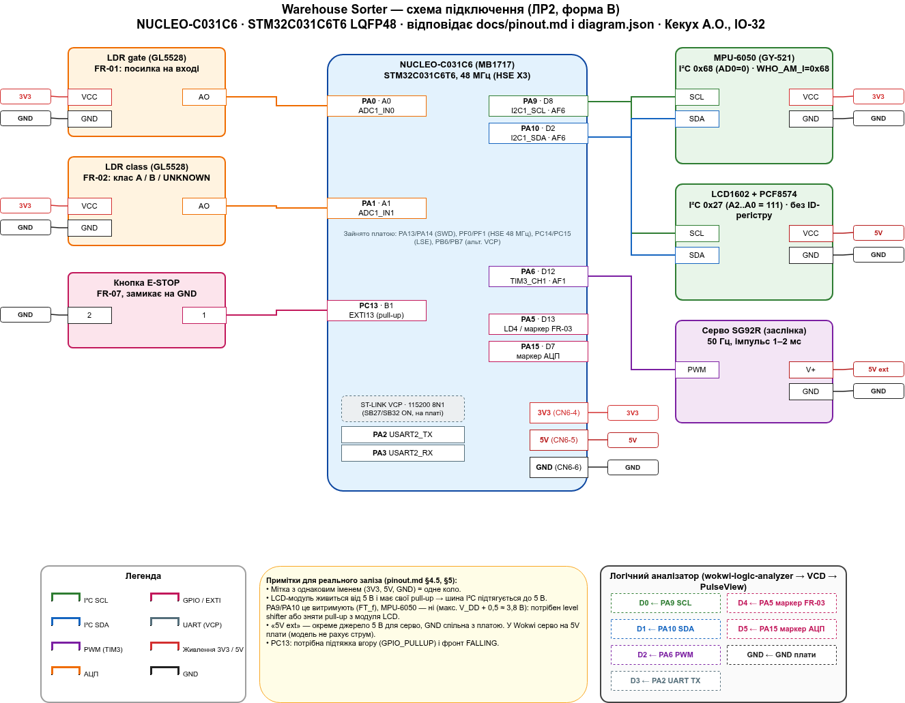

*Рисунок 1 - Схема підключення стенда*

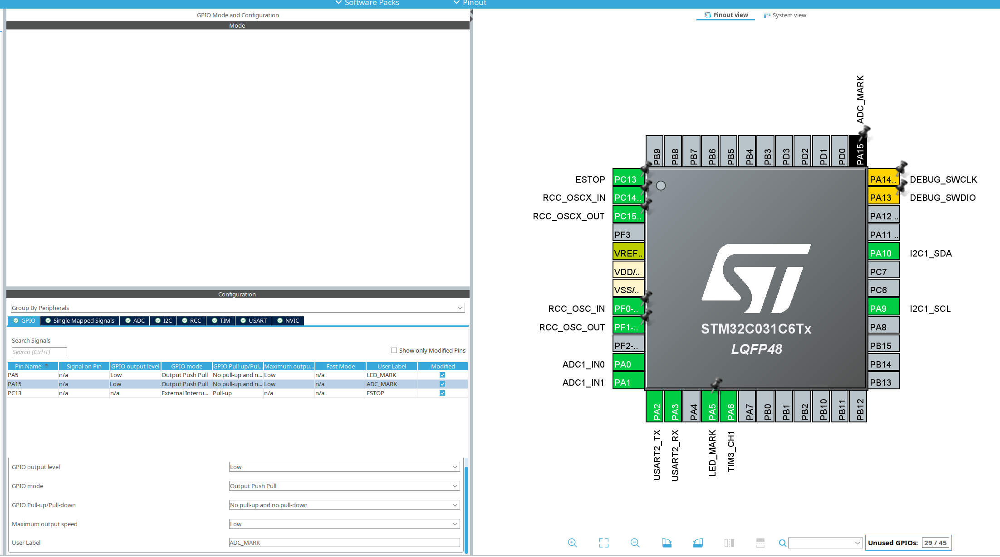

*Рисунок 2 - Призначення пінів у CubeMX*

Чому так:

- **I²C на PA9/PA10.** Це пара I2C1 в AF6 з типом FT_f (5V-tolerant), яка не перетинається з бортовою обв'язкою плати (DS13867 табл. 12–13, UM2953 табл. 11). PB6/PB7 відпали, бо це альтернативний маршрут VCP через SB31/SB33 (pinout.md §8).
- **Відхилено PB8/PB9 (Arduino D15/D14).** Звичне місце I²C для шилдів, але UM2953 у табл. 11 і табл. 12 позначає SCL і SDA навпаки. Для інструкції, за якою збирає стороння людина, така неоднозначність не підходить (pinout.md §8).
- **Окреме живлення серво.** Плата видає не більше 500 мА, до енумерації USB - лише 100 мА (UM2953 §6.5.2, табл. 7). Пусковий струм серво з цим порівнянний, тому на залізі серво живиться від окремих 5 В зі спільною землею. У Wokwi воно підключене до 5V.2, бо модель не рахує струм (pinout.md §5).
- **Конфлікт 5 В на I²C.** Модуль LCD живиться від 5 В і своїми pull-up тягне шину до 5 В. PA9/PA10 це витримують, а MPU-6050 - ні: максимум на SDA/SCL - V_DD + 0,5 В (MPU-6000/6050 PS §6.9). На залізі треба зняти pull-up з модуля PCF8574 або поставити перетворювач рівнів BSS138. У симуляторі рівні ідеальні (pinout.md §4.5).

Інструкція з підключення:

1. MPU-6050: VCC → 3V3, GND → GND, SCL → PA9 (D8), SDA → PA10 (D2), AD0 → GND (адреса 0x68).
2. LCD1602 з PCF8574: VCC → 5V, GND → GND, SCL → PA9, SDA → PA10; перемички адреси A2..A0 = 111 (адреса 0x27). На залізі спершу прибрати конфлікт 5 В на I²C.
3. Фоторезистори: VCC → 3V3, GND → GND; AO gate → PA0 (A0), AO class → PA1 (A1).
4. Серво: сигнал → PA6 (D12). У Wokwi V+ → 5V; на залізі V+ від окремого джерела 5 В, його GND з'єднати з GND Nucleo.
5. Кнопка E-STOP: один вивід → PC13, другий → GND (на Nucleo це бортова кнопка B1).
6. Консоль: окремих дротів не треба, USART2 (PA2/PA3) уже виведено на ST-LINK VCP; термінал 115200 8N1.
7. Логічний аналізатор: D0 → PA9, D1 → PA10, D2 → PA6, D3 → PA2, D4 → PA5, D5 → PA15, D6 → PC13, GND → GND.
8. Перевірка: після скидання в терміналі мають з'явитися `found 0x27`, `found 0x68` і рядок `SELFTEST summary`.

Коміт: https://github.com/SPapor/lab1-stm32-sorter/commit/e5778cc

Коміт: https://github.com/SPapor/lab1-stm32-sorter/commit/0a418e8

### 4.3. Перевірка пристроїв

Після старту прошивка сканує I²C і запускає самоперевірку. Для кожного пристрою вона друкує один рядок формату `<мс> SELFTEST <пристрій> status=<OK|WARN|FAIL> key=value`, а підсумок виводить ще й на LCD.

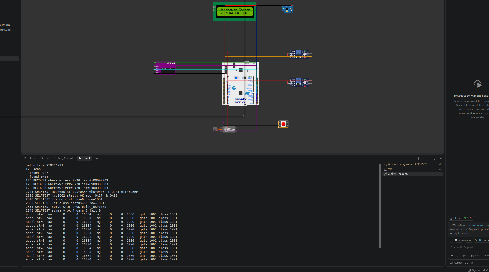

*Рисунок 3 - Рядки SELFTEST і підсумок на LCD1602*

```
2745 SELFTEST mpu6050 status=WARN who=0x68 tries=3 err=SLEEP
2820 SELFTEST lcd1602 status=OK addr=0x27 rb=0x08
2826 SELFTEST ldr_gate status=OK raw=1001
2830 SELFTEST ldr_class status=OK raw=1001
2835 SELFTEST servo status=OK pulse_us=1500
2840 SELFTEST summary ok=4 warn=1 fail=0
```

- **MPU-6050:** відповідає з WHO_AM_I = 0x68. WARN означає, що SLEEP за три спроби не знявся (проблема 8, п. 4.8).
- **LCD:** відповідає на 0x27, зворотне читання порту PCF8574 дає 0x08 - саме те, що було записано.
- **Серво:** при 90° у CCR стоїть 1500 мкс.

**Правдоподібність даних.** У спокої акселерометр дає `raw 0 0 16384 → mg 0 0 1000`: модуль вектора дорівнює 1 g при чутливості 16384 LSB/g для ±2 g. Після зсуву повзунків у Wokwi сирі 16384, −15564, 24576 перераховуються в 1000, −949, 1500 mg (рисунок 4).

**Незалежність каналів АЦП.** Якщо затінювати лише gate, міняється тільки gate (1001 → 206 → 3483), а class лишається 1001. Якщо лише class - міняється тільки class (1001 → 177 → 3881), а gate лишається 3483.

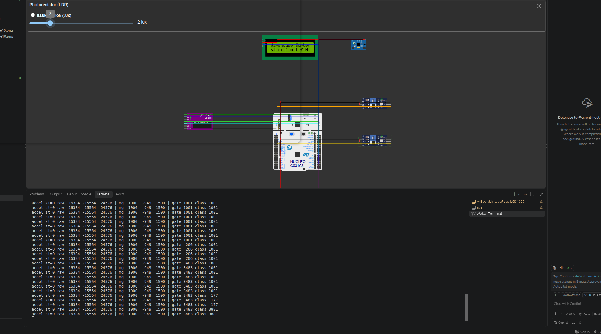

*Рисунок 4 - Телеметрія: 1 g у спокої, зсув повзунків MPU-6050, окремо gate і class*

**E-STOP.** На кожне натискання PC13 прошивка друкує `<мс> ESTOP press n=N` і пише лічильник на LCD. Кнопка в Wokwi брязкотить: на записі PC13 (канал D6) кожен перехід триває 1,7–2,4 мс і дає до 199 фронтів. Тому після першого фронту переривання вимикається на 20 мс, а потім прошивка читає рівень піна (проблема 14). Чотири кліки дали рівно n=1…4 (рисунок 5).

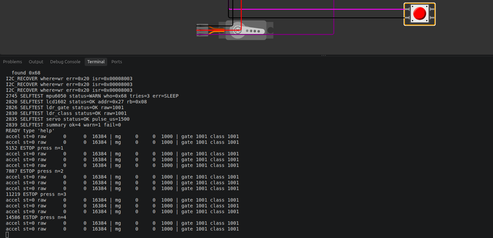

*Рисунок 5 - Натискання E-STOP: рядки ESTOP press n=1…4*

Коміт: https://github.com/SPapor/lab1-stm32-sorter/commit/642543a

Коміт: https://github.com/SPapor/lab1-stm32-sorter/commit/dccf7dc

### 4.4. Логічний аналізатор

Щоб записи можна було повторити, у прошивку додано команди `cap whoami`, `cap accel`, `cap lcd`, `cap servo <кут>`, `cap uart`, `cap adc` і ще дві для аномалій. Кожна виконує рівно одну транзакцію всередині імпульсу маркера на PA5 і друкує рядок `CAP … st=…` (рисунок 6). Канали аналізатора: D0 - SCL, D1 - SDA, D2 - ШІМ серво, D3 - UART TX, D4 - маркер команди, D5 - маркер АЦП, D6 - кнопка E-STOP.

Записи лежать у docs/lab_2/captures/ (all.vcd, nack-order.vcd), декодування й вимірювання - у docs/lab_2/captures/measurements.md, порівняння з розрахунком - у docs/lab_2/analysis.md.

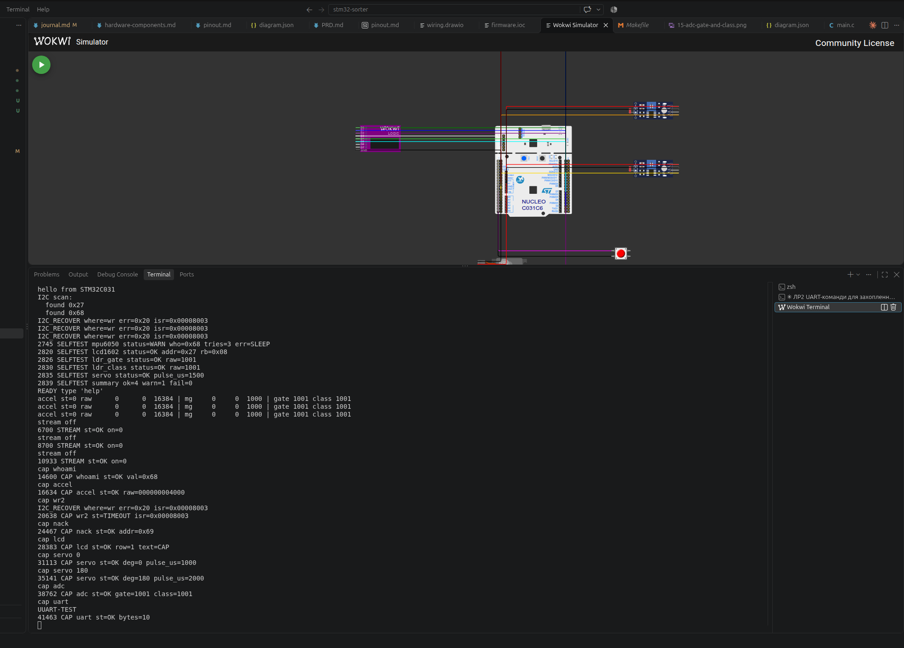

*Рисунок 6 - Сесія команд cap, під час якої записано all.vcd*

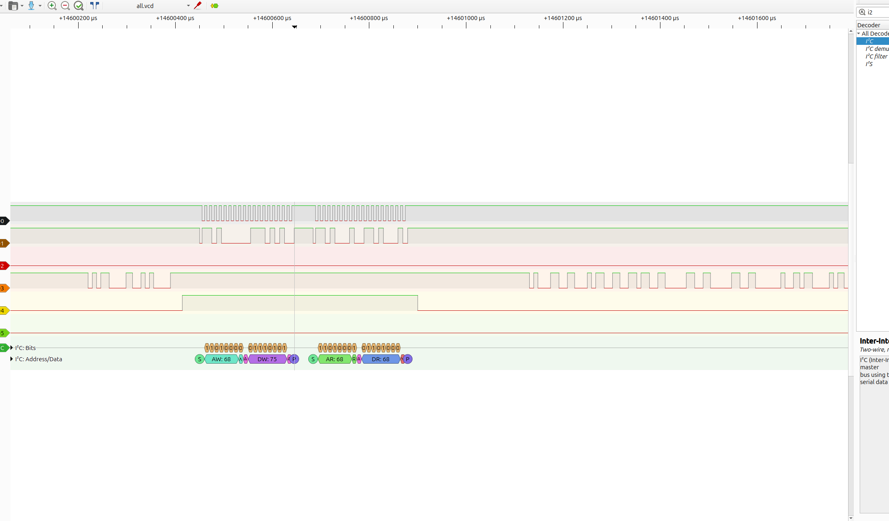

*Рисунок 7 - cap whoami: запис 0x75, читання 0x68*

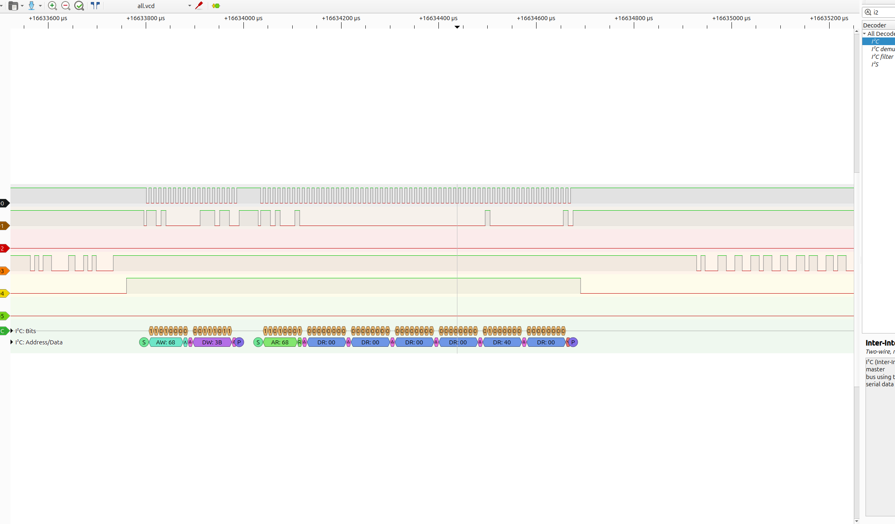

*Рисунок 8 - cap accel: читання 6 байтів з 0x3B (00 00 00 00 40 00)*

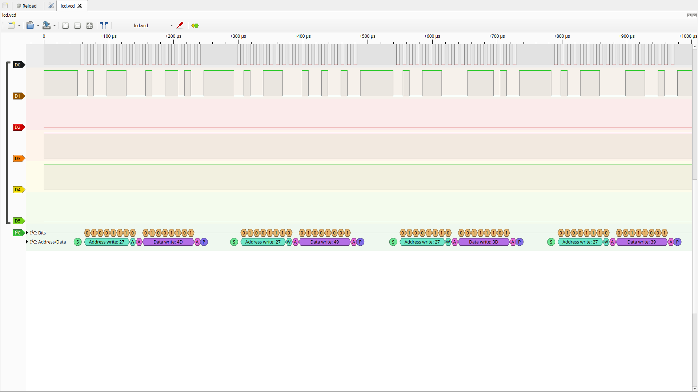

*Рисунок 9 - cap lcd: символ 'C' - чотири записи 4D 49 3D 39 на 0x27*

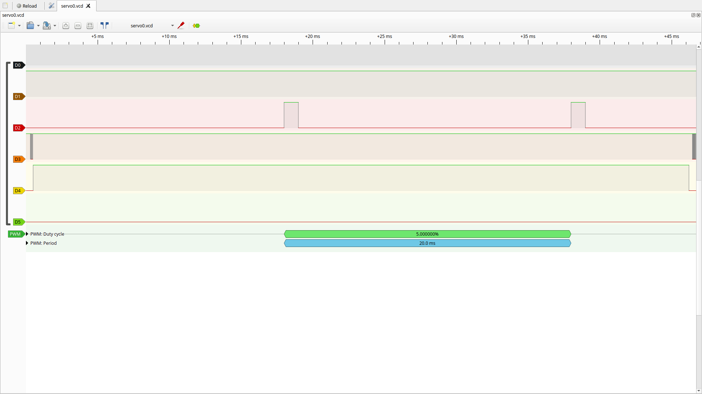

*Рисунок 10 - cap servo 0: імпульс 1000 мкс, період 20 мс*

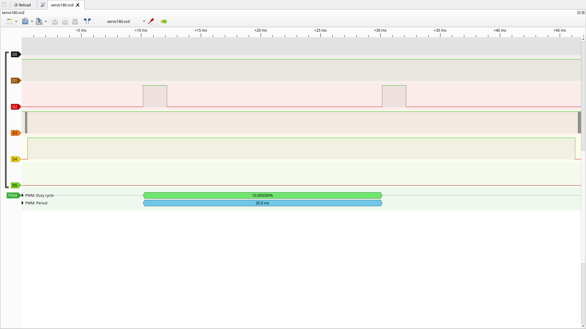

*Рисунок 11 - cap servo 180: імпульс 2000 мкс, період 20 мс*

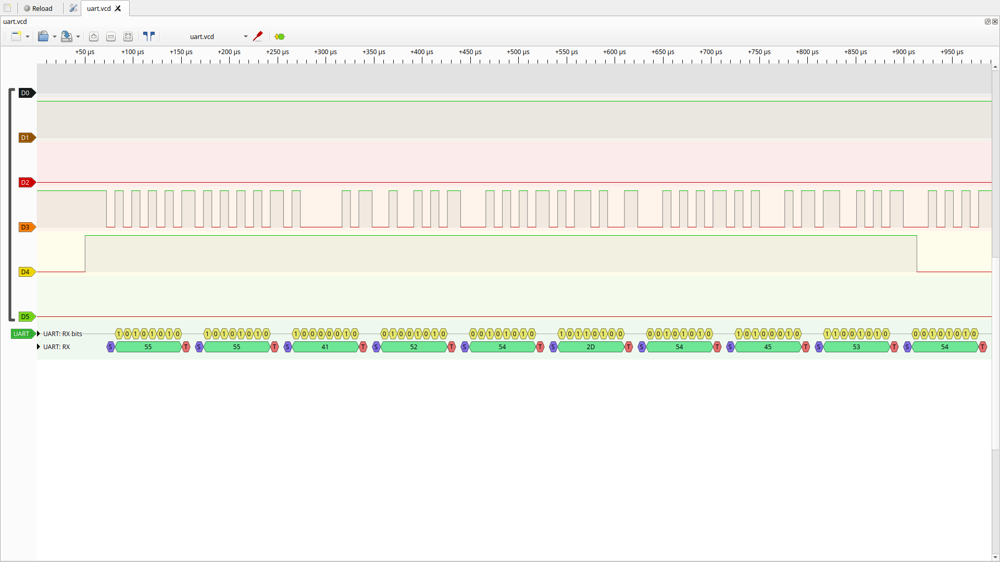

*Рисунок 12 - cap uart: 0x55 і рядок «UART-TEST»*

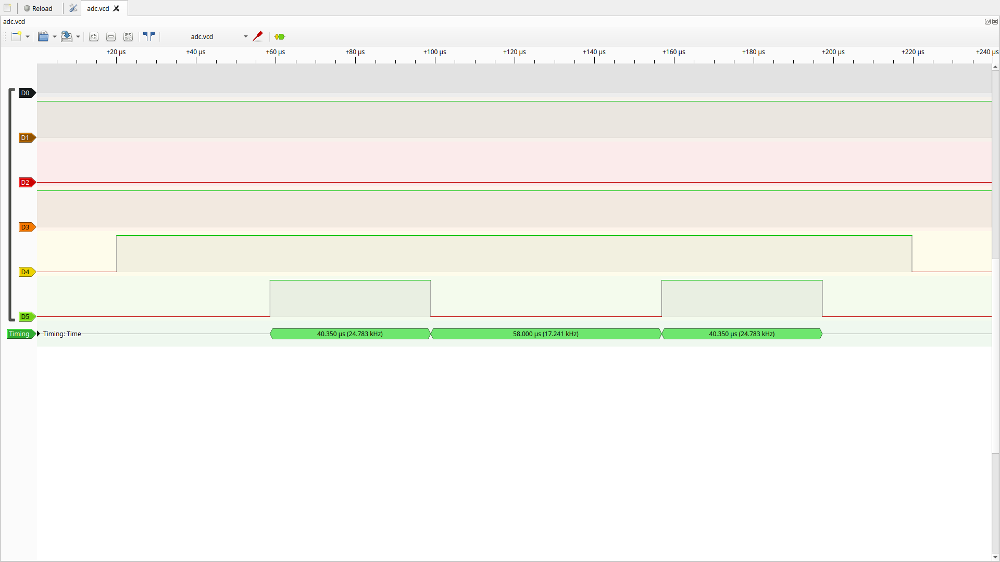

*Рисунок 13 - cap adc: два імпульси маркера АЦП по 40,35 мкс*

| Параметр | Розрахунок | Виміряно |
|---|---|---|
| f_SCL | ≤ 103,9 кГц (TIMINGR) | 100,0 кГц |
| t_LOW / t_HIGH | 5,708 / 3,917 мкс | 5,000 / 5,000 мкс |
| Біт UART | 8,6875 мкс (BRR = 417, 115 108 бод) | 8,6875 мкс |
| Імпульс серво | 1000 / 2000 мкс | 1000,0 / 2000,0 мкс |
| Період ШІМ | 20 мс | 20,000 мс |
| АЦП | 583 нс на перетворення | маркер 40,35 мкс |

f_SCL у межах розрахунку, але розподіл 50/50 замість 5,708/3,917 мкс показує, що Wokwi не моделює SCLL/SCLH. Біт UART точно збігся з округленням BRR = 417, а не з ідеальними 8,6806 мкс. Маркер АЦП показує шлях HAL (Start → Poll → GetValue), а не саме перетворення.

**Ручне декодування байта LCD.** PCF8574: P0 = RS, P1 = RW, P2 = EN, P3 = BL, P4..P7 = D4..D7.

| Байт | D7..D4 | BL | EN | RW | RS |
|---|---|---|---|---|---|
| 0x4D | 0100 | 1 | 1 | 0 | 1 |
| 0x49 | 0100 | 1 | 0 | 0 | 1 |
| 0x3D | 0011 | 1 | 1 | 0 | 1 |
| 0x39 | 0011 | 1 | 0 | 0 | 1 |

RS = 1 - це дані. Старший півбайт 4 і молодший 3 захоплюються по спаду EN, разом 0x43 = 'C'. Увесь символ займає 926,2 мкс.

Коміт: https://github.com/SPapor/lab1-stm32-sorter/commit/512d728

Коміт: https://github.com/SPapor/lab1-stm32-sorter/commit/899195b

### 4.5. Аномалії

**Запис 2 байтів у MPU-6050 (cap wr2).** На шині лише `S 68W A 6B A`: другого байта і STOP немає, а SCL лишається в 0 до наступної транзакції - 3,933 с у all.vcd. Прошивка отримує `st=TIMEOUT isr=0x00008003`, і відновлення HAL лінію не відпускає.

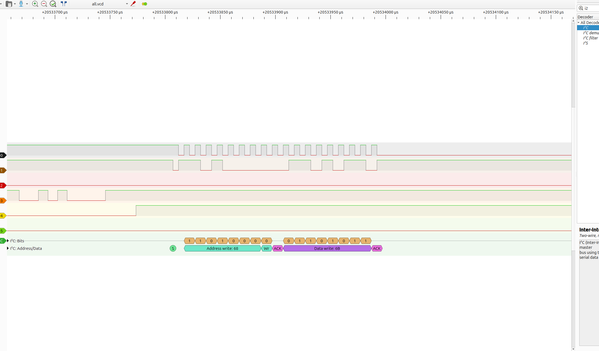

*Рисунок 14 - cap wr2: після 0x6B SCL лишається в 0, STOP немає*

**Транзакція після зависання.** Наступна команда `cap nack` уже не виводить на шину ні START, ні адресу: видно лише відпущений SCL і два STOP. Прошивка при цьому друкує `st=OK`. Так само «з'їдається» запис вказівника 0x6B у самоперевірці, тому зворотне читання повертає 0x40 і статус SLEEP.

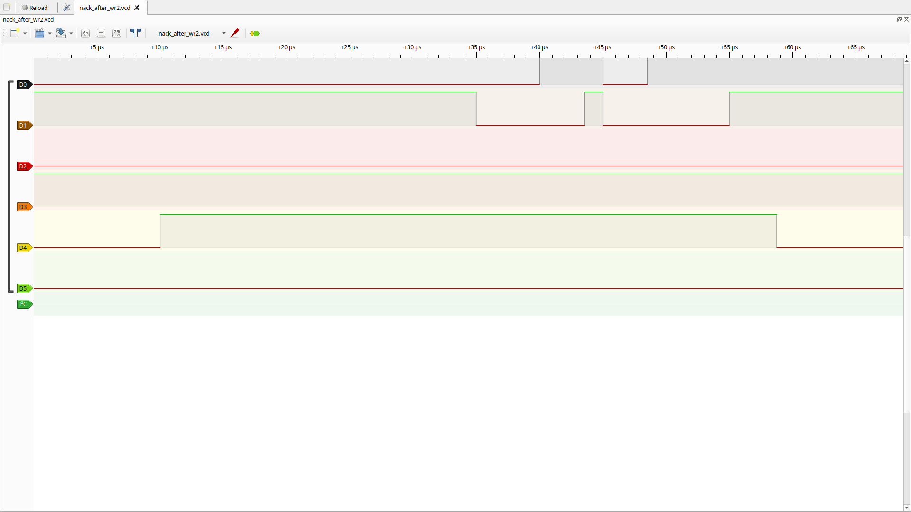

*Рисунок 15 - cap nack після cap wr2: START і адреси немає*

**NACK на шині, а HAL каже OK.** На вільній шині запис на відсутню адресу 0x69 дає `S 69W N P` - ведений не підтвердив адресу. Але `HAL_I2C_Master_Transmit` повертає HAL_OK, і прошивка друкує `CAP nack st=OK`. Це окрема розбіжність, вона не залежить від першої аномалії.

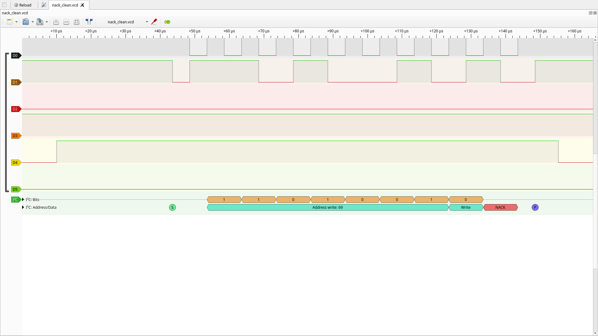

*Рисунок 16 - cap nack на вільній шині: адреса 0x69 і NACK*

Коміт: https://github.com/SPapor/lab1-stm32-sorter/commit/48919a1

### 4.6. Структура проєкту


*Рисунок 17 - Діаграма компонентів (стрілки - у напрямку #include)*

- **Шари:**
  - Core - код CubeMX і main.c, де все збирається разом;
  - Drivers - HAL і CMSIS від ST;
  - Platform - board.h і обгортки над HAL;
  - Devices - драйвери mpu6050, lcd1602 та інтерфейс шини i2c_bus.h;
  - App - розбір команд cli;
  - tests - хостові тести.
- **Правило залежностей.** App і Devices не включають заголовки HAL, CubeMX і Platform. Драйвер бачить шину лише як структуру з двома вказівниками на функції; у прошивці її заповнює Platform/i2c_hal.c, у тестах - fake.
- **Перевірка правила.** tools/check-deps.sh (`make check-deps`) шукає заборонені `#include` у App/ і Devices/ і при знахідці друкує `файл:рядок` та завершується з кодом 1.
- **CI.** GitHub Actions на кожен push і pull request запускає check-deps, build, test і coverage.
- **Збірка.** Згенерований Makefile не редагується: власні каталоги і прапорці `-Wall -Wextra -Werror` додає firmware/app.mk. Прошивка займає 26 800 B text (81,8 % flash) і збирається без попереджень.

Детально - docs/architecture.md.

Коміт: https://github.com/SPapor/lab1-stm32-sorter/commit/f8f4e45

### 4.7. Тестування

Тести збираються звичайним gcc у Docker (`make test`), фреймворк - Unity v2.7.0. Усього 46 тестів, усі проходять:

- **test_mpu6050.c - 16:** WHO_AM_I, чужий ID, помилки шини, вихід зі SLEEP з 1-ї і 3-ї спроби, ERR_SLEEP, прискорення, raw → mg.
- **test_lcd1602.c - 13:** ініціалізація HD44780 байт у байт, символ, курсор, по 1 байту на запис, помилка шини на кожному кроці.
- **test_cli.c - 17:** усі команди, межі аргументу серво, backspace, переповнення, CR LF дає одну команду.

**Тестові вектори з аналізатора:**
- байти `00 00 00 00 40 00` з cap accel → 0 / 0 / 1000 mg, як у UART;
- символ 'C' → рівно `4D 49 3D 39` на 0x27;
- `set_cursor(0, 1)` → `CC C8 0C 08`.

| Файл | Рядки | Гілки |
|---|---|---|
| Devices/mpu6050.c | 100 % | 100 % |
| Devices/lcd1602.c | 100 % | 100 % |
| App/cli.c | 98 % | 98 % |
| Разом | 99,4 % | 99,2 % |

Поріг - 80 % рядків і гілок, його перевіряє `make coverage`. Тести дефектів у коді не знайшли.

CI: https://github.com/SPapor/lab1-stm32-sorter/actions/runs/39674504820

Коміт: https://github.com/SPapor/lab1-stm32-sorter/commit/0b2ee64

Коміт: https://github.com/SPapor/lab1-stm32-sorter/commit/8956634

### 4.8. Проблеми та їх вирішення

Проблеми 1–7 описано у звіті ЛР1, тут - лише проблеми ЛР2 (повний журнал - docs/journal.md).

**Проблема 8: запис 2 байтів у MPU-6050 у Wokwi → TIMEOUT, шина зависає**

Симптом: при старті тричі `I2C_RECOVER where=wr err=0x20 isr=0x00008003`, самоперевірка дає `mpu6050 status=WARN err=SLEEP`. На шині після першого байта даних SCL лежить у 0, STOP немає (рисунок 14).

Фікс: усі записи в LCD роблю по 1 байту. `mpu6050_init` не довіряє статусу запису, а перевіряє PWR_MGMT_1 зворотним читанням, до 3 спроб. Після помилки шина переініціалізується. У симуляторі SLEEP так і не знімається, тому самоперевірка показує WARN. Коміт: 67afe00, 642543a.

**Проблема 9: запис на відсутню адресу 0x69 → HAL_OK, хоча на шині NACK**

Симптом: `cap nack` → `CAP nack st=OK addr=0x69`, хоча I²C-скан 0x69 не бачить, а на записі аналізатора видно NACK (рисунок 16).

Фікс: не виправлено. Розбіжність задокументовано записом аналізатора і таблицею рядків прошивки в docs/lab_2/captures/measurements.md. Коміт: 48919a1.

**Проблема 10: власний код у main.c збирався без -Wextra -Werror**

Симптом: app.mk вмикав `-Wextra -Werror` лише для Platform/, Devices/ і App/, а main.c з 486 рядками власного коду отримував тільки `-Wall`.

Фікс: в app.mk додано `$(BUILD_DIR)/main.o: CFLAGS += -Wextra -Werror`. З `-Wextra` main.c виявився чистим, розмір прошивки не змінився. Коміт: f8f4e45.

**Проблема 11: кнопка E-STOP (PC13) - GPIO_NOPULL і переривання за RISING**

Симптом: у згенерованому gpio.c для PC13 стояли `GPIO_MODE_IT_RISING` і `GPIO_NOPULL`. Кнопка замикає PC13 на GND, тож без підтяжки вивід висить, а переривання спрацювало б лише на відпусканні.

Фікс: у CubeMX для PC13 поставив `GPIO_PULLUP`, `GPIO_MODE_IT_FALLING` і мітку ESTOP, проєкт перегенерував. Коміт: 679124e.

**Проблема 12: після регенерації CubeMX diff на весь main.c**

Симптом: у .ioc змінив лише піни, а diff main.c - 240/240 рядків.

Фікс: CubeMX пише файли Core/ з CRLF, а я раніше зберіг main.c з LF, і регенерація повернула CRLF. Тепер редагую Core/ зі збереженням CRLF (docs/architecture.md §5). Коміт: 679124e.

**Проблема 13: власні .o не потрапляють у лінкування при збірці через app.mk**

Симптом: `arm-none-eabi-gcc: error: build/adc_hal.o: No such file or directory`, і так само для решти об'єктів Platform/ і Devices/ (відтворено на копії дерева без фіксу).

Фікс: у згенерованому Makefile пререквізити `firmware.elf` розкриваються ще до того, як app.mk додає власні файли, тому make їх не збирає, хоча команда лінкування їх уже містить. В app.mk явно дописав `$(BUILD_DIR)/$(TARGET).elf: $(USER_OBJECTS)`. Коміт: 67afe00.

**Проблема 14: E-STOP - одне натискання рахується кілька разів або губиться**

Симптом: перша версія обробника на кілька кліків давала `ESTOP press n=6…15`, друга губила кліки: на записі 20 натискань, у UART 13.

Фікс: записав PC13 на канал D6 аналізатора і побачив, що кожен перехід кнопки Wokwi брязкотить 1,7–2,4 мс (до 199 фронтів), а клік тримає кнопку лише 33 або 67 мс. Тепер на першому фронті переривання вимикається, через 20 мс прошивка читає PC13 і вмикає переривання знову. 4 кліки - рівно n=1…4 (рисунок 5).

**Проблема 15: вивід на LCD зрідка обривається NACK на адресі 0x00**

Симптом: під час виводу на LCD - `I2C_RECOVER where=wr err=0x24`, решта рядка не виводиться. На записі наступний START іде через 6 мкс після STOP (зазвичай 46–51 мкс) з адресою 0x00 і отримує NACK.

Фікс: не виправлено, причина не встановлена. З кнопкою не пов'язано: останній фронт PC13 був за 50 мс до збою, переривання вимкнене.

## 5. Висновок

Навчився:

- обирати піни і розраховувати параметри шин від дерева тактування (TIMINGR, BRR, PSC/ARR) з опорою на datasheet, reference manual і user manual плати;
- записувати й декодувати I²C, UART і ШІМ у PulseView та sigrok-cli і звіряти виміряне з розрахунком;
- писати хостові тести з mock і fake шини, міряти покриття і запускати все це в CI.

Куди рухаюся в ЛР3: реалізувати логіку сортувальника з PRD (поріг gate, клас посилки, маршрут заслінки, удар, E-STOP) в App/ поверх абстракцій часу, журналу і маркерів, щоб винести її з main.c.

## 6. Матеріали та посилання

1. InvenSense. MPU-6000/MPU-6050 Register Map and Descriptions, RM-MPU-6000A-00, rev 4.0, 09.03.2012. 47 с.
2. InvenSense. MPU-6000/MPU-6050 Product Specification, PS-MPU-6000A-00, rev 3.4, 19.08.2013. 57 с.
3. Texas Instruments. PCF8574 Remote 8-Bit I/O Expander for I2C Bus. Datasheet SCPS068K, вересень 2024. 42 с.
4. Hitachi. HD44780U (LCD-II) Dot Matrix Liquid Crystal Display Controller/Driver. ADE-207-272(Z), rev 0.0. 60 с.
5. STMicroelectronics. STM32C031x4/x6 Datasheet, DS13867, rev 4. 103 с. https://www.st.com/en/microcontrollers-microprocessors/stm32c031c6.html
6. STMicroelectronics. RM0490 Reference Manual: STM32C0 series. https://www.st.com/en/microcontrollers-microprocessors/stm32c031c6.html#documentation
7. STMicroelectronics. STM32 Nucleo-64 boards (MB1717). User manual UM2953, rev 2, листопад 2024. 33 с. https://www.st.com/resource/en/user_manual/um2953-stm32-nucleo64-board-mb1717-stmicroelectronics.pdf
8. NXP Semiconductors. UM10204 I²C-bus specification and user manual.
9. sigrok. sigrok-cli 0.7.2, PulseView 0.4.2. https://sigrok.org
10. ThrowTheSwitch. Unity - unit testing for C, v2.7.0. https://github.com/ThrowTheSwitch/Unity
