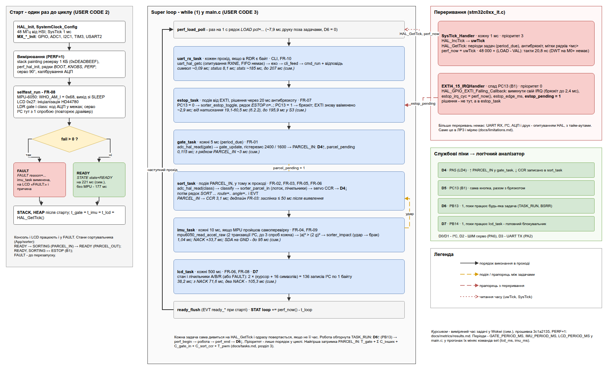
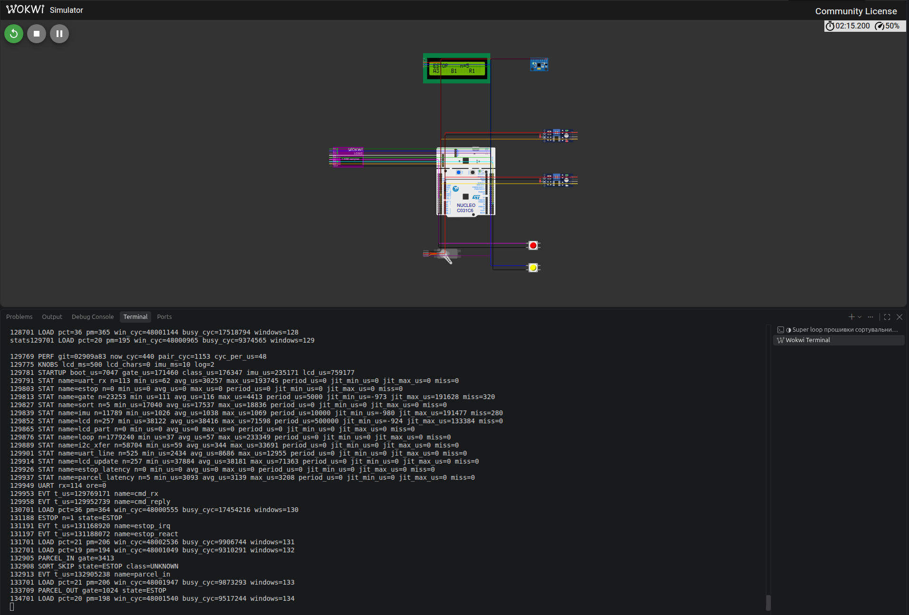
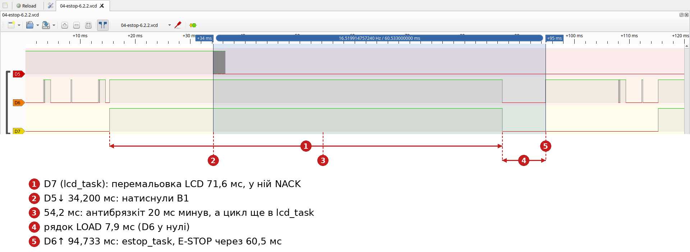
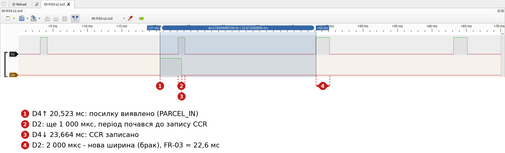
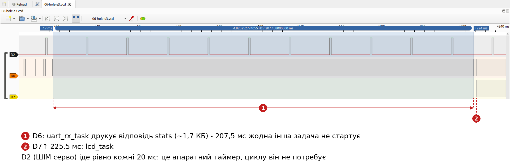
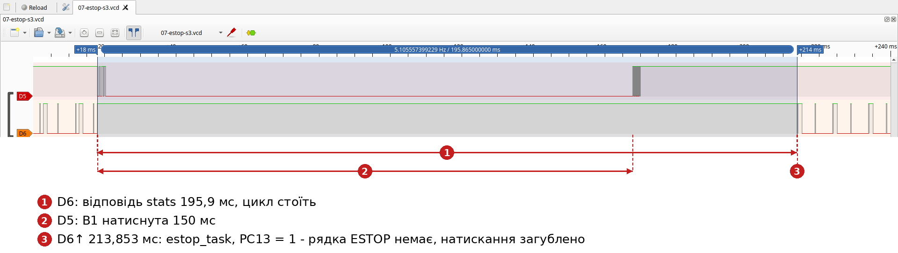
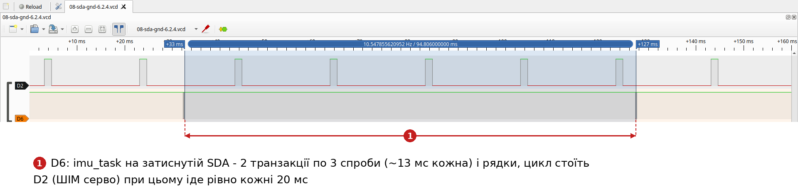

Міністерство освіти і науки України · Національний технічний університет України «Київський політехнічний інститут» · Факультет інформатики та обчислювальної техніки · Кафедра обчислювальної техніки

Лабораторна робота №3 з дисципліни «Системне програмування». Виконав: студент 4 курсу групи ІО-32 Кекух А.О. Перевірив: Гордієнко Н.Ю. 2026

# Лабораторна робота №3

**Реалізація вимог продукту на bare metal (super loop): вимірювання швидкодії та пам'яті, пошук меж підходу**

**Мета:** зібрати Warehouse Sorter як цілий продукт - усі FR з PRD в одній прошивці без операційної системи, у моделі super loop. І не лише змусити його працювати, а й поміряти, де super loop перестає встигати: час кожної задачі, джитер, затримку реакції, завантаження, пам'ять і стек. З цих вимірів скласти реєстр обмежень і базову лінію, з якою в ЛР4 порівнюватиму FreeRTOS.

Репозиторій: https://github.com/SPapor/lab1-stm32-sorter

PR-и ЛР3: [#13](https://github.com/SPapor/lab1-stm32-sorter/pull/13), [#14](https://github.com/SPapor/lab1-stm32-sorter/pull/14), [#15](https://github.com/SPapor/lab1-stm32-sorter/pull/15), [#16](https://github.com/SPapor/lab1-stm32-sorter/pull/16), [#17](https://github.com/SPapor/lab1-stm32-sorter/pull/17)

Відео: 

## 2. Завдання

1. Реалізувати FR-01...FR-10 з PRD у super-loop прошивці і для кожної вимоги показати статус (виконана / з обмеженням / недосяжна) з доказом.
2. Виміряти швидкодію: час кожної задачі, період головного циклу, затримку реакції на подію, джитер періодичних задач, завантаження CPU у кількох сценаріях.
3. Оцінити пам'ять: flash і RAM за модулями, фактичну глибину стека, купу, буфери і запас.
4. Прогнати сценарії S1-S3 і 6.2.1-6.2.7, порівняти результати між собою, з PRD і з розрахунком.
5. Скласти реєстр обмежень: де super loop ламається, як обійти без ОС і що дала б ОС.
6. Зафіксувати базову лінію для ЛР4: сценарії, метрики й інструменти, які повторю на FreeRTOS без змін.

Форма виконання: B (Wokwi). Усі числа часу в звіті - **симуляційні (сим.)**: Wokwi для VS Code 4.1.0 і `wokwi-cli` 0.27.1, прошивка `3c1a2135`, збірка `PERF=1`.

## 3. Розподіл обов'язків

Роботу виконано одноосібно, тож усі п'ять ролей з методички (розділ 9) - мої.

| № | Роль | Зона відповідальності | Артефакти | Відповідальний |
|---|---|---|---|---|
| 1 | Розробка super loop | FR з PRD у прошивці, структура циклу, задачі, переривання, CLI | `firmware/`, docs/tasks.md, docs/architecture.md | Кекух А.О. |
| 2 | Метрики | що і чим міряти, вимірювальний модуль (SysTick, EVT, службові GPIO), формат логів, скрипти аналізу, пам'ять | docs/perf.md, `App/perf.c`, `Platform/perf_hal.c`, `tools/stats_table.py`, `evt_latency.py`, `vcd_timing.py`, `stack_graph.py` | Кекух А.О. |
| 3 | Тестування | сценарії з очікуваннями, скрипти запуску, таблиці, порівняння з PRD | docs/scenarios.md, `tools/run_scenario.py`, docs/metrics/results.md | Кекух А.О. |
| 4 | Тестування на обладнанні | прогони у Wokwi, записи аналізатора, відмови (SDA на GND, старт без MPU) | docs/metrics/*.log, docs/captures/*.vcd | Кекух А.О. |
| 5 | Звіт | реєстр обмежень, базова лінія, журнал, звіт, відео | docs/limitations.md, docs/baseline-lab4.md, docs/journal.md, цей звіт | Кекух А.О. |

## 4. Процес виконання

### 4.1. Журнал роботи

| Дата | Що зроблено | PR |
|---|---|---|
| 09.11-10.11 | Super loop: задачі uart_rx, estop, gate, sort, imu, lcd; логіка FR в App/ з тестами; docs/tasks.md з розрахунком найгіршої затримки | #13 |
| 10.11 | Вимірювальний модуль: `perf_now` на SysTick, `STAT`, джитер, `LOAD`, `EVT`, службові піни PB13, PB14, stack painting, `-fstack-usage`, команди `stats`, `hist`, `stack`, `heap`; docs/perf.md | #14 |
| 11.11-12.11 | -2,4 КБ флешу без зміни виводу; ручки `set` для точки зламу; `tools/run_scenario.py`, сценарії S1-S3 і 6.2, скрипти розбору | #15 |
| 12.11 | Прогони кроку 4 у VS Code і через `wokwi-cli` (VCD), година 6.2.6; виправлення `perf_now` і тайм-ауту I²C; results.md | #16 |
| 12.11-13.11 | Доміри: S2 на 30 посилок, S3 на 30 натискань, удар, старт без MPU, удар 20 мс; реєстр обмежень, базова лінія ЛР4, журнал | #17 |
| 13.11 | docs/architecture.md і діаграма циклу, звіт, план відео | - |

### 4.2. Опис прошивки



*Рисунок 1 - Структура прошивки: старт, задачі в порядку виклику, переривання, службові піни (джерело - docs/lab_3/img/superloop.drawio)*

**Головний цикл.** Після самоперевірки `main()` крутиться в `while (1)` і по черзі викликає задачі: `uart_rx_task -> estop_task -> gate_task -> sort_task -> imu_task -> lcd_task`. Кожна сама перевіряє, чи її час (`HAL_GetTick` і `period_due`, або прапорець події), і якщо ні - одразу повертається. Якщо так - робить усю роботу і лише тоді віддає керування. Пріоритетів немає, їх заміняє порядок: прийом UART першим, бо в USART2 без FIFO вміщається один байт; E-STOP перед gate і sort; sort одразу за gate, щоб посилка оброблялася в тому ж проході; LCD, найдовша операція, - останньою.

| Задача | FR | Період / подія | Дедлайн | Час (сим.) |
|---|---|---|---|---|
| `uart_rx_task` | CLI, FR-10 | кожен прохід, якщо є байт | - | символ 0,09 мс, `status` 8,1 мс, `stats` ~185 мс |
| `estop_task` | FR-07 | EXTI + 20 мс антибрязкоту | у PRD немає | ~2,9 мс |
| `gate_task` | FR-01 | 5 мс | через FR-03 | 0,115 мс, з PARCEL_IN ~3 мс |
| `sort_task` | FR-02, 03, 05, 06 | подія PARCEL_IN, той самий прохід | FR-03: ≤ 50 мс | до CCR 3,1 мс |
| `imu_task` | FR-04, FR-09 | 10 мс | через FR-05 | 1,04 мс, з NACK +33,7 мс |
| `lcd_task` | FR-06, FR-08 | 500 мс | - | 38,2 мс |

**Переривання.** Їх два. SysTick (1 мс, пріоритет 3) веде `uwTick`: на ньому періоди задач, антибрязкіт, мітки `<мс>` у журналі і лічильник `perf_now`. EXTI4_15 (спад PC13, пріоритет 0) ловить кнопку E-STOP: обробник лише вимикає свій IRQ, запам'ятовує момент і ставить прапорець, а рішення приймає estop_task через 20 мс за рівнем піна. Так в ISR немає ні HAL з тайм-аутом, ні `printf`, і брязкіт (до ~200 фронтів, журнал ЛР2, проблема 14) не заважає. UART, I²C і АЦП працюють опитуванням HAL - навмисно, щоб побачити, де це перестає працювати.

**Стани і FR.** `App/sorter.c`: READY -> SORTING на PARCEL_IN, назад на PARCEL_OUT; READY і SORTING <-> ESTOP за B1; FAULT, якщо самоперевірка дала FAIL, - до перезапуску (imu_task вимкнена, на LCD причина). Логіку без заліза (gate, classify, impact, sorter, health, period, perf, memmark, lcdfmt, cli) я виніс в App/ і покрив тестами на хості: `make test` - 161 тест, 0 збоїв. Шари, модулі і службові піни - docs/architecture.md.



*Рисунок 2 - Стенд у Wokwi для VS Code: після п'яти посилок (на LCD `A3 B1 R1`, серво на 180°) натиснуто B1, у терміналі - відповідь `stats`, `ESTOP n=1 state=ESTOP` і посилка, пропущена в ESTOP (`SORT_SKIP`)*


*Рисунок 3 - LCD у роботі: стан, кількість посилок і лічильники лотків A, B, R (FR-06, S2, знімок `wokwi-cli` на 45-й секунді)*


*Рисунок 4 - Старт без MPU-6050: «FAULT:» / «MPU not found» (FR-08, знімок `wokwi-cli` на 3-й секунді)*

Коміт: https://github.com/SPapor/lab1-stm32-sorter/commit/daab1ca

### 4.3. Методика вимірювань

Як радить методичка (розділ 5), кожну метрику я брав щонайменше одним з трьох способів, а затримку E-STOP - усіма трьома (4.7). Подробиці - docs/perf.md.

1. **Лічильник у прошивці.** У Cortex-M0+ немає DWT і CYCCNT, тож такти я склав з тіку HAL і SysTick: `perf_now() = uwTick · 48 000 + (LOAD - VAL)`, крок 20,8 нс. Читання - у критичній секції, з поправкою на PENDSTSET. Кожна задача обгорнута `TASK_RUN`: `perf_begin` і `perf_end` рахують min/avg/max, джитер старту (інтервал між стартами мінус період), пропуски (інтервал > 2 періодів), гістограму з кроком 100 мкс і завантаження за вікно 1 с. Команди `stats`, `stats reset`, `load`, `hist`, `stack`, `heap`.
2. **Журнал EVT.** Рядки `EVT t_us=<64-біт мкс> name=...` у ключові моменти (parcel_in, servo_set, estop_irq, estop_react, cmd_rx, cmd_reply, i2c_fail, i2c_ok, ready_*). Друкуються після реакції, а `t_us` - момент самої події, тож друк у затримку не потрапляє. Пари рахує `tools/evt_latency.py` (n, min, медіана, max, p99).
3. **Службові піни і аналізатор.** D4 (LD4): фронт - PARCEL_IN, спад - CCR записано. D6 (PB13): працює будь-яка задача. D7 (PB14): працює lcd_task. D5 - сама кнопка. Пишу через BSRR однією інструкцією. VCD розбирає `tools/vcd_timing.py`.

**Похибка.** Пара `perf_now` коштує 1 153 такти (24 мкс, рядок `PERF pair_cyc`), і в час задачі потрапляє лише ~`now_cyc` = 440 тактів (9 мкс): облік джитера я роблю до взяття `t0` (журнал, проблема 22). Але `i2c_xfer` міряє кожну з 136 транзакцій LCD, тож `lcd` завищений на ~3,3 мс. 32-бітний лічильник переповнюється раз на 89,5 с, і беззнакова різниця це переживає, поки інтервал коротший (розділ 6, питання 4). За годину 6.2.6 було ~45 переповнень і жодного хибного виміру.

**Чому числа «сим.».** Wokwi - не залізо: I²C рівно 100 кГц і 50 %, кнопка брязкотить по-своєму, MPU-6050 не знімає SLEEP, а LCD зрідка відповідає NACK (~1 раз на 30 с). Модель детермінована: старт однаковий до мікросекунди в усіх 17 логах, тож один прогін у ній значить більше, ніж на залізі, але повторювати на залізі все одно треба.

**Сценарії** запускає `tools/run_scenario.py`: шле команди в UART симулятора (RFC2217), чекає відповідь на кожну, пише лог з git-хешем у заголовку. Без вікна те саме робить `wokwi-cli` за файлом дій, і тоді ж пишеться VCD (без D0, D1, D3, інакше Wokwi не віддає запис). Час у сценаріях - за мітками МК, а не за годинником хоста.

Коміт: https://github.com/SPapor/lab1-stm32-sorter/commit/8f95b03

Коміт: https://github.com/SPapor/lab1-stm32-sorter/commit/153774a

### 4.4. Результати S1-S3

S1 - простій 60 с; S2 - 30 посилок раз на 3 с, класи по колу, рідкі команди; S3 - потік `stats` двічі на секунду 60 с, посилки раз на 4 с і 30 натискань B1 (по черзі 150 і 450 мс). Таблиця скорочена з docs/metrics/results.md, розділ 2 (`tools/stats_table.py`).

| Метрика | S1 (сим.) | S2 (сим.) | S3 (сим.) | PRD | Спосіб |
|---|---|---|---|---|---|
| FR-03 від виявлення: D4↑ -> нова ширина ШІМ, max | - | 22,61 мс (n=30) | 19,60 мс | ≤ 50 мс | аналізатор |
| FR-03 від появи посилки (оцінка), max | - | 129,48 мс | 235,51 мс | ≤ 50 мс | лічильник + розрахунок |
| PARCEL_IN -> запис CCR, max | - | 3,21 мс | 3,11 мс | - | лічильник, EVT |
| E-STOP: фронт PC13 -> реакція, max | - | - | 195,87 мс (25 з 30) | - | лічильник, EVT, аналізатор |
| gate: джитер старту, max / пропуски | 75,32 мс / 158 | 101,27 мс / 281 | 207,40 мс / 255 | ≤ 22,4 мс (запас FR-03) | лічильник |
| imu: джитер старту, max | 71,69 мс | 97,64 мс | 212,35 мс | - | лічильник |
| lcd_task, max | 71,59 мс | 105,27 мс | 71,47 мс | - | лічильник, D7 |
| прохід циклу (loop), max | 71,72 мс | 105,41 мс | 255,90 мс | - | лічильник |
| uart_rx (команда + відповідь), max | 12,51 мс | 18,90 мс | 207,44 мс | - | лічильник |
| найдовша «дірка» D6 | 79,51 мс | 105,40 мс | 207,46 мс | - | аналізатор |
| i2c_xfer (з повторами), max | 33,69 мс | 34,14 мс | 33,57 мс | - | лічильник |
| LOAD: медіана / max | 20 % / 24 % | 20 % / 32 % | 39 % / 64 % | - | лічильник |
| стек (STACK used) | 904 B | 904 B | 904 B | < 1024 B | stack painting |
| купа (HEAP arena) | 436 B | 436 B | 436 B | - | mallinfo |
| загублено байтів UART | 0 | 0 | 204 з 720 | - | лічильник + скрипт |

Що з цього видно:

- **FR-03 двома способами.** Від виявлення (як у плані тестування PRD) - до 22,6 мс, вимога виконується. Розкид 3,3-22,6 мс - це фаза ШІМ: CCR з preload, нова ширина виходить з наступного 20-мс періоду. Від появи посилки на датчику (період gate + запізнілий старт gate + PARCEL_IN -> CCR + період ШІМ) - 129,5 мс у S2 і 235,5 мс у S3. Для конвеєра важливіше друге, і саме воно дає «не виконана в S3».
- **Звідки джитер.** У S1 і S2 найгірше - NACK на LCD у Wokwi: кожен коштує ~33,7 мс, а в S2 два NACK потрапили в одну перемальовку (38 + 2 × 33,7 = 105,3 мс). У S3 - відповідь `stats` (1 711 байтів по ~106 мкс = ~185 мс, до 207 мс).
- **E-STOP у S3.** Довгі натискання (450 мс) - 15 з 15, затримка до 195,9 мс. Короткі (150 мс) - 10 з 15: решту відпустили раніше, ніж закінчилася відповідь `stats`, і estop_task прочитала PC13 = 1, тобто «брязкіт».
- **Стек і купа** однакові в усіх трьох: 904 B і 436 B. Найбільше за всі прогони - 944 B (6.2.5, 6.2.6).

### 4.5. Сценарії 6.2

| Сценарій | Що робив | Результат (сим.) | Висновок |
|---|---|---|---|
| 6.2.1 Довга операція і періодична задача | LCD кожні 100 мс, 30 с | LOAD 47 %, пропуски gate 11,7/с (у S1 2,4/с), джитер 101 мс | частота LCD множить пропуски, кожна перемальовка (38 мс) довша за 2 періоди gate |
| 6.2.2 Подія під час довгої операції | 40 натискань B1 по 150 мс, LCD кожні 100 мс | 40 з 40, затримка 19,1-60,5 мс, медіана 19,8 мс | без потоку UART E-STOP встигає; хвіст - натискання під перемальовку з NACK |
| 6.2.3 Потік команд по UART | 20 `status` з паузами, 2 × 50 без пауз | з паузами побито 8 з 20, без пауз проходить 1 з 50; прийнято 168 байтів з 883, `ore=0` | прийом опитуванням губить решту команди, якщо будь-яка задача довша за байт (86,8 мкс) |
| 6.2.4 Відмова пристрою | `TEST_I2C_FAULT=1` (0x69 раз на с), SDA на GND 2 с | 0x69: 37,5 мс раз на с; SDA: 36 `IMU_ERR`, loop 95 мс, LOAD до 99 %, шина ожила через ~17 мс без скидання | FR-09 працює, але кожна невдала транзакція зупиняє весь цикл |
| 6.2.5 Пошук точки зламу | `lcd_ms` 500 -> 32, `lcd_chars=4`, `imu_ms` 5 -> 1 | LOAD 99 % при `lcd_ms=32`, 88 % при `imu_ms=1`; FR-03 не вкладається вже при `lcd_ms=500` (62,8 мс); з `lcd_chars=4` - 33,6 мс | межа - не частота, а тривалість однієї блокувальної операції |
| 6.2.6 Тривала робота | 60 хв часу МК, посилки на початку і в кінці | купа 436 B у всіх 63 вимірах, стек 944 B, gate 727 302 запуски, 126 NACK (усі з другої спроби), посилки після години 3,19-3,34 мс | витоків немає, переповнення лічильника не дає хибних вимірів |
| 6.2.7 Старт | скидання з підключеним скриптом; окремо схема без MPU | READY на 221 мс, `boot_us=7047` в усіх 17 логах; без MPU - `FAULT reason=MPU_NOT_FOUND` на 177 мс | старт детермінований; FR-08 працює і на відмову |
| 6.2.8 Живлення під час запису у flash | - | N/A: продукт нічого не пише у flash | - |
| Удар (FR-04, FR-05) | 6 посилок класу A, перед трьома удар 2,24 g на 0,3 с; окремо 10 ударів по 20 мс під потоком `stats` | 0,3 с - 3 з 3 у брак; 20 мс під потоком - зловлено лише 3 з 10 | поріг працює, а вибірка нерегулярна |

Коміт: https://github.com/SPapor/lab1-stm32-sorter/commit/f5125f3

Коміт: https://github.com/SPapor/lab1-stm32-sorter/commit/3a8d547

### 4.6. Записи логічного аналізатора

Записи лежать у docs/captures/, для скріншотів я вирізав короткі вікна (docs/lab_3/captures/, `tools/vcd_window.py`). Час на рисунках - від початку вікна.



*Рисунок 5 - 6.2.2, найгірше натискання: від спаду D5 до старту estop_task на D6 - 60,5 мс*

Як це читати. На 34,200 мс B1 замикає PC13 (D5 падає, далі ~2 мс брязкоту). EXTI ловить перший спад, і до цього моменту LCD уже ~19 мс перемальовується (D7 високий з 15,318 мс). Через 20 мс (~54,2 мс) антибрязкіт минає, і estop_task уже могла б вирішувати, але цикл стоїть у lcd_task: у цій перемальовці LCD відповів NACK, і вона тривала 71,6 мс замість 38. D7 падає на 86,874 мс, далі ще 7,9 мс цикл друкує рядок `LOAD` поза задачами (D6 у нулі), і лише на 94,733 мс D6 піднімається - це estop_task. Разом 60,5 мс: 20 мс антибрязкоту + 32,6 мс решти перемальовки + 7,9 мс рядка. Лічильник і EVT дали те саме число (60,54 мс).



*Рисунок 6 - S2, FR-03 від виявлення: D4↑ -> перший імпульс нової ширини на D2 - 22,6 мс*

Посилку знайдено на 20,523 мс (D4↑), CCR записано на 23,664 мс (D4↓, 3,14 мс програмної частини). Але період ШІМ почався на 23,138 мс, за 0,53 мс до запису, тож цей імпульс ще старий (1 000 мкс), і нова ширина (2 000 мкс, брак) виходить лише з наступного періоду - 43,138 мс. Це найгірша фаза, звідси максимум 22,6 мс.



*Рисунок 7 - S3: 207,5 мс жодна задача не стартує, поки друкується відповідь `stats`*



*Рисунок 8 - S3: натискання на 150 мс під відповіддю `stats` загублено*

Відповідь `stats` почалася на 17,950 мс, натискання - через 38 мкс. B1 відпустили на 167,835 мс, а відповідь закінчилася лише на 213,840 мс. estop_task стартувала на 213,853 мс, прочитала PC13 = 1 і за 69 мкс вийшла без рядка `ESTOP`: для неї це брязкіт відпускання. Так губиться 5 з 15 коротких натискань (обмеження 5).



*Рисунок 9 - 6.2.4: імпульс imu_task на затиснутій SDA - 94,8 мс*

Дві транзакції MPU-6050 по 3 спроби, кожна - 5 мс тайм-ауту + рядок `I2C_RECOVER` + переініціалізація (~13 мс), плюс `IMU_ERR` і `EVT`. ШІМ на D2 при цьому йде рівно кожні 20 мс: це апаратний таймер, цикл йому не потрібен.

Коміт: https://github.com/SPapor/lab1-stm32-sorter/commit/7143825

### 4.7. Одна метрика трьома способами: затримка E-STOP

Прогін 6.2.2, 40 натискань.

| Спосіб | Початок | Кінець | min | медіана / середнє | max |
|---|---|---|---|---|---|
| лічильник, `STAT estop_latency` | `perf_now()` в ISR EXTI | рішення в estop_task | 19,14 мс | - / 28,26 мс | 60,54 мс |
| журнал, `EVT estop_irq -> estop_react` | той самий момент | той самий момент | 19,14 мс | 19,84 мс / - | 60,54 мс |
| аналізатор, D5↓ -> D6↑ | перший спад D5 | перший старт задачі після антибрязкоту | 19,41 мс | - / 30,25 мс | 60,53 мс |

Максимум збігається до 10 мкс. Лічильник і журнал - по суті один вимір (`estop_irq` = `estop_react` мінус те саме `lat`), різниться лише ціна: журнал додає два рядки EVT (~7,5 мс друку після рішення). Незалежний лише аналізатор. У 34 натисканнях він дає на 4-6 мкс менше (D6 піднімається на початку estop_task, а мітка береться кількома рядками нижче), у 6 - на 13,3 мс більше: D6 спільний для всіх задач, час VCD не прив'язаний до тіку МК, і `vcd_timing.py` іноді бере не той фронт. Звідси середнє 30,25 проти 28,26 мс. Висновок: для максимуму годиться будь-який спосіб, для розподілу - лічильник, а аналізатору потрібен окремий канал для estop_task (docs/metrics/results.md, розділ 4).

Коміт: https://github.com/SPapor/lab1-stm32-sorter/commit/dd79ed9

### 4.8. Порівняння з розрахунком

Розрахунок робив до прогонів (docs/tasks.md), а результати звіряв у docs/metrics/results.md, розділ 5. Головне:

| Що | Розрахунок | Виміряно (сим.) | Чому |
|---|---|---|---|
| перемальовка LCD | 31,5 мс | 38,1-38,3 мс (+21 %) | вимір кожної транзакції і обгортка `i2c_hal`: 281 мкс на транзакцію замість 232 |
| байт у UART | 86,8 мкс | ~106 мкс | форматування `printf` поверх 91,9 мкс на лінії |
| невдала спроба I²C з NACK | ~10,5 мс | 33,7 мс (×3,2) | після тайм-ауту HAL ще чекає STOPF до 25 мс (`I2C_TIMEOUT_STOPF`), цього я не врахував |
| LOAD у простої | ~18 % | 20 % | з виміряними часами задач виходить 20,3 % |
| втрачено команд з 20 (6.2.3) | 1-2 | 8 | рахував лише LCD, а губить будь-яка задача, довша за байт, зокрема imu кожні 10 мс |
| E-STOP max (6.2.2) | ~84 мс | 60,5 мс | у межах |
| FR-03 від появи, `lcd_chars=4` | ~35 мс | 33,6 мс | збіглося |

Структура найгіршого випадку підтвердилася (LCD і довгий вивід блокують усе), але константи в tasks.md на 10-25 % оптимістичні: я брав час «на дроті» і не рахував ні HAL, ні `printf`, ні сам вимір.

### 4.9. Статус FR

Вердикт - за максимумом у S3 (методичка 6.3), а де S3 вимогу не зачіпає - за сценарієм, що її перевіряє. Повна таблиця з доказами - docs/metrics/results.md, розділ 6.

| FR | Статус | Сценарій і доказ | Обмеження в реєстрі |
|---|---|---|---|
| FR-01 виявлення посилки | виконана | S2: 30 з 30 PARCEL_IN, S3: 15 з 15; `test_gate.c` | [1](limitations.md#обмеження-1-одна-довга-операція-блокує-все-перемальовка-lcd-38-мс), [2](limitations.md#обмеження-2-блокувальний-вивід-у-uart-відповідь-stats-до-207-мс): запізнення до джитера gate |
| FR-02 клас A / B / UNKNOWN | виконана | S2: 30 з 30 (`a=10 b=10 reject=10`); `test_classify.c` | немає |
| FR-03 заслінка ≤ 50 мс | з обмеженням | від виявлення 22,6 мс (S2, n=30); від появи 129,5 мс (S2), 235,5 мс (S3), 62,8 мс у простої | [1](limitations.md#обмеження-1-одна-довга-операція-блокує-все-перемальовка-lcd-38-мс), [2](limitations.md#обмеження-2-блокувальний-вивід-у-uart-відповідь-stats-до-207-мс), [4](limitations.md#обмеження-4-відмова-i²c-зупиняє-весь-цикл) |
| FR-04 удар > 2 g | з обмеженням | 0,3 с: 3 з 3; 20 мс під потоком `stats`: 3 з 10; у Wokwi лише сумою осей (±2 g на вісь) | [6](limitations.md#обмеження-6-нерегулярне-опитування-imu---короткий-удар-можна-пропустити) |
| FR-05 брак: удар або UNKNOWN | виконана | UNKNOWN: S2 10 з 10; удар: 3 з 3 у брак при класі A | [6](limitations.md#обмеження-6-нерегулярне-опитування-imu---короткий-удар-можна-пропустити): непомічений удар не дає браку |
| FR-06 лічильники на LCD | виконана | `STATUS a=10 b=10 reject=10 total=30`; LCD кожні 500 мс (рисунок 3) | [1](limitations.md#обмеження-1-одна-довга-операція-блокує-все-перемальовка-lcd-38-мс), [4](limitations.md#обмеження-4-відмова-i²c-зупиняє-весь-цикл) |
| FR-07 E-STOP | з обмеженням | 6.2.2: 40 з 40 (до 60,5 мс); S3: 25 з 30, короткі 10 з 15 | [5](limitations.md#обмеження-5-e-stop-вирішується-в-циклі---коротке-натискання-губиться), [2](limitations.md#обмеження-2-блокувальний-вивід-у-uart-відповідь-stats-до-207-мс) |
| FR-08 самоперевірка, FAULT | виконана | 6.2.7: `SELFTEST_END ok=4 warn=1`, READY 221 мс; без MPU - FAULT (рисунок 4) | немає (у Wokwi MPU не знімає SLEEP, WARN) |
| FR-09 відновлення I²C | виконана | 6.2.4: 0x69 - 3 спроби; SDA на GND - шина ожила через ~17 мс; 126 NACK за годину, усі з другої спроби | [4](limitations.md#обмеження-4-відмова-i²c-зупиняє-весь-цикл) |
| FR-10 рядок на кожну подію | виконана | 8 043 рядки подій - усі строго `<мс> <ПОДІЯ> key=value` | [2](limitations.md#обмеження-2-блокувальний-вивід-у-uart-відповідь-stats-до-207-мс), [3](limitations.md#обмеження-3-прийом-uart-опитуванням-без-буфера) |

Недосяжних FR немає: усі 10 є в прошивці. FR-03 і FR-07 ламаються тим самим - довгими блокувальними операціями в одному циклі, FR-04 - нерегулярною вибіркою.

Коміт: https://github.com/SPapor/lab1-stm32-sorter/commit/64d4a62

### 4.10. Пам'ять

Вивід лінкера (`-Wl,--print-memory-usage`) і `arm-none-eabi-size` для продукту (`PERF=1`):

```
Memory region         Used Size  Region Size  %age Used
             RAM:        3288 B        12 KB     26.76%
           FLASH:       31060 B        32 KB     94.79%

   text    data     bss     dec     hex filename
  30940     120    3168   34228    85b4 build/firmware.elf
```

У `bss` уже сидить резерв купи 512 B і стека 1 024 B зі скрипту лінкера, тож власне статичних даних - 120 + 1 632 B.

| Збірка | Flash | RAM |
|---|---|---|
| `PERF=1` (продукт з вимірюванням) | 31 060 B (94,8 %) | 3 288 B (26,8 %) |
| `PERF=0` (без вимірювання) | 25 672 B (78,3 %) | 2 352 B |
| `TEST_I2C_FAULT=1` | 31 196 B (95,2 %) | 3 288 B |
| `LAB2_CAP=1` (harness ЛР2, без PERF) | 28 420 B (86,7 %) | 2 360 B |

Вимірювальний модуль коштує 5 388 B flash і 936 B RAM. Після кроку 2 він забив flash на 98 %, і я звільнив 2,4 КБ без зміни виводу (журнал, проблема 21).

За модулями (`make map-summary`): HAL 9 512 B, `main.c` з кодом CubeMX 9 268 B, stdio з newlib (libc_nano) 7 592 B, App 1 970 B, Platform 1 063 B, libgcc 808 B, Devices 650 B. Найбільші символи: `main()` 3 816 B (компілятор вбудував у неї статичні функції), рядкові константи `main.c` 1 242 B, `nano-vfprintf_i` 964 B, `nano-vfprintf` 836 B, `fvwrite` 756 B, `HAL_RCC_OscConfig` 624 B, `findfp` 616 B, `lcd_run` 560 B.

**Стек.**

| Оцінка | Значення | Як отримано |
|---|---|---|
| найбільший кадр однієї функції | 136 B (`main`), далі `stat_line` 72, `SystemClock_Config` 64, `heap_report` 64, `lcdfmt_u32` 64 | `-fstack-usage`, `make stack-usage`; усі кадри `static`, `-Wstack-usage=512` не спрацював |
| найглибший ланцюжок від `main` | 916 B: `main -> lcd_run -> lcd1602_print -> ... -> xfer -> print_recover -> iprintf -> _vfiprintf_r -> ... -> HAL_UART_Transmit` | `make stack-graph` (`tools/stack_graph.py`): кадри з дизасемблера, разом з HAL і newlib |
| + переривання | 916 + 148 = 1 064 B (SysTick 8 + 36, EXTI 68 + 36: кадр винятку 32 B і до 4 B вирівнювання на 8 байт; EXTI може перервати SysTick) | те саме |
| виміряно (stack painting) | 904 B у S1-S3, 944 B max (6.2.5, 6.2.6) | команда `stack`, шаблон 0xDEADBEEF |
| резерв | 1 024 B (`_Min_Stack_Size`), запас за виміром 80 B (8 %) | скрипт лінкера |

Статична оцінка вийшла більшою за виміряну і навіть за резерв: вона бере всі найгірші шляхи одночасно - NACK на LCD, рядок `I2C_RECOVER` з `printf` посеред перемальовки і обидва переривання на самому дні. За всі прогони такого збігу не було, але NACK на LCD у Wokwi трапляється ~1 раз на 30 с, тож він можливий. Реального падіння не буде: резерв - це лише межа для лінкера, а між купою і стеком ще ~9 КБ вільної RAM. Але `overflow=1` тоді спрацює, і 80 B запасу - це мало. Резерв стека варто збільшити до 2 КБ (RAM вистачає), а в ЛР4 стек кожної задачі доведеться підбирати так само - статичною оцінкою і виміром.

**Купа.** `HEAP arena=436 used=436` з першої команди і до 78-ї хвилини 6.2.6. Сам продукт `malloc` не викликає, це stdio з newlib (`findfp`, `makebuf`, docs/perf.md, розділ 7). Резерв 512 B, запас 76 B.

**Буфери.** Рядок CLI - 32 B, LCD - 2 × 17 B бажаного тексту і 2 × 16 B показаного (для `lcd_chars`), `stdout` без буфера (`_IONBF`), прийом UART - лише RDR (1 байт). Статистика вимірювань - 936 B RAM.

**Запас:** flash 1 708 B (5,2 %), RAM 9 000 B (73 %). Тобто впираюся я у flash, а не в RAM: ОС на 4-8 КБ без `-flto` вже не влізе (обмеження 7, docs/baseline-lab4.md, ризик b).

Коміт: https://github.com/SPapor/lab1-stm32-sorter/commit/d3f2984

Коміт: https://github.com/SPapor/lab1-stm32-sorter/commit/d287c95

### 4.11. Реєстр обмежень

Повністю, у форматі методички (симптом, доказ, причина в архітектурі, обхід без ОС і його ціна, що дасть ОС і її ціна, гіпотеза для ЛР4) - docs/limitations.md. Коротко:

| № | Обмеження | Доказ (сим.) | Без ОС | З ОС | Гіпотеза ЛР4 |
|---|---|---|---|---|---|
| 1 | одна довга операція блокує все | LCD 38 мс; FR-03 від появи 62,8 мс у простої | `lcd_chars=4`: 33,6 мс | LCD - задача з низьким пріоритетом | джитер gate ≤ 2 мс |
| 2 | блокувальний вивід у UART | `stats` до 207 мс; джитер gate 207 мс у S3 | TX через переривання/DMA з буфером | задача-логер і черга | джитер gate у S3 ≤ 5 мс |
| 3 | прийом UART опитуванням | 6.2.3: 8 з 20 побито, 168 з 883 байтів | RXNE і кільцевий буфер | те саме + stream buffer | 0 з 20 побитих |
| 4 | відмова I²C зупиняє цикл | NACK 33,7 мс; SDA на GND - цикл 95 мс | backoff, перевірка BUSY, I²C в IT | задачу imu витісняють | джитер gate у 6.2.4 ≤ 2 мс |
| 5 | E-STOP вирішується в циклі | S3: 5 з 15 коротких загублено, до 195,9 мс | рішення в ISR таймера | задача з найвищим пріоритетом | 0 загублених, ≤ 22 мс |
| 6 | нерегулярне опитування imu | джитер imu 212 мс; удар 20 мс - 3 з 10 | FIFO або INT MPU-6050 | `vTaskDelayUntil(10 мс)` | 10 з 10 |
| 7 | flash 94,8 %, запас стека 8 % | 31 060 B; стек 944 з 1 024 B | `-flto` (-3,9 КБ), свій форматер | лише забирає пам'ять | ~31,5 КБ з FreeRTOS і LTO |
| 8 | нова задача - ~17 місць у main.c | `grep imu main.c` | таблиця задач | задача - окремий модуль | 1 файл і 2-3 місця |
| 9 | спільні дані ISR і циклу | проблема 18: час стрибав назад, хоча `uwTick` volatile | один записувач, критична секція | черги, семафори, м'ютекси | захищених об'єктів 2 -> ≥ 5 |

Що super loop робить краще (теж перевірю в ЛР4): старт детермінований до мікросекунди (`boot_us=7047` у 17 логах), READY за 221 мс, RAM 3,3 КБ з одним стеком, накладні витрати - LOAD 20 % у простої, гонитв між задачами немає в принципі, а налагоджувати легко - порядок виконання видно з коду.

Базова лінія для ЛР4 - docs/baseline-lab4.md: команди для кожного сценарію, фінальні метрики, 10 гіпотез з числами, інструменти без змін. Два ризики: SysTick забере FreeRTOS, тож `perf_now` доведеться перенести на тік ОС + `SysTick->VAL` або на TIM14/16/17; а ядро FreeRTOS (+4,3 КБ мінімум, поміряно під Cortex-M0+) без `-flto` у flash не влазить.

Коміт: https://github.com/SPapor/lab1-stm32-sorter/commit/2b30fce

Коміт: https://github.com/SPapor/lab1-stm32-sorter/commit/08290ca

### 4.12. Проблеми та їх вирішення

Проблеми 1-15 - у звітах ЛР1 і ЛР2, повний журнал ЛР3 (16-28) - docs/journal.md. Тут - сім, що найбільше вплинули на результати.

**Проблема 16: FR-04 - однією віссю удар понад 2 g не отримати**

Симптом: по одній осі більше 1 999 mg не буває, поріг FR-04 «понад 2 g» недосяжний.

Причина: MPU-6050 після скидання в діапазоні ±2 g (32767 / 16384 = 1,99994 g). Розширити можна записом `ACCEL_CONFIG`, але 2-байтовий запис у Wokwi обривається TIMEOUT (проблема 8).

Фікс: удар рахується за модулем |a|² > (2000 mg)² (`App/impact.c`), у Wokwi - сумою осей, X = 2 g і Z = 1 g дають 2,24 g. Коміти: ed330dd, 2b88f2f.

**Проблема 17: у простої gate пропускає по ~20 запусків, джитер 102 мс**

Симптом: перший S1 - `STAT gate miss=151 jit_max_us=102473`, хоча в простої нічого, крім періодичних задач, немає. У лозі раз на 4-13 с `I2C_RECOVER ... err=0x24`.

Причина: Wokwi зрідка відповідає NACK на LCD, і HAL після цього чекав увесь тайм-аут `I2C_HAL_TIMEOUT_MS` = 100 мс. Увесь цей час цикл стояв.

Фікс: тайм-аут 5 мс (найдовша робоча транзакція ~0,7 мс). Пізніше з'ясувалося, що спроба з NACK все одно коштує ~33,7 мс через `I2C_TIMEOUT_STOPF` = 25 мс усередині HAL, але це втричі менше. Коміт: 3c1a213.

**Проблема 18: час у вимірюваннях зрідка стрибає на 1 мс назад**

Симптом: `STAT loop max_us=89477524` - майже 2³² тактів, тобто різниця «кінець мінус початок» вийшла від'ємною. ~560 таких на мільйон проходів.

Причина: `perf_now` додає тік сам, якщо SysTick уже пройшов 0, а переривання ще не було (прапорець PENDSTSET). У Wokwi PENDSTSET з'являється на кілька тактів пізніше, ніж перезавантажується VAL, і в цьому вікні час на 1 мс менший.

Фікс: якщо від початку тіку минуло менше 128 тактів, а PENDSTSET немає, `read_tick` читає пару ще раз з дозволеними перериваннями. За годину 6.2.6 - жодного хибного виміру. Коміт: 25efc09.

**Проблема 19: SDA на GND - кожна транзакція I²C зупиняє цикл на ~40-48 мс**

Симптом: у 6.2.4, поки SDA на землі, падають усі транзакції (`err=0x20`, BUSY), loop 95 мс, gate джитер 90 мс, LOAD до 99 % (рисунок 9).

Причина: це не симулятор, а сам super loop. HAL у кожній спробі чекає тайм-аут, FR-09 множить його на 3, а imu_task повторює це кожні 10 мс.

Фікс: не виправляв - FR-09 працює як треба (шина ожила без скидання), а ціну записав в обмеження 4 з обходами (backoff, перевірка BUSY). Коміт запису: 3257280.

**Проблема 21: з вимірюванням флеш забитий на 98 %, harness ЛР2 не влазить**

Симптом: після кроку 2 продукт - 32 228 B з 32 768, а `LAB2_CAP=1` з PERF: «region FLASH overflowed by 2032 bytes».

Причина: вимірювання коштувало 5 048 B: вбудовані в `main()` функції звітів, рядки форматів, `mallinfo()` з `malloc_stats` і `fprintf`, статистика в `.data` з копією у флеші.

Фікс: `LAB2_CAP=1` сам вимикає PERF (коміт d3f2984), потім -2,4 КБ без зміни виводу: свій `lcdfmt` замість `snprintf`, `_mallinfo_r`, статистика в `.bss` (коміт d287c95).

**Проблема 22: час періодичної задачі включав облік її джитера**

Симптом: виміряний час gate (~0,1 мс) був більшим за суму її викликів, і різниця росла з кількістю задач.

Причина: `perf_begin` брав `t0` до обліку старту, а там ділення на `cyc_per_us` - на M0+ програмне, сотні тактів.

Фікс: спершу облік джитера, потім `t0 = perf_now()`. Коміт: d343929.

**Проблема 24: цифра ехо злипається з міткою часу МК**

Симптом: у логах `10180467 LOAD` - ехо набраного «10» злиплося з рядком «180467 LOAD». Скрипт брав 10 180 467 мс за час МК, і всі тайм-аути сценарію з'їжджали до 20 разів.

Причина: прошивка друкує ехо між рядками подій (той самий UART), і цифра ехо впритул до мітки нічим не відділена. Скрипт ще й розбирав потік двічі, по-різному.

Фікс: один розбір потоку (`StreamSplitter`): рядок FR-10 прошивка друкує цілим, тож межу видно; скільки цифр - ехо, вирішує те, що мітка не починається з 0 і не йде назад. Перевірив на всіх 18 логах - жодного зіпсованого рядка. Коміт: 39dbc99.

## 5. Висновок

**Чи потрібна продукту ОС.** Так, і в першу чергу заради пріоритетів, а не «бо так роблять усі». Ось що показали виміри:

- **E-STOP** - найважливіша подія продукту, а в S3 вона чекає до 195,9 мс і губить 5 з 15 коротких натискань, бо чекає кінця відповіді `stats`. Без ОС це лікується лише перенесенням логіки в ISR таймера, тобто продуктовий стан почнуть міняти і ISR, і цикл.
- **FR-03** від появи посилки - 235,5 мс у S3 і 62,8 мс навіть у простої при вимозі 50 мс. Межа - тривалість однієї блокувальної операції: LCD 38 мс, вивід до 207 мс, NACK 33,7 мс. Без ОС кожну таку операцію треба різати на машину станів вручну. З LCD я це зробив (`lcd_chars=4`: 33,6 мс), а з UART, I²C і кожною новою операцією доведеться так само.
- **FR-04**: удар на 20 мс під навантаженням ловиться 3 з 10, бо imu_task «раз на 10 мс» насправді чекає до 212 мс.

Усе це одна причина: у super loop немає витіснення, і порядок задач - єдиний пріоритет. ОС дає саме це: E-STOP, gate і imu з високим пріоритетом витіснять LCD і логер.

Але не все з реєстру вирішує ОС. Прийом UART (8 з 20 побитих команд) лікує переривання RXNE з буфером, з ОС чи без. Пам'ять ОС тільки забирає: flash уже 94,8 %, ядро FreeRTOS - мінімум +4,3 КБ, тож без `-flto` (-3,9 КБ) продукт не влізе, а RAM з купою і стеками задач виросте з 3,3 до ~7-8 КБ з 12. З'являться м'ютекс на I²C (imu і lcd на одній шині), реентерабельність `printf` і стек на кожну задачу. А те, що super loop робить добре - детермінований старт за 221 мс, LOAD 20 % у простої, відсутність гонитв, - в ЛР4 треба не втратити. Ці числа і 10 гіпотез записано в docs/baseline-lab4.md, перевірю їх тими самими сценаріями.

Навчився:

- міряти час на ядрі без DWT: складати лічильник з SysTick і тіку, розуміти, чому беззнакова різниця переживає переповнення і де вона ламається;
- міряти одну метрику трьома способами і пояснювати розбіжність між ними, а не брати перше число;
- ганяти сценарії автоматично (RFC2217 і `wokwi-cli` без вікна) і не вірити лічильникам наосліп: `ore=0` у Wokwi при 204 загублених байтах, від'ємний час через PENDSTSET;
- рахувати стек двома способами і бачити, що статична оцінка з HAL і newlib (1 064 B) більша за резерв, хоча виміряне вкладається.

Куди рухаюся в ЛР4: ті самі FR на FreeRTOS з X-CUBE-FREERTOS, задачі з пріоритетами (E-STOP і gate - найвищі, LCD і логер - найнижчі), м'ютекс на I²C, перенесення `perf_now` з SysTick і повтор усіх сценаріїв з baseline-lab4.md без змін.

## 6. Відповіді на контрольні питання

1. **Головний цикл і найгірша затримка.** `while (1)` з задачами по черзі, кожна сама перевіряє свій час і повертається (розділ 4.2). Найгірша затримка реакції на посилку: `L_max = T_gate + Σ C_інших задач + C_gate_in + C_sort_ccr + T_pwm`, тобто період опитування, по одному найгіршому виконанню кожної іншої задачі, власний шлях реакції і період ШІМ. У простої з LCD це 62,8 мс, у S3 - 235,5 мс.
2. **Джитер** - відхилення моменту старту періодичної задачі від номінального: інтервал між стартами мінус період. Міряю в `perf_period_start` тактами `perf_now` (min, max, пропуски, гістограма `hist`), на аналізаторі - інтервали між фронтами D6. Причина в моїй прошивці - блокувальні операції інших задач: перемальовка LCD (38 мс), відповідь у UART (до 207 мс), NACK на LCD (33,7 мс).
3. **Чому найгірший час.** Дедлайн порушує одна найгірша подія, а не середня: E-STOP, що прийшов у 207-мс «дірку», загублений, хоч медіана затримки 19,8 мс. Що максимум справжній: прогони довгі (у 6.2.6 - 727 302 запуски gate за годину), максимум збігається трьома незалежними способами до 10 мкс (4.7), абсурдні максимуми я розбирав, а не відкидав (так знайшлася проблема 18), а кожен максимум пояснений конкретною причиною (NACK, відповідь `stats`).
4. **DWT і наш лічильник.** DWT CYCCNT - 32-бітний лічильник тактів ядра Cortex-M3/M4/M7: його вмикають один раз, і далі він сам рахує кожен такт. У Cortex-M0+ (STM32C031, ARMv6-M) лічильника CYCCNT немає: DWT там, якщо є, має лише компаратори для точок зупинки. Тому я склав лічильник сам: `perf_now = uwTick · 48 000 + (SysTick->LOAD - SysTick->VAL)` - номер мілісекунди з переривання SysTick плюс такти всередині поточної мілісекунди з самого SysTick. Читаю в критичній секції, з поправкою на PENDSTSET (проблема 18). Різниця двох беззнакових значень `end - start` рахується за модулем 2³², тож навіть після переповнення (0xFFFFFFF0 -> 0x10) вона правильна (0x20). Перестає бути коректною, коли сам інтервал ≥ 2³² тактів (89,5 с при 48 МГц): 2³² + 16 тактів виглядає як 16. Тому лічильником міряю лише короткі речі, а довгі - 64-бітним `t_us`.
5. **Час прибуття рядка на хості** включає все, що між МК і скриптом: час друку самого рядка (~106 мкс на байт), буферизацію UART-моста, RFC2217 і ОС хоста. До того ж Wokwi йде повільніше за реальний час (~0,5×), тож секунда хоста - не секунда МК. Тому затримки беру з міток МК (`t_us` у EVT), а сценарій теж рахує час за мітками МК.
6. **Що можна в ISR:** коротко зафіксувати подію (прапорець, мітка часу, байт у буфер), скинути джерело переривання. **Що не можна:** чекати (HAL з тайм-аутом, `HAL_Delay`), друкувати, викликати неререентерабельне (`printf`, `malloc`). Якщо в ISR кнопки (пріоритет 0) викликати HAL з тайм-аутом, тайм-аут рахується через `HAL_GetTick`, а SysTick має пріоритет 3 і не може перервати EXTI, тож `uwTick` стоїть - і очікування, якщо пристрій не відповість, не закінчиться ніколи.
7. **volatile** забороняє компілятору кешувати змінну в регістрі і викидати читання/запис, тобто кожне звернення йде в пам'ять. Але атомарності групи значень і порядку відносно інших змінних він не гарантує. Приклад: `perf_now` читає `uwTick` (volatile) і `SysTick->VAL` - це два значення, і між читаннями SysTick може перейти через 0. Одного volatile мало, потрібна критична секція і перевірка PENDSTSET, і навіть так у Wokwi знадобилося повторне читання (проблема 18). Так само три змінні E-STOP з ISR: захищає їх не volatile, а те, що ISR вимикає свій EXTI до кінця обробки.
8. **text, data, bss.** text - код і константи у flash (30 940 B), data - ініціалізовані змінні: місце в RAM плюс копія початкових значень у flash (120 B), bss - змінні, що обнуляються при старті, лише RAM (3 168 B, разом з резервом купи і стека зі скрипту лінкера). Фактичного стека там не видно, бо стек - не змінна: це область, яку програма займає під час роботи. Лінкер знає лише її резерв (`_Min_Stack_Size`), а скільки реально використано, залежить від того, які ланцюжки викликів і переривання спрацюють.
9. **Статична і виміряна.** Статична (`-fstack-usage`) дає кадр кожної функції (у мене max 136 B у `main`), а глибину треба складати по графу викликів, і для HAL і newlib `.su` немає. Я склав граф з дизасемблера: 916 B від `main` + 148 B переривань (кадр винятку 32 B і до 4 B вирівнювання на кожне) = 1 064 B. Виміряна (stack painting) - 904-944 B. Статична більша, бо бере всі найгірші шляхи одночасно (NACK і `printf` посеред LCD, обидва переривання на дні), а у прогонах такого збігу не було. Зате виміряна не знає шляхів, які не трапились, тож потрібні обидві.
10. **Камера.** У продукті камери немає: у C031 немає DCMI і всього 12 КБ RAM (PRD, розділ C, альтернативи). Якщо оцінювати: вільно ~9 КБ, тож кадр у градаціях сірого влізе лише до 80 × 60 (4,8 КБ), а QQVGA 160 × 120 (19,2 КБ) - ні навіть в один буфер.
11. **I²C перестає відповідати.** Кожна транзакція чекає тайм-аут: з NACK - ~33,7 мс на спробу (5 мс нашого тайм-ауту + 25 мс очікування STOPF у HAL), з затиснутою SDA - 13 мс на спробу. FR-09 повторює до 3 разів, тож транзакція - до 47,7 мс, а imu_task з двома транзакціями - до 95 мс, і так кожні 10 мс. Весь цей час стоять gate, E-STOP і UART: джитер gate 90 мс, LOAD до 99 %. Після відновлення шини все оживає за ~17 мс без скидання.
12. **Найсерйозніше обмеження** - E-STOP вирішується в циклі (обмеження 5): аварійна кнопка в S3 губить 5 з 15 коротких натискань і чекає до 196 мс. Розв'язує його витіснення з пріоритетами: задача E-STOP з найвищим пріоритетом, ISR віддає їй семафор, вона робить `vTaskDelay(20)` на антибрязкіт і перемикає стан, незалежно від того, що друкують інші. Нові ризики: стан сортувальника стане спільним для кількох задач (критичні секції або м'ютекс), задача з високим пріоритетом, що не блокується, вб'є всі нижчі, кожній задачі свій стек, а затримка тепер включає тік і перемикання контексту.
13. **Що super loop робить краще:** детермінований старт (`boot_us=7047` у всіх 17 логах, READY за 221 мс), один стек і 3,3 КБ RAM на все, LOAD 20 % у простої без тіку ОС і idle-задачі, жодних гонитв між задачами, бо вони йдуть по черзі, і просте налагодження - порядок виконання видно з коду, а час задачі - одна пара `perf_now`.

## 7. Матеріали та посилання

1. Методичні вказівки до ЛР3 «Реалізація вимог продукту на bare metal (super loop): вимірювання швидкодії та пам'яті, пошук меж підходу». Курс «Системне програмування вбудованих систем».
2. STMicroelectronics. RM0490 Reference Manual: STM32C0 series. https://www.st.com/en/microcontrollers-microprocessors/stm32c031c6.html#documentation
3. STMicroelectronics. STM32C031x4/x6 Datasheet, DS13867, rev 4. https://www.st.com/en/microcontrollers-microprocessors/stm32c031c6.html
4. STMicroelectronics. STM32CubeC0 V1.4.1, драйвер HAL I²C: `stm32c0xx_hal_i2c.c` (`I2C_IsErrorOccurred`, `I2C_TIMEOUT_STOPF`).
5. ARM. ARMv6-M Architecture Reference Manual (SysTick; DWT в ARMv6-M без лічильника CYCCNT).
6. InvenSense. MPU-6000/MPU-6050 Register Map and Descriptions, RM-MPU-6000A-00, rev 4.0.
7. GCC і GNU ld: `-fstack-usage`, `-Wstack-usage`, `-Wl,-Map`, `--print-memory-usage`. https://gcc.gnu.org/onlinedocs/
8. newlib: `mallinfo`, stdio. https://sourceware.org/newlib/
9. R. Barry. Mastering the FreeRTOS Real Time Kernel - A Hands-On Tutorial Guide. https://www.freertos.org
10. STMicroelectronics. X-CUBE-FREERTOS. https://www.st.com/en/embedded-software/x-cube-freertos.html
11. Wokwi: Wokwi для VS Code 4.1.0, `wokwi-cli` 0.27.1. https://docs.wokwi.com
12. sigrok. sigrok-cli 0.7.2, PulseView 0.4.2. https://sigrok.org
