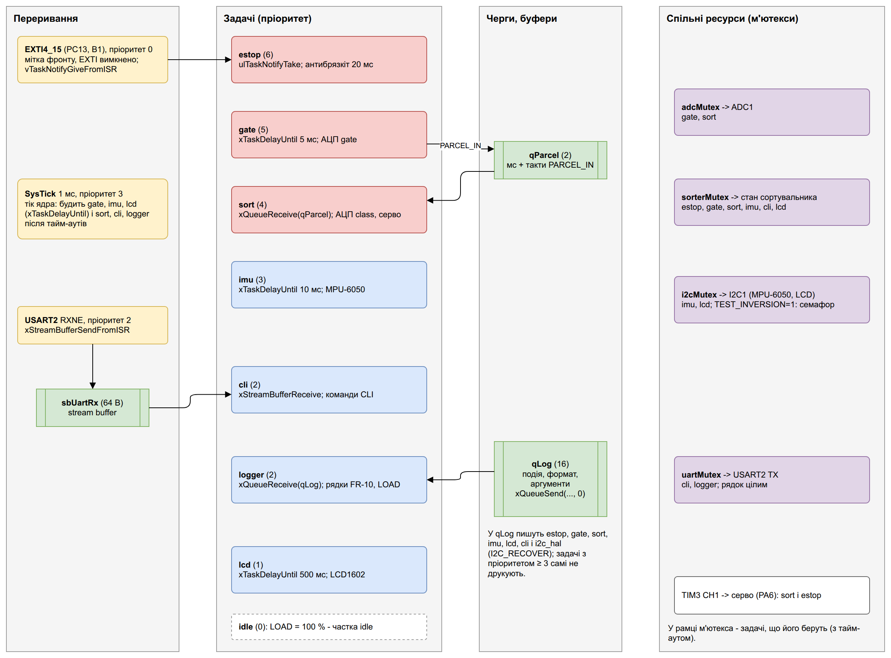
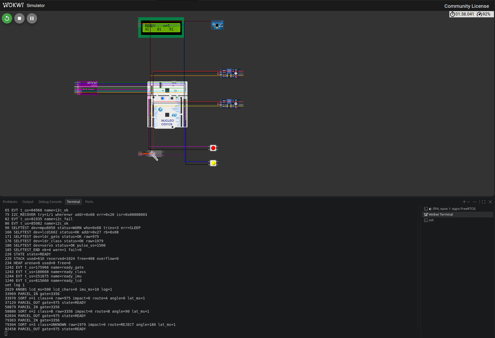
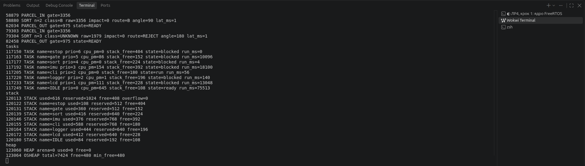
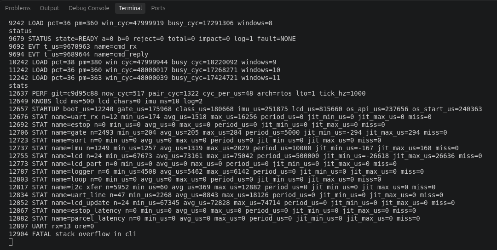
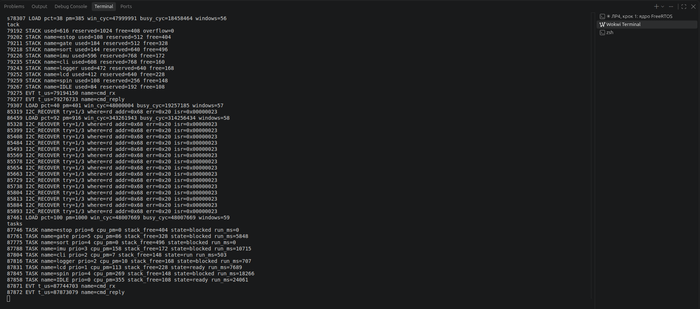
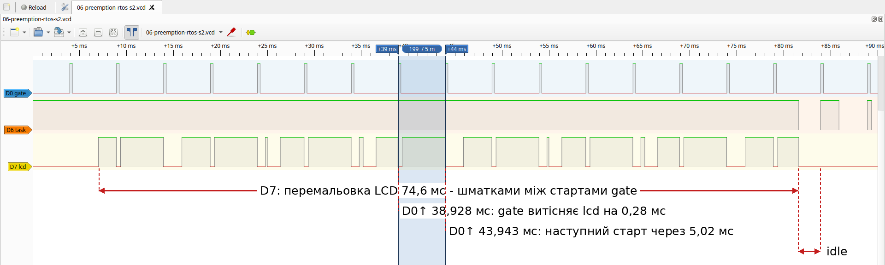
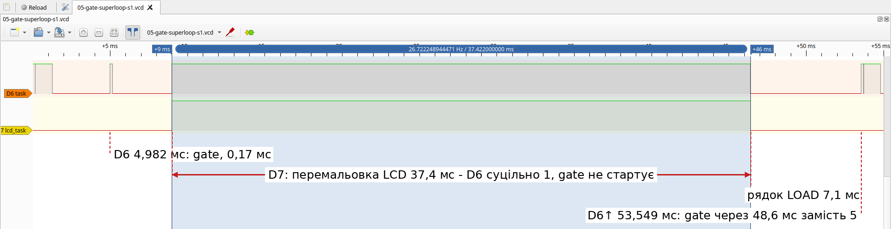
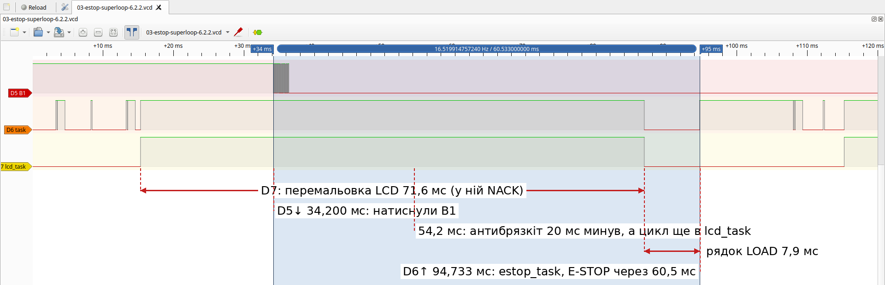
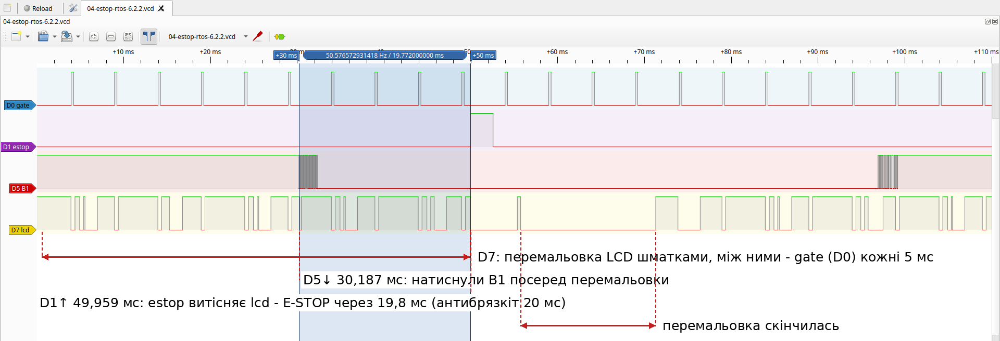

Міністерство освіти і науки України · Національний технічний університет України «Київський політехнічний інститут» · Факультет інформатики та обчислювальної техніки · Кафедра обчислювальної техніки

Лабораторна робота №4 з дисципліни «Системне програмування». Виконав: студент 4 курсу групи ІО-32 Кекух А.О. Перевірив: Гордієнко Н.Ю. 2026

# Лабораторна робота №4

**Перенесення продукту на FreeRTOS: задачі, пріоритети, механізми взаємодії і порівняння з super loop**

**Мета:** реалізувати ті самі вимоги PRD, що й у ЛР3, на FreeRTOS, повторити всі вимірювання базової лінії тим самим кодом і в тих самих сценаріях, перевірити гіпотези з реєстру обмежень ЛР3, знайти нові проблеми, які приносить ОС, і числами відповісти, чи виправдана ОС для цього продукту.

Репозиторій: https://github.com/SPapor/lab1-stm32-sorter

PR-и ЛР4: [#19](https://github.com/SPapor/lab1-stm32-sorter/pull/19), [#20](https://github.com/SPapor/lab1-stm32-sorter/pull/20), [#21](https://github.com/SPapor/lab1-stm32-sorter/pull/21), [#22](https://github.com/SPapor/lab1-stm32-sorter/pull/22), [#23](https://github.com/SPapor/lab1-stm32-sorter/pull/23), [#24](https://github.com/SPapor/lab1-stm32-sorter/pull/24), ⟨частина Б: PR частини Б⟩

Відео: https://drive.google.com/file/d/1mFOMtUlL71s9ZkQRrh79D0JZcDdzL22I/view?usp=sharing

## 2. Завдання

1. Реалізувати FR-01...FR-10 з PRD на FreeRTOS.
2. Спроєктувати розбиття на задачі: які задачі, які пріоритети, які механізми взаємодії, і обґрунтувати це вимогами.
3. Повторити всі вимірювання базової лінії ЛР3 тим самим методом у тих самих сценаріях.
4. Перевірити кожну гіпотезу з реєстру обмежень ЛР3: підтверджена, частково чи спростована.
5. Знайти нові проблеми, яких не було в super loop: інверсія пріоритетів, переповнення стека, голодування, вичерпання черги і купи, вплив частоти тіку (методичка 7.2).
6. Зробити обґрунтований висновок, який підхід підходить цьому продукту.

Форма виконання: B (Wokwi). Усі числа часу - **симуляційні (сим.)**: Wokwi для VS Code (RFC2217, без квоти) і `wokwi-cli` (частина Б, грудень, коли поновиться квота). Обидві прошивки збираються з одного дерева і одного коміту: `make build ARCH=superloop|rtos LTO=1`.

**Що в цьому звіті ще не заповнено.** Квоту `wokwi-cli` я вичерпав на кроці 1 (журнал, проблема 41). 22.11 зняв без неї, у Wokwi для VS Code, усе, що вдалося: 6.2.2, 6.2.4, 6.2.7-fault, S2 і удар на обох ARCH. Дії з `tools/wokwi/*.yaml` (кнопка, LDR, акселерометр) виконувала миша зі скрипта в реальному часі, а не `wokwi-cli` у часі симуляції; у таблицях ці рядки позначені «VS Code». S3, S3 з `TICK_HZ=100` і удар 20 мс так зняти не вийшло: під потоком `stats` Wokwi у VS Code отримує натискання пачками, і 150 мс натискання стають коротшими за антибрязкіт (журнал, проблема 68). Вони - у частині Б з `wokwi-cli`, місця позначені «⟨частина Б⟩», список - у додатку А.

## 3. Розподіл обов'язків

Роботу виконано одноосібно, тож усі п'ять ролей з методички (розділ 8) - мої.

| № | Роль | Зона відповідальності | Артефакти | Відповідальний |
|---|---|---|---|---|
| 1 | Розробка на FreeRTOS | ядро і `FreeRTOSConfig.h`, розбиття на задачі, пріоритети, черги, м'ютекси, переривання, перенесення FR з ЛР3, обхід PRIMASK для Wokwi | `firmware/Tasks/`, `firmware/Platform/rtos/`, docs/rtos-design.md, docs/architecture.md (розділ 10), `docs/lab_4/img/tasks.drawio` | Кекух А.О. |
| 2 | Метрики | ті самі вимірювання ЛР3 в обох ARCH, run-time stats, стеки, купа ОС, вартість тіку і перемикання (`OSMETRICS`), скрипти аналізу | `App/perf.c`, `Platform/rtos/rtos_osm.c`, `tools/stats_table.py --os`, docs/perf.md | Кекух А.О. |
| 3 | Тестування | сценарії ЛР3 і 7.2, очікування до прогону, порівняльна таблиця, вердикти по FR і гіпотезах | `tools/scenarios/`, збірки `TEST_OS`, `TEST_INVERSION`, docs/metrics/lab4/results.md | Кекух А.О. |
| 4 | Тестування на обладнанні | прогони обох прошивок у Wokwi, записи аналізатора, логи | docs/metrics/lab4/*.log, docs/captures/ | Кекух А.О. |
| 5 | Звіт | висновок про вибір підходу, журнал проблем, реєстр, звіт, відео | docs/journal.md, docs/limitations.md, цей звіт, docs/lab_4/video-plan.md | Кекух А.О. |

## 4. Процес виконання

### 4.1. Журнал роботи

| Дата | Що зроблено | PR |
|---|---|---|
| 17.11-18.11 | Крок 1: ядро FreeRTOS-Kernel V11.3.3 сабмодулем, збірка `ARCH=superloop\|rtos`, `LTO`, `TICK_HZ` з одного дерева; база часу (SysTick - ядру, TIM17 - HAL, `perf_now` з того самого лічильника); хуки `FATAL`; уся прошивка в одній задачі, smoke S1; виявлено, що Wokwi не враховує PRIMASK | #19 |
| 18.11 | Крок 2: обхід PRIMASK (`SIM_CRIT`, власна копія порту), стрес-тест ядра; сім задач, черги, м'ютекси, сповіщення, потоковий буфер; ручна перевірка в Wokwi | #20 |
| 19.11 | Крок 3: команда `tasks`, вартість ОС (`OSMETRICS`), дослід інверсії пріоритетів (`TEST_INVERSION`) | #21 |
| 19.11 | Крок 4, частина А: S1, 6.2.1, 6.2.3, 6.2.5, 6.2.6, 6.2.7 на обох ARCH з одного коміту; results.md, гіпотези | #22 |
| 20.11 | Крок 5: сценарії 7.2 (стек, голодування, черга, купа, тік); фікс `logger`, перевірка створення об'єктів ядра; реєстр обмежень з ОС | #23 |
| 20.11 | Крок 6: architecture.md для rtos, звіт, план відео | #24 |
| 22.11 | Частина Б у Wokwi для VS Code: 6.2.2, 6.2.4, 6.2.7-fault, S2, удар на обох ARCH, дії мишею зі скрипта; заповнення таблиць | ⟨частина Б⟩ |
| ⟨частина Б⟩ | S3, удар 20 мс, S3 з тіком 100 Гц на обох ARCH через `wokwi-cli`; заповнення таблиць | ⟨частина Б⟩ |

### 4.2. Конфігурація ядра

| Що | Значення |
|---|---|
| Ядро | FreeRTOS-Kernel V11.3.3, сабмодуль `firmware/Middlewares/FreeRTOS` (коміт `89592801`, тег `V11.3.3`), нативний API |
| Порт | `portable/GCC/ARM_CM0`; у Wokwi - копія з обходом PRIMASK `Platform/rtos/port_sim/` (`SIM_CRIT=1`), для плати - порт без змін (`SIM_CRIT=0`) |
| Heap | `heap_4`, `configTOTAL_HEAP_SIZE` 7 424 B, після старту вільно 480 B і далі не міняється (6.2.6) |
| Тік | SysTick, 1 000 Гц |
| Що збирається | `tasks.c`, `queue.c`, `list.c`, `stream_buffer.c`, `heap_4.c`, порт; без таймерів і груп подій |

Параметри, змінені відносно типових (повна таблиця - docs/rtos-design.md, розділ 1):

| Параметр | У мене | Типово | Навіщо |
|---|---|---|---|
| `configTICK_RATE_HZ` | 1 000 | у шаблоні 100 | роздільність затримок 1 мс, як у super loop; з 100 Гц період `gate` 5 мс неможливий (7.2 п. 6) |
| `configMAX_PRIORITIES` | 7 | у шаблоні 5 | idle і шість робочих рівнів, кожен рівень - список у RAM |
| `configMINIMAL_STACK_SIZE` | 48 слів | у шаблоні 128 | стек idle; виміряно 84 B з 192 |
| `configMAX_TASK_NAME_LEN` | 8 | 16 | імена до 7 символів, -8 B на TCB |
| `configTOTAL_HEAP_SIZE` | 7 424 B | немає | сім задач (стеки 4 480 B), TCB, черги, потоковий буфер, м'ютекси |
| `configUSE_MUTEXES` | 1 | 0 | шина I²C, АЦП, стан сортувальника, UART TX |
| `configUSE_STREAM_BUFFERS` | 1 | 1 | прийом UART з ISR |
| `configUSE_TIMERS` | 0 | 0 | не потрібні, `timers.c` не збирається |
| `configUSE_EVENT_GROUPS` | 0 | 1 | не потрібні, `event_groups.c` не збирається (flash) |
| `configUSE_TICK_HOOK` | 0 | - | тіки для `perf_now` рахує сам `SysTick_Handler`: хук губив тіки, поки ядро доганяє відкладені (журнал, проблема 34) |
| `configUSE_MALLOC_FAILED_HOOK` | 1 | 0 | `FATAL malloc` і зупинка (7.2 п. 5) |
| `configCHECK_FOR_STACK_OVERFLOW` | 2 | 0 | `FATAL stack overflow in <задача>` (7.2 п. 2) |
| `configGENERATE_RUN_TIME_STATS` | 1 (з `PERF`) | 0 | завантаження за задачами |
| `configRUN_TIME_COUNTER_TYPE` | `uint64_t` | `uint32_t` | 32 біти тактів переповнюються за 89,5 с |
| `configUSE_STATS_FORMATTING_FUNCTIONS` | 0 | 0 | `vTaskList` тягне `sprintf`; рядки `TASK` друкую сам |
| `configASSERT` | лише в збірці `ASSERT=1` | немає | з повним API і обходом продукт інакше не вміщався у flash (розділ 4.8) |

**Особливості Cortex-M0+.** BASEPRI немає, тож критична секція ядра вимикає всі переривання, `configMAX_SYSCALL_INTERRUPT_PRIORITY` порт не читає, а FromISR-функції можна викликати з будь-якого пріоритету. Пріоритетів NVIC лише 4. DWT CYCCNT немає - лічильник run-time stats іде від `perf_now` (SysTick + номер тіку), як і всі вимірювання ЛР3.

**Wokwi не враховує PRIMASK.** Після `cpsid i` модель далі викликає обробники SysTick і TIM17 (журнал, проблема 35, `TEST_PRIMASK`: 10 тіків з 10 при PRIMASK = 1). Порт ARM_CM0 на цьому стоїть, і стрес-тест ядра зависав (проблема 43). Тому в симуляції працює власна копія порту: критична секція ще й програмно відкладає переривання NVIC, тік і PendSV. Ціна - +694 такти на пару вхід/вихід секції задачі і +689 на пару секції ISR (`TEST_CRITCOST`), +444 B flash. На залізі обхід не потрібен, і в усіх таблицях я показую частку обходу окремо.

### 4.3. Схема задач



*Рисунок 1 - задачі, переривання і механізми взаємодії ARCH=rtos (джерело - docs/lab_4/img/tasks.drawio)*

| Задача | Пріоритет | Запуск, період | Стек, слів (найбільше використано) | FR | Дедлайн з PRD |
|---|---|---|---|---|---|
| `estop` | 6 | сповіщення з ISR EXTI + 20 мс антибрязкоту | 128 (392 B) | FR-07 | гіпотеза ЛР3 - ≤ 22 мс |
| `gate` | 5 | `xTaskDelayUntil` 5 мс | 128 (360 B) | FR-01 | через FR-03: запас 22,4 мс на джитер |
| `sort` | 4 | черга `qParcel` | 160 (448 B) | FR-02, FR-03, FR-05 | FR-03: заслінка ≤ 50 мс |
| `imu` | 3 | `xTaskDelayUntil` 10 мс | 192 (560 B) | FR-04, FR-09 | удар має потрапити в рішення про посилку |
| `cli` | 2 | потоковий буфер з ISR USART2 | 192 (620 B) | CLI | немає |
| `logger` | 2 | черга `qLog` | 160 (472 B) | FR-10 | немає |
| `lcd` | 1 | `xTaskDelayUntil` 500 мс | 160 (536 B) | FR-06 | немає |
| idle | 0 | - | 48 (84 B) | - | - |

Пріоритети - за жорсткістю дедлайну з PRD. E-STOP - аварійна кнопка, найвищий. Періодичні `gate` і `imu` - за періодом (rate-monotonic: 5 мс вище за 10 мс). `sort` - одразу під `gate`: отримує від неї подію і має вкластися в FR-03, а `gate` не повинна чекати на `sort`. `cli` і `logger` - фонові, без дедлайну. LCD - найдовша операція (37-95 мс) без дедлайну, тож найнижча: саме вона в ЛР3 блокувала все (обмеження 1).

Механізми: `qParcel` (2 записи, `gate` -> `sort`), `qLog` (16 записів, усі задачі -> `logger`; задачі з пріоритетом ≥ 3 не друкують самі), `sbUartRx` (64 B, ISR USART2 -> `cli`), сповіщення (ISR EXTI -> `estop`), чотири м'ютекси з успадкуванням пріоритету (АЦП, I²C на кожну транзакцію, стан сортувальника, рядок UART). Переривання EXTI і USART2 стоять на пріоритеті SysTick (3), щоб мітка часу в ISR не могла потрапити між входом у тік і його рахунком (журнал, проблема 45). Детально - docs/architecture.md, розділ 10, і docs/rtos-design.md, розділ 6.

### 4.4. Методика

Методичка 7.1: обидві прошивки - той самий стенд, той самий день, той самий вимірювальний код. Super loop на кроці 4 - не та збірка, що в ЛР3: `LTO=1` (rtos без LTO не влазить), власний форматер замість `printf` newlib, службові піни PB12 і PB15, рядок `BOOT` однієї довжини. Тому порівнюю два прогони одного коміту (`b6e72123`): `ARCH=superloop` і `ARCH=rtos`, а логи ЛР3 - третя колонка для довідки (docs/metrics/lab4/results.md, розділ 0).

- **Інструменти** - ті самі, що в ЛР3: `perf_now`, рядки `STAT`, `LOAD`, `EVT`, `tools/run_scenario.py`, `tools/stats_table.py`, `tools/evt_latency.py`, PulseView. Для rtos додано рядки `TASK`, `MTX`, `LOGQ`, `SIMCRIT`, `OSHEAP` і команду `tasks`.
- **LOAD означає різне.** У super loop - сума часу задач, у rtos - 100 % мінус частка idle (з ядром, перериваннями і обходом). Тому поряд - «корисна робота» одним способом для обох: Σ n × avg рядків `STAT` задач за вікно (журнал, проблема 58).
- **Частка обходу SIM_CRIT** рахується з рядка `SIMCRIT` (секцій за секунду × 694 / 689 тактів) і показується окремо.



*Рисунок 2 - Wokwi для VS Code, rtos (код `1a03385`; у `BOOT` - `c9d95c88`, хеш до переписування дат кроку 6): стенд після трьох посилок - A, B і брак; на LCD `READY n=3`, `A1 B1 R1`, у терміналі три рядки `SORT` з `lat_ms=1`*

### 4.5. Порівняльна таблиця

Формат - методичка 7.3. Вердикт для метрик з вимогою PRD - за максимумом у S3; поки S3 немає, вердикт за частиною А позначено «(А)». Рядки «VS Code» - частина Б, знята 22.11 у Wokwi для VS Code на коміті `6f5fd394` (прошивка та сама, що в `1a03385`), дії мишею зі скрипта. Логи - docs/metrics/lab4/, README там же.

| Метрика | Сценарій | ЛР3 (`3c1a2135`) | super loop (`b6e72123`) | FreeRTOS (`b6e72123`) | Різниця rtos - super loop | Вимога PRD | Хто кращий |
|---|---|---|---|---|---|---|---|
| E-STOP: фронт PC13 -> реакція, max | S3 | 195,9 мс | ⟨частина Б⟩ | ⟨частина Б⟩ | ⟨частина Б⟩ | не задано (FR-07); гіпотеза ≤ 22 мс | ⟨частина Б⟩ |
| E-STOP: зараховано натискань | S3 | 25 з 30 (короткі 10 з 15) | ⟨частина Б⟩ | ⟨частина Б⟩ | ⟨частина Б⟩ | кожне (FR-07) | ⟨частина Б⟩ |
| E-STOP під довгою операцією, max | 6.2.2 (VS Code) | 60,5 мс | 55,2 мс, 39 з 40 (аналізатор - до 114,8 мс) | **20,6 мс, 40 з 40** (аналізатор - 19,3-20,6 мс) | −34,6 мс | - | FreeRTOS |
| FR-03: поява посилки -> ШІМ, max | S3 | 235,5 мс | ⟨частина Б⟩ | ⟨частина Б⟩ | ⟨частина Б⟩ | ≤ 50 мс | ⟨частина Б⟩ |
| FR-03: поява посилки -> ШІМ, max | S2 (VS Code) | 129,5 мс | 79,20 мс | **26,22 мс** | −52,98 мс (÷3,0) | ≤ 50 мс | FreeRTOS |
| FR-03: оцінка в простої, max | S1 (6.2.5, блок 2) | 62,77 мс | 64,08 мс | **27,92 мс** | −36,16 мс (÷2,3) | ≤ 50 мс | FreeRTOS (А) |
| PARCEL_IN -> запис CCR, max | S2 (VS Code) | 3,34 мс | 2,92 мс | **0,91 мс** | −2,01 мс | частина FR-03 | FreeRTOS |
| gate: джитер старту, max | S3 | 207 мс | ⟨частина Б⟩ | ⟨частина Б⟩ | ⟨частина Б⟩ | ≤ 22,4 мс (запас FR-03) | ⟨частина Б⟩ |
| gate: джитер старту, max | S1 | 75,32 мс | 36,48 мс | **0,32 мс** | −36,16 мс (÷114) | ≤ 22,4 мс | FreeRTOS (А) |
| gate: пропуски | S1, ~63 с | 158 | 138 | **0** | −138 | 0 | FreeRTOS (А) |
| gate: джитер старту, max / пропуски | S2 (VS Code) | 101,27 мс / 281 | 51,28 мс / 278 | **0,31 мс / 0** | −50,97 мс | ≤ 22,4 мс | FreeRTOS |
| gate: джитер старту, max / пропуски | 6.2.4 (VS Code) | ~90 мс | 112,06 мс / 125 | **1,44 мс / 0** | −110,62 мс | ≤ 22,4 мс | FreeRTOS |
| imu: джитер старту, max | S3 | 212 мс | ⟨частина Б⟩ | ⟨частина Б⟩ | ⟨частина Б⟩ | - | ⟨частина Б⟩ |
| imu: джитер старту, max | S1 | 71,69 мс | 36,61 мс | **0,32 мс** | −36,29 мс (÷114) | - | FreeRTOS |
| удар 20 мс під потоком `stats` | удар 20 мс | 3 з 10 | ⟨частина Б⟩ | ⟨частина Б⟩ | ⟨частина Б⟩ | кожен (FR-04) | ⟨частина Б⟩ |
| удар 0,3 с, посилка в брак | удар (VS Code) | 3 з 3 | 3 з 3 | 3 з 3 | 0 | кожен (FR-04, FR-05) | ≈ |
| старт без MPU | 6.2.7-fault (VS Code) | FAULT, консоль жива | `FAULT` на 201 мс | `FAULT` на 203 мс | +2 мс | FAULT з причиною (FR-08) | ≈ |
| команда -> відповідь, p99 | S1 | 176,9 мс | 175,2 мс | 452,6 мс | +277 мс (×2,6) | - | super loop |
| команди з паузами 0,5 с | 6.2.3 | 12 з 20 | 13 з 20 | **20 з 20** | +7 | - | FreeRTOS |
| команди без пауз, пройшло | 6.2.3 | 1 з 50 (прийнято 19 % байтів) | 1 з 50 і 1 з 50 | 11 і 10 з 50 (оброблено 22 % байтів) | +19 з 100 | - | FreeRTOS, але обидва далеко від потоку |
| перемальовка LCD, max | S1 | 71,59 мс (NACK) | 37,34 мс | 95,22 мс | +57,9 мс (×2,6) | - | super loop |
| LOAD у простої, медіана | S1 | 20 % | 19 % | 36 % | +17 п. п. | - | super loop |
| корисна робота задач | S1 | 19,8 % | 18,8 % | 32,8 % | +14 п. п. | - | super loop |
| з них обхід SIM_CRIT | S1 | - | - | 4,0 % | - | - | лише Wokwi |
| точка зламу за LOAD | 6.2.5 | `lcd_ms=32` | `lcd_ms=32` | `lcd_ms=50` | раніше | - | super loop |
| READY від скидання | 6.2.7 | 221 мс | 222 мс | 226 мс | +4 мс (+1,8 %) | ≤ 500 мс | ≈ (обидва із запасом) |
| розкид старту, 2 запуски | 6.2.7 | ≤ 0,32 мс | 1,24 мс | 0,003 мс | - | - | FreeRTOS |
| стабільність за годину: купа, стек | 6.2.6 | сталі | - | сталі (купа ОС 480 B вільно, 60 замірів) | - | - | ≈ |
| flash (чисті збірки `1a03385`, розділ 4.6) | - | 31 060 B (без LTO) | 21 660 B | 31 988 B | +10 328 B (+48 %) | ≤ 32 768 B | super loop |
| RAM статично (`1a03385`) | - | 3 288 B | 3 488 B | 11 832 B | +8 344 B (×3,4) | ≤ 12 288 B | super loop |
| стек: зарезервовано / використано | S1 і 6.2.6 | 1 024 / 944 B | 1 024 / 640 B | MSP 1 024 / 616 B + задачі 4 480 / 3 052 B | +4,5 КБ | - | super loop |
| рядків коду, специфічних для ARCH | - | - | 56 (`Platform/superloop/`) | 1 589 (`Tasks/sorter_tasks.*`, `Platform/rtos/rtos_hal.*`, `rtos_diag.c`, `FreeRTOSConfig.h`) | +1 533 | - | super loop |
| місць у коді для нової періодичної задачі | - | ~17 | 7 | 11 у 3 файлах | +4 | - | super loop |
| об'єктів синхронізації | - | 2 (`volatile`) | 2 | 8 (черги, буфер, сповіщення, м'ютекси) | +6 | - | залежить: rtos захищає більше, але й помилитися є де |

Спільний код (App/, Devices/ - 1 669 рядків; `main.c` - 2 172) в обох однаковий; рядки рахував `wc -l`. Майже всі «FreeRTOS кращий» - там, де пріоритет високий (gate, imu, E-STOP, прийом UART); майже всі «super loop кращий» - запас процесора, пам'ять і все, що в rtos має низький пріоритет.

Ті самі метрики таблицею `tools/stats_table.py` (S1 - частина А, S2 - частина Б у VS Code, S3 - додаток А):

```
python3 tools/stats_table.py --s1 docs/metrics/lab4/S1_2026-11-19_1853.log --s2 docs/metrics/lab4/S2_2026-11-22_1642.log --s3 ⟨S3 super loop⟩ --vcd S3=⟨VCD S3 super loop⟩
python3 tools/stats_table.py --s1 docs/metrics/lab4/S1_2026-11-19_1903.log --s2 docs/metrics/lab4/S2_2026-11-22_1640.log --s3 ⟨S3 rtos⟩ --vcd S3=⟨VCD S3 rtos⟩
```

Вивід для rtos, поки S1 і S2 (super loop у S2: FR-03 79,20 мс, джитер gate 51,28 мс і 278 пропусків, imu 49,90 мс і 241, LOAD 32 %):

| Метрика | S1 (сим.) | S2 (сим.) | S3 (сим.) | Вимога PRD | Спосіб | Вердикт |
|---|---|---|---|---|---|---|
| FR-03: поява посилки -> зміна ШІМ (оцінка), max | - | 26,22 мс | ⟨частина Б⟩ | ≤ 50 мс (FR-03) | лічильник + розрахунок | ⟨частина Б⟩ |
| E-STOP: фронт PC13 -> реакція, max | - | - | ⟨частина Б⟩ | не задано (FR-07) | лічильник | ⟨частина Б⟩ |
| gate: джитер старту, max | 0,32 мс | 0,31 мс | ⟨частина Б⟩ | ≤ 22,4 мс (запас FR-03) | лічильник | ⟨частина Б⟩ |
| gate: пропуски (інтервал > 2 періодів) | 0 | 0 | ⟨частина Б⟩ | - | лічильник | - |
| imu: джитер старту, max | 0,32 мс | 4,07 мс | ⟨частина Б⟩ | - | лічильник | - |
| lcd: час задачі, max | 95,22 мс | 115,75 мс | ⟨частина Б⟩ | - | лічильник | - |
| команда -> відповідь, p99 | 452,57 мс | 444,41 мс | ⟨частина Б⟩ | - | журнал EVT | - |
| завантаження CPU, max LOAD | 71 % | 72 % | ⟨частина Б⟩ | - | лічильник | - |
| глибина стека MSP (STACK used) | 616 B | 616 B | ⟨частина Б⟩ | < 1024 B (резерв) | stack painting | ⟨частина Б⟩ |
| UART: загублено байтів | 0 | 0 | ⟨частина Б⟩ | - | лічильник + скрипт | - |

### 4.6. Вартість ОС і пам'ять

**Вартість ядра** - збірка `OSMETRICS=1`, `docs/metrics/lab4/OSMETRICS_2026-11-19.log` (57,3 с: `osbench`, 5 посилок, 8 E-STOP, команди), `python3 tools/stats_table.py --os docs/metrics/lab4/OSMETRICS_2026-11-19.log`:

| Метрика | n | avg | max | avg без обходу | max без обходу |
|---|---|---|---|---|---|
| обробник тіку: SysTick -> xTaskIncrementTick | 56433 | 44 мкс | 107 мкс | 30 мкс | 93 мкс |
| вибір задачі: traceTASK_SWITCHED_OUT -> _IN | 37933 | 54 мкс | 65 мкс | - | - |
| перемикання: xTaskNotifyGive -> після ulTaskNotifyTake (вищий пріоритет) | 1000 | 196 мкс | 804 мкс | 163 мкс | 717 мкс |
| ISR -> задача: EXTI E-STOP -> estop | 16 | 262 мкс | 1260 мкс | 229 мкс | 1217 мкс |
| ISR -> задача: USART2 RXNE -> cli | 4 | 503 мкс | 565 мкс | 388 мкс | 436 мкс |
| черга: gate xQueueSend -> sort після xQueueReceive | 5 | 559 мкс | 572 мкс | 487 мкс | 500 мкс |
| м'ютекс: take + give без конкуренції | 1000 | 95 мкс | 1751 мкс | 64 мкс | 1621 мкс |

У частці процесора (оцінка n × avg / вікно): тік - 4,4 % (без обходу 3,0 %), вибір задачі при ~660 перемиканнях на секунду - ~3,6 %. Модель Wokwi виконує код ядра в рази повільніше за розрахунок у тактах (журнал, проблема 44): перемикання очікував 60-80 мкс. На залізі, без обходу і з реальною швидкістю ядра, ці числа будуть меншими; тут вони - верхня оцінка для порівняння в одній моделі. Max - пари, які витіснила задача вищого пріоритету.

**Завантаження за задачами** (S1, rtos, `tasks`): `imu` 152 ‰, `lcd` 113 ‰, `gate` 86 ‰, `cli` і `logger` по ~10 ‰, `estop` і `sort` - 0 у простої, IDLE 635 ‰.



*Рисунок 3 - `tasks`, `stack`, `heap` після трьох посилок з рисунка 2: IDLE 645 ‰ (інший запуск, ніж S1), найменший запас стека - idle 108 B і `gate` 152 B, купа ОС - 480 B вільно*

**Пам'ять** (`--print-memory-usage`, `LTO=1`, чисті збірки `1a03385`):

| Складова | super loop | rtos | Чим заплачено |
|---|---|---|---|
| flash разом | 21 660 B (66 %) | 31 988 B (97,6 %) | +10 328 B |
| з них ядро (`tasks`, `queue`, `stream_buffer`, `list`, `heap_4`, порт), оцінка з map без LTO | - | ~8,4 КБ | API кроків 2-3 |
| `Tasks/` і `Platform/rtos/` (задачі, звіти `TASK`/`MTX`/`LOGQ`, хуки, база часу, обхід) | - | ~2 КБ | |
| RAM статично | 3 488 B | 11 832 B (96,3 %) | +8 344 B |
| з них купа ОС | - | 7 424 B: стеки задач 4 480 B, TCB, `qLog` 704 B, `qParcel`, потоковий буфер 64 B, 4 м'ютекси; вільно 480 B | |
| статичні дані ядра | - | ~300 B (списки 7 пріоритетів, лічильники) | |
| стек MSP (до старту ядра і переривання) | 1 024 B | 1 024 B | |

Найбільша складова - стеки задач (4 480 B, 38 % RAM). Зменшити можна лише разом із запасом: найменший запас уже 104 B у `lcd` (після `I2C_RECOVER` на адресі самого LCD у S2), 108 B в idle і 120 B в `estop` (після 40 натискань у 6.2.2), а переповнення на 44 B без перевірки псує TCB сусідньої задачі (7.2 п. 2).

### 4.7. Інверсія пріоритетів

Збірки `TEST_INVERSION=sem|mutex` (методичка 7.2 п. 1, docs/rtos-design.md, розділ 7): `lcd` (1) тримає шину I²C усю перемальовку і будить `hog` (2), який 50 мс крутиться; `imu` (3) кожні 10 мс хоче шину.

| | двійковий семафор | м'ютекс | розрахунок |
|---|---|---|---|
| `imu` чекала шину, max | **121,9 мс** | **45,2 мс** | до ~120 / ~80 мс |
| `hog` працював за 15 с | 1 345 мс | 210 мс | - |

З семафором `imu` чекає ще й `hog`, що до шини не має стосунку; з м'ютексом `lcd` успадковує пріоритет 3 і `hog` її не витісняє. Різниця 76,7 мс - це і є інверсія. У продукті шина береться на транзакцію, і найдовше очікування - 1,06 мс (крок 2); 89,8 мс тієї самої інверсії вийшло через блокувальну чергу (7.2 п. 4).

### 4.8. Сценарії 7.2

Окремі збірки `TEST_OS=<назва>`, Wokwi для VS Code, docs/rtos-design.md, розділ 8:

| Пункт | Що зробив | Результат | Висновок |
|---|---|---|---|
| 2. Переповнення стека | стек `cli` нижче high water mark на 236 і на 44 B, з перевіркою 2 і без | 44 B з перевіркою - `FATAL stack overflow in cli`; 44 B без - працює, але зіпсований TCB сусідньої `imu`; 236 B - МК зависає і з перевіркою, і без | хук ловить лише мілкі переповнення: запас - від HWM після рідкісних подій, ≥ ~100 B (проблема 66) |
| 3. Голодування | задача `spin` (4) крутиться 5 с з кожних 20 | `gate` не помітила; `spin` 252 ‰, IDLE 380 ‰ замість 635; після вікна `xTaskDelayUntil` доганяє ~500 періодів `imu` пачкою, LOAD 100 %; до фіксу `logger` після вікна не відновлювався (проблема 62) | у run-time stats за довге вікно голодування не видно, лише по idle і джитеру |
| 4. Вичерпання черги | 40 записів у `qLog` (16 місць) щосекунди, тайм-аут 0 і 20 мс | 0: губиться рівно 24 з 40, лічильник `drop` = втрачене; 20 мс: 4 з 520, але `gate` (5) чекає `logger` (2) до 89,8 мс | відправник обирає: втрати або чужа швидкість; втрати в `qParcel` не рахуються (проблема 63) |
| 5. Вичерпання купи ОС | купа 6 400 B замість 7 424 | з хуком - `FATAL malloc` до старту ядра; без хука - продукт без LCD мовчки, після фіксу - `FATAL create lcd` | хук - страховка, а не перевірка коду (проблема 64) |
| 6. Частота тіку | S1 з тіком 100 Гц; S3 з 1000 і 100 Гц - ⟨частина Б⟩ | `gate` раз на 10 мс замість 5, LOAD 31 % замість 36 %, ціна обходу 2,3 % замість 4,0 %; S3: ⟨частина Б⟩ | продукту треба ≥ 200 Гц; `ms_ticks` округлює мовчки (проблема 65) |



*Рисунок 4 - `TEST_OS=stack_near` (стек `cli` на 44 B нижче high water mark): `status` проходить, на `stats` - `FATAL stack overflow in cli`*



*Рисунок 5 - `TEST_OS=starve`, `tasks` о 87,7 с, одразу після четвертого вікна `spin` (80-85 с): `spin` 269 ‰, IDLE 355 ‰; `LOAD pct=92` за ~7 с (рядок затримався - `logger` теж голодував), далі 100 %; пачка `I2C_RECOVER` (тайм-аут читання MPU) - поки `imu` доганяє пропущені періоди. Числа - із запуску на знімку, у таблиці - з логу `7.2.3_2026-11-20_1414`*

### 4.9. Хронологія задач



*Рисунок 6 - S2 (VS Code), rtos (`docs/lab_4/captures/06-preemption-rtos-s2.vcd`): перемальовка LCD (D7) 74,6 мс іде шматками, між ними кожні 5 мс стартує `gate` (D0); курсори - два сусідні старти gate, 5,02 мс*

За 74,6 мс перемальовки `gate` стартувала 15 разів з інтервалом 4,98-5,02 мс і щоразу працювала 0,28 мс: щойно приходить її час, ядро знімає `lcd` (D7 падає) і повертає після. Тому перемальовка вдвічі довша, ніж у super loop (37,4 мс, рисунок 7), але `gate` її не помічає. D6 падає в 0 лише після кінця перемальовки - тоді працює idle. Методичка просить хронологію для S3; S3 - у частині Б з `wokwi-cli`, а механізм у S2 той самий.

Для порівняння - той самий момент у super loop: поки LCD перемальовується 37,4 мс, жодна задача не стартує (D6 суцільно 1):



*Рисунок 7 - S1, super loop (`docs/lab_4/captures/05-gate-superloop-s1.vcd`): перемальовка LCD 37,4 мс, `gate` чекає*



*Рисунок 8 - 6.2.2, super loop ЛР3: від спаду D5 до старту estop_task - 60,5 мс*



*Рисунок 9 - 6.2.2 (VS Code), rtos (`docs/lab_4/captures/04-estop-rtos-6.2.2.vcd`): B1 натиснули посеред перемальовки LCD; від спаду D5 до старту `estop` (D1) - 19,8 мс, тобто лише антибрязкіт, і `estop` одразу витісняє `lcd` (у super loop - 60,5 мс, рисунок 8)*

### 4.10. Статус FR

| FR | super loop (ЛР3, вердикт за S3) | FreeRTOS (частина А і частина Б у VS Code) | FreeRTOS (вердикт за S3) |
|---|---|---|---|
| FR-01 виявлення посилки | виконана: S2 30 з 30, S3 15 з 15 | 5 з 5 вручну, 6 з 6 у 6.2.6, S2 30 з 30 | ⟨частина Б⟩ |
| FR-02 клас A / B / UNKNOWN | виконана | 5 з 5 (A, REJECT, B, A, B); S2 30 з 30 (`a=10 b=10 reject=10`) | ⟨частина Б⟩ |
| FR-03 заслінка ≤ 50 мс | з обмеженням: від появи 235,5 мс у S3, 62,8 мс у простої | оцінка в простої 27,9 мс; від появи в S2 26,2 мс (super loop 79,2 мс); PARCEL_IN -> CCR 0,9 мс | ⟨частина Б⟩ |
| FR-04 удар > 2 g | з обмеженням: 20 мс під потоком `stats` - 3 з 10 | удар 0,3 с - 3 з 3 (як і super loop); 20 мс під потоком - ⟨частина Б⟩ | ⟨частина Б⟩ |
| FR-05 брак: удар або UNKNOWN | виконана | UNKNOWN -> REJECT (S2 10 з 10); удар - 3 з 3 у брак при класі A | ⟨частина Б⟩ |
| FR-06 лічильники на LCD | виконана | виконана, LCD кожні 500 мс (перемальовка 76-95 мс) | ⟨частина Б⟩ |
| FR-07 E-STOP | з обмеженням: S3 25 з 30, до 195,9 мс | 4 з 4 вручну (два по 120 мс), 8 з 8 в OSMETRICS, 6.2.2 - 40 з 40; 19,3-20,6 мс | ⟨частина Б⟩ |
| FR-08 самоперевірка, FAULT | виконана, READY 221 мс | READY 226 мс, `SELFTEST_END ok=4 warn=1`; без MPU - `FAULT reason=MPU_NOT_FOUND` на 203 мс, консоль жива, на LCD «FAULT: MPU not found» | виконана (6.2.7-fault) |
| FR-09 відновлення I²C | виконана | одне `I2C_RECOVER` після старту в S1 відновилось; 6.2.4: 0x69 - 3 спроби щосекунди, SDA на GND 2 с - шина ожила без скидання, джитер gate 1,44 мс | виконана (6.2.4) |
| FR-10 рядок на кожну подію | виконана | з обмеженням: у S1, S2, 6.2.2, 6.2.6 `drop=0`, але в 6.2.4 (SDA на GND) `drop=327` - `qLog` не встигає за `I2C_RECOVER` кожні ~6 мс; втрати пораховані (проблема 70) | ⟨частина Б⟩ |

### 4.11. Перевірка гіпотез ЛР3

Формат методички 7.4 для кожного обмеження - docs/metrics/lab4/results.md, розділ 2; тут коротко.

| Обмеження ЛР3 | Гіпотеза | Механізм | ЛР3 -> ЛР4 | Вердикт | Ціна; нова проблема |
|---|---|---|---|---|---|
| 1. довга операція блокує все | джитер gate ≤ 2 мс, FR-03 від появи в S2 ≤ 30 мс | `gate` (5) витісняє `lcd` (1) | S1: 36,48 -> 0,32 мс, FR-03 64,1 -> 27,9 мс; S2 (VS Code): джитер 101,27 -> 0,31 мс, FR-03 від появи 129,5 -> 26,2 мс | підтверджено (S1, S2) | LCD 76-95 мс замість 37 |
| 2. блокувальний вивід | джитер gate у S3 ≤ 5 мс, E-STOP ≤ 25 мс | `cli` і `logger` на 2 | ⟨частина Б⟩ | ⟨частина Б⟩ | відповідь p99 ×2,6 |
| 3. прийом UART | з паузами 0 побитих з 20; без пауз ≥ 95 % | RXNE + потоковий буфер | з паузами 20 з 20; без пауз 22 % | частково | буфер 64 B губить потік (проблема 57) |
| 4. відмова I²C | у 6.2.4 джитер gate ≤ 2 мс | шина в задачах нижче `gate` | 6.2.4 (VS Code): джитер gate ~90 -> 1,44 мс, пропусків 0 (super loop того самого коміту - 112 мс і 125) | підтверджено | у вікні відмови губляться рядки журналу (`drop=327`, проблема 70) |
| 5. E-STOP губиться | 0 загублених коротких, ≤ 22 мс | `estop` (6), сповіщення | вручну 4 з 4, 19,6-20,2 мс; 6.2.2 (VS Code) 40 з 40, 19,3-20,6 мс (super loop - 39 з 40, до 55,2 мс); S3 - ⟨частина Б⟩ | під довгою операцією так; під потоком - ⟨частина Б⟩ | - |
| 6. нерегулярне опитування imu | джитер imu ≤ 2 мс; удар 20 мс 10 з 10 | `imu` (3), `xTaskDelayUntil` | S1: 36,61 -> 0,32 мс; з посилками до 3,6 мс (S2 - 4,07 мс); удар 0,3 с - 3 з 3; удар 20 мс - ⟨частина Б⟩ | S1, S2 так; удар 20 мс ⟨частина Б⟩ | `sort` вище за `imu` (проблема 59) |
| 7. пам'ять | flash ~31,5 КБ, RAM ~7-8 КБ | мінімальне ядро, LTO | flash 31 988 B; RAM 11 832 B | flash так, RAM спростовано (+4 КБ) | 7 стеків і купа ОС |
| 8. модульність | нова задача - 1 файл, 2-3 місця | задача - запис у `task_def` | 11 місць у 3 файлах проти 7 | спростовано | спільні роботи для двох ARCH |
| 9. спільні дані | захищених об'єктів 2 -> ≥ 5 | черги, м'ютекси, сповіщення | 8 | підтверджено | кожен - місце для помилки (проблеми 55, 63) |
| 10. що super loop робить краще | READY ≤ 243 мс, LOAD у простої ≤ 22 %, розкид ≤ 0,5 мс | - | READY 226 мс, розкид 3 мкс, LOAD 36 % | READY і розкид так, LOAD спростовано | +17 п. п. процесора |

**Що super loop робить краще - підтвердилось вимірюваннями.** Погіршення понад 10 % проти super loop того самого коміту: LOAD у простої +89 %, корисна робота +74 %, RAM ×3,4, flash +48 %, перемальовка LCD ×2,6, відповідь на команду ×2,6, точка зламу раніше (`lcd_ms=50` проти 32). Не підтвердилось лише одне побоювання: старт. READY +1,8 %, а розкид старту в rtos навіть менший (3 мкс проти 1,24 мс). Простота налагодження - теж правда: на кожну з проблем 43, 51, 61, 62 пішло більше часу, ніж на будь-яку проблему ЛР3, бо порядок виконання вже не видно з коду.

### 4.12. Реєстр обмежень: що ОС розв'язала і що принесла

Повністю - docs/limitations.md, розділи «Що з цим зробила FreeRTOS» і «Нові обмеження, які принесла ОС».

| Обмеження ЛР3 | Що з ним зараз | Число |
|---|---|---|
| 1. довга операція блокує все | розв'язано (S1, S2) | джитер gate 36,48 -> 0,32 мс (S1), 51,28 -> 0,31 мс (S2) |
| 2. блокувальний вивід | частково | вищі задачі не страждають, відповідь p99 175 -> 453 мс |
| 3. прийом UART | частково | з паузами 20 з 20; без пауз 22 % |
| 4. відмова I²C | розв'язано для вищих задач; нове - втрати рядків журналу | 6.2.4: джитер gate 112 -> 1,44 мс, `drop=327` |
| 5. E-STOP | розв'язано під довгою операцією (6.2.2), S3 - ⟨частина Б⟩ | 6.2.2: 40 з 40, 19,3-20,6 мс (super loop 39 з 40, до 55,2 мс) |
| 6. опитування imu | розв'язано (S1, S2), удар 20 мс - ⟨частина Б⟩ | джитер imu 36,61 -> 0,32 мс; удар 0,3 с 3 з 3 |
| 7. пам'ять | ні, гірше | RAM 96 %, flash 97,6 % |
| 8. модульність | частково | 7 -> 11 місць |
| 9. спільні дані | частково | 2 -> 8 об'єктів |

| Нове обмеження від ОС | Доказ |
|---|---|
| голодування нижчих задач | 6.2.5, `imu_ms=2`: `cli` мовчить, `lcd` - 0 перемальовок, IDLE 0 ‰ (проблема 56); 7.2 п. 3 |
| задача, що звітує, теж голодує | `logger` після > 1 с голодування не друкував `LOAD` ніколи (проблема 62, виправлено) |
| стек кожної задачі і high water mark | 4 480 B стеків; HWM видно лише після рідкісних подій (проблема 47); глибоке переповнення вішає без `FATAL` (проблема 66) |
| потоковий буфер 64 B | 6.2.3 без пауз: 544 з 700 байтів загублено (проблема 57) |
| RAM 96 % | 11 832 з 12 288 B; ще одна задача - `FATAL malloc` (проблема 52) |
| LOAD +17 п. п. | 19 -> 36 % у простої |
| інверсія пріоритетів | семафор: 121,9 мс проти 45,2 мс з м'ютексом; блокувальна черга: `gate` чекає `logger` 89,8 мс |
| мовчазні втрати | `qParcel` без лічильника (проблема 63); період, округлений до тіку (проблема 65) |

### 4.13. Проблеми та їх вирішення

Проблеми 1-28 - у звітах ЛР1-ЛР3, повний журнал ЛР4 (29-67) - docs/journal.md. Тут - сім, що найбільше вплинули на результати; шість з них специфічні для ОС (43, 45, 47, 56, 62, 64).

**Проблема 35: у Wokwi PRIMASK не маскує переривання**

Симптом: `__disable_irq()`, 3 мс очікування за `COUNTFLAG` SysTick, `__get_PRIMASK()` до і після - 1 і 1, а `uwTick` за цей час 24 -> 27. Відтворюється збіркою `TEST_PRIMASK=1`: 10 тіків з 10 при PRIMASK = 1 в обох ARCH.

Причина: модель Cortex-M0+ у Wokwi при PRIMASK = 1 далі викликає обробники SysTick і TIM17. На залізі `cpsid i` маскує все.

Фікс: `perf_now` перечитує номер тіку, `FATAL` вимикає ще й лінії NVIC і `TICKINT`. Коміти: `04e7809`, `b743e8b`, `6a0c445` (збірка-доказ).

**Проблема 43: PRIMASK у Wokwi -> багатозадачне ядро зависає**

Симптом: стрес-тест `TEST_KSTRESS=1` (4 задачі, черги, м'ютекс, ISR на 2 кГц) - за 10 с лише 4 перемикання, одне з них усередині критичної секції, далі планувальник стоїть, FATAL немає.

Причина: порт ARM_CM0 покладається на те, що PendSV і SysTick усередині `cpsid i` не виконуються. У Wokwi PendSV спрацьовує одразу, задача йде з процесора з вкладеністю секцій 1, і стан ядра неузгоджений.

Фікс: копія порту `Platform/rtos/port_sim/` - критична секція програмно відкладає переривання, тік і PendSV (`SIM_CRIT=1`); дійшов до робочого варіанта за чотири ітерації, кожна з прогоном KSTRESS (120 с без помилок). Ціна +694 / +689 тактів на пару секцій, +444 B. Коміт: `f8d7ee3`.

**Проблема 45: perf_now з переривання, пріоритетнішого за SysTick, може відстати на тік**

Симптом: у KSTRESS час обробника TIM14 за двома мітками `perf_now` - від'ємний, майже тік.

Причина: TIM14 перериває `SysTick_Handler` між входом і `rtos_hal_ticks++`: `perf_now` бачить старий номер тіку, а лічильник уже з нового періоду.

Фікс: EXTI E-STOP і USART2 - на пріоритеті SysTick (3): переривання того самого пріоритету не витісняє обробник, тож мітка в ISR вже не потрапляє в це вікно. Коміт: `7898267`.

**Проблема 47: стеки sort і imu майже вичерпані - видно лише після посилки і збою I²C**

Симптом: після однієї посилки `TASK name=sort stack_free=72` з 512 B, після чотирьох `I2C_RECOVER` у `imu` - 80 B з 640. До того обидві мали по 380 B запасу.

Причина: найглибший шлях кожної задачі - рідкісний (рядок `SORT` із сімома аргументами, `I2C_RECOVER` з глибини транзакції через форматер `qLog`). Статичний аналіз рахував super loop, де цього шляху не було, а high water mark показує лише те, що вже сталося.

Фікс: `sort` - 160 слів, `imu` - 192, купа 7 424 B; HWM міряю лише після сценарію з усіма рідкісними подіями. Коміти: `7ddedc64`, `134b06e9`.

**Проблема 56: у rtos при imu_ms=2 CLI і LCD голодують**

Симптом: 6.2.5 на rtos: після `set imu_ms 2` чотири спроби команди без відповіді, `STAT lcd n=0`, IDLE 0 ‰; сценарій не дійшов до кінця. Super loop з тим самим навантаженням (LOAD 56 %) відповідає.

Причина: голодування за правилами пріоритетів: `imu` (3) з періодом 2 мс працює 1,65 мс, разом з `gate`, тіком і обходом - ≥ 100 %, на пріоритети 2 і нижче нічого не лишається.

Фікс: не потрібен - це і є точка зламу rtos; для продукту `imu_ms` нижче ~5 мс не дозволяти. Записано в реєстр нових обмежень.

**Проблема 62: після голодування logger більше не друкує LOAD і крутиться без блокування**

Симптом: 7.2 п. 3: після першого 5-секундного вікна `spin` рядків `LOAD` немає до кінця прогону, `logger` 414 ‰, `lcd` голодує вже через нього, IDLE 79 ‰.

Причина: `logger` друкує `LOAD`, коли відставання від `next` у межах секунди; після довшого голодування умова не виконується ніколи, а час очікування черги (беззнакова різниця) стає 0 - задача крутиться без блокування.

Фікс: якщо `next` після зсуву все ще не в майбутньому, він рахується від поточного тіку. Перевірка - `7.2.3_2026-11-20_1414.log`: `LOAD` повертається через ~1 с, `logger` 9 ‰. Коміти: `3591ef9`, `1a03385`.

**Проблема 64: без хука купи задача мовчки не створюється**

Симптом: 7.2 п. 5, збірка без `vApplicationMallocFailedHook`: продукт працює без задачі `lcd`, екран не оновлюється, а `tasks` на місці `lcd` друкує `cli` ще раз.

Причина: `tasks_start` не перевіряв, що повернув `xTaskCreate`; `vTaskGetInfo(NULL)` повертає задачу, що питає.

Фікс: кожне створення черги, буфера, м'ютекса і задачі перевіряється, при помилці - `FATAL create <що>` (`7.2.5_2026-11-20_1948.log`: `239 FATAL create lcd`). Коміт: `1a03385`.

## 5. Висновок

**Чи виправдана ОС для цього продукту.** ⟨частина Б: остаточно - за рядками S3 таблиці 4.5; нижче - за частиною А⟩ Так, але не тому, що вона в усьому краща. Вона дає рівно одну річ, якої super loop не дає без ручної роботи, - витіснення з пріоритетами, і за цю річ продукт платить пам'яттю й процесором.

Що виграно (частина А, сим.):
- **gate і imu** у простої: джитер 36,5 -> 0,32 мс (÷114), пропусків 138 -> 0, і це не залежить від довжини перемальовки LCD чи відповіді на команду;
- **FR-03** в оцінці від появи посилки: 64,1 -> 27,9 мс, тобто вимогу 50 мс тепер виконано й у простої, а в super loop - ні; PARCEL_IN -> CCR 3,3 -> 0,9 мс;
- **E-STOP**: у ручних перевірках 12 з 12, 19,5-20,4 мс, включно з короткими натисканнями на 120 мс (у ЛР3 S3 губив 5 з 15 і чекав до 195,9 мс) - ⟨частина Б: S3⟩;
- **команди з паузами** 13 -> 20 з 20, старт без розкиду.

Що втрачено:
- **пам'ять**: RAM 3,5 -> 11,8 КБ (96 %), flash 21,7 -> 32,0 КБ (97,6 %); ще одна задача вже не влазить;
- **процесор**: LOAD у простої 19 -> 36 %, корисна робота 18,8 -> 32,8 % (обхід для Wokwi - лише 4 п. п.); точка зламу раніше;
- **все з низьким пріоритетом** повільніше в 2,6 раза: перемальовка LCD, відповідь на команду;
- **нові класи помилок**: голодування, інверсія, переповнення стека окремої задачі, мовчазні втрати в чергах і при створенні об'єктів (проблеми 56, 62-66).

Super loop робить краще саме те, що я й передбачав у ЛР3 (запас процесора, пам'ять, простота), і не гірше на старті. Але жодна з його переваг не стосується вимоги PRD: усі вимоги з числами (FR-03, FR-07, READY) - на стороні rtos або обидва виконують їх із запасом. Тому для продовження розробки я обрав би FreeRTOS, з трьома умовами: шину I²C брати на транзакцію (інверсія коротка), `imu_ms` не нижче 5 мс, і перейти на МК з більшою RAM, якщо задач стане більше, - на C031 запасу вже немає.

**Коли вибір змінився б.** Якби FR-03 і FR-07 не мали жорстких дедлайнів (наприклад, лише лічильник посилок без заслінки), super loop з `lcd_chars=4` виконав би все, займаючи третину RAM і половину процесора. Якби вимоги ще жорсткіші (E-STOP ≤ 5 мс), не допомогла б і ОС: 20 мс антибрязкоту і тік 1 мс - уже межа, треба переривання таймера, з ОС чи без.

Навчився:
- переносити ядро на МК, якого немає в демо: власна база часу на двох таймерах, `perf_now` без DWT, бюджет flash до байта і LTO;
- не вірити симулятору там, де він не модель заліза: PRIMASK у Wokwi, ціна обходу окремою колонкою;
- проєктувати задачі від дедлайнів PRD і перевіряти рідкісні шляхи, а не середні (стеки, голодування, доганяння за часом);
- міряти вартість ОС тими самими мітками, що й продукт, і пам'ятати про ефект спостерігача (проблема 51).

## 6. Відповіді на контрольні питання

1. **Blocked і Ready.** Ready - задача може виконуватися і чекає лише процесора; Blocked - чекає події (тік, черга, сповіщення, м'ютекс) і в списку готових її немає, тож планувальник її не розглядає і процесора вона не споживає. У super loop кожна задача на кожному проході сама перевіряє «чи мій час» - це і є 55 мкс проходу циклу, а в rtos у простої 63,5 % часу - idle.
2. **Витіснення.** Коли ISR чи задача робить готовою задачу вищого пріоритету, ядро виставляє PendSV; на виході з останнього переривання PendSV зберігає регістри поточної задачі, `vTaskSwitchContext` вибирає найвищу готову і відновлює її. У мене між FromISR у EXTI і першою інструкцією `estop` - 262 мкс avg у Wokwi (229 без обходу): вихід з ISR, PendSV, вибір задачі (54 мкс) і вихід з `ulTaskNotifyTake`.
3. **vTaskDelay і vTaskDelayUntil.** Перша рахує затримку від виклику, тож час роботи задачі додається до періоду і накопичується; друга - від попереднього пробудження, період сталий. Для `gate`, `imu`, `lcd` - `xTaskDelayUntil`: джитер gate 0,32 мс без дрейфу за годину (6.2.6: 1 069 914 запусків при очікуваних 1 069 891). Побічний ефект - після голодування вона доганяє пропущені періоди пачкою (7.2 п. 3).
4. **Роздільність** - один тік, 1 мс; `ms_ticks` округлює вгору. З тіком 100 Гц період `gate` 5 мс став 10 мс, кожен старт +5 мс, LOAD -5 п. п. (7.2 п. 6). На вимірювання тік не впливає: `perf_now` рахує такти (21 нс).
5. **FromISR.** Звичайні функції можуть блокувати і перемикати задачу прямо з виклику, а ISR блокуватися не може; FromISR не блокують і повертають «треба перемкнутися», яке ISR передає в `portYIELD_FROM_ISR`. `configMAX_SYSCALL_INTERRUPT_PRIORITY` - межа, вище якої ISR не можна кликати API, бо критична секція їх не маскує. На Cortex-M0+ BASEPRI немає, секція вимикає все, і параметр не діє. Пріоритети: EXTI і USART2 - 3, як SysTick і PendSV, щоб мітка в ISR не потрапила між входом у тік і його рахунком (проблема 45); SVC - 0.
6. **М'ютекс і семафор.** М'ютекс має власника і успадкування пріоритету: поки високопріоритетна задача чекає, власник отримує її пріоритет. Двійковий семафор - лише сигнал, без власника. Інверсія - високопріоритетна задача чекає низькопріоритетну, яку витісняє середня. Виміряно: 121,9 мс із семафором проти 45,2 мс із м'ютексом (4.7).
7. **Сповіщення, черга чи семафор.** Сповіщення - коли одна задача отримує факт події від одного джерела (EXTI -> `estop`): найдешевше, без окремого об'єкта. Черга - коли передаються дані або джерел кілька (`gate` -> `sort` несе дві мітки часу, `qLog` - записи від усіх задач). Семафор - для обліку кількох подій чи ресурсів без даних; у продукті його не знадобилося.
8. **Розмір стека.** Стартова оцінка - статичний аналіз (`tools/stack_graph.py`) + кадр перемикання і переривання; потім high water mark (`stack`, `TASK stack_free`) після сценарію з усіма рідкісними подіями. Двічі виявилося мало (проблеми 46, 47). Запас після рідкісних подій зараз - від 104 B (`lcd`) до 200 B (`imu`); у частині Б (22.11) `lcd` і `estop` ще раз показали, що high water mark росте з кожною новою рідкісною подією (проблема 69). 7.2 п. 2 показав, що хук ловить лише мілкі переповнення, тож запас тримаю не менше ~100 B.
9. **Приріст пам'яті.** Flash +10,3 КБ: ядро з API кроків 2-3 (~8,4 КБ) і `Tasks/`, `Platform/rtos/` (~2 КБ). RAM +8,3 КБ: купа ОС 7 424 B, з них стеки задач 4 480 B - найбільша складова. Зменшити її можна, лише зменшивши запас (а він уже 104-120 B у найтісніших) або кількість задач (`cli` і `logger` об'єднати - мінус стек 640 B і TCB, але відповідь на команду знову блокуватиме журнал).
10. **Вартість.** Обробник тіку 44 мкс (30 без обходу), вибір задачі 54 мкс, перемикання з пробудженням 196 мкс (163) - у Wokwi, що виконує код ядра в рази повільніше за розрахунок. Частка ядра: тік ~4,4 %, вибір задачі ~3,6 %, обхід для Wokwi - 4 %; LOAD у простої 36 % проти 19 % у super loop.
11. **Найкраще розв'язано** обмеження 1 (довга операція блокує все): джитер gate 36,48 -> 0,32 мс. **Не розв'язано зовсім** - пам'ять (обмеження 7): стало гірше, RAM 96 %. Прийом UART без пауз (обмеження 3) - теж ні: втрата лише перейшла з приймача в буфер.
12. **Нові класи помилок:** голодування (6.2.5 `imu_ms=2`, 7.2 п. 3), «доганяння» за часом після голодування (проблема 62), переповнення стека окремої задачі на рідкісному шляху (46, 47, 66), інверсія пріоритетів, мовчазні втрати в чергах і при створенні об'єктів (63, 64), гонки при зміні спільного стану з кількох задач (55). Виявив їх сценаріями 7.2, командами `tasks`/`stack` після рідкісних подій і code review.
13. **Super loop замість FreeRTOS** обрав би, якщо дедлайни м'які або є лише один довгий шлях, який легко порізати: super loop з `lcd_chars=4` дає джитер gate 5,97 мс (ЛР3, 6.2.5) і FR-03 33,6 мс, а коштує RAM 3,5 КБ, flash 21,7 КБ і LOAD 19 % у простої - утричі менше RAM і на 17 п. п. менше процесора, ніж rtos. Також - на МК з 4-8 КБ RAM, де сім стеків просто не вмістяться, і там, де важливі передбачуваність і простота сертифікації: порядок виконання видно з коду.

## 7. Матеріали та посилання

1. Методичні вказівки до ЛР4 «Перенесення продукту на FreeRTOS». Курс «Системне програмування вбудованих систем».
2. FreeRTOS-Kernel V11.3.3. https://github.com/FreeRTOS/FreeRTOS-Kernel
3. R. Barry. Mastering the FreeRTOS Real Time Kernel - A Hands-On Tutorial Guide. https://www.freertos.org
4. FreeRTOS: Customisation (`FreeRTOSConfig.h`), Run Time Statistics, Stack Overflow Checking. https://www.freertos.org/Documentation
5. STMicroelectronics. RM0490 Reference Manual: STM32C0 series; STM32C031x4/x6 Datasheet, DS13867. https://www.st.com/en/microcontrollers-microprocessors/stm32c031c6.html
6. ARM. ARMv6-M Architecture Reference Manual (PRIMASK, SysTick, PendSV, відсутність BASEPRI і DWT CYCCNT).
7. Wokwi: Wokwi для VS Code, `wokwi-cli`. https://docs.wokwi.com
8. sigrok. PulseView. https://sigrok.org
9. Звіт ЛР3 і базова лінія: docs/lab3-report.md, docs/baseline-lab4.md.

## Додаток А. Що заповнити після частини Б

22.11 у Wokwi для VS Code зняті й уже внесені: 6.2.2, 6.2.4, 6.2.7-fault, S2 і удар на обох ARCH (журнал, проблема 68). Лишилися прогони під потоком `stats` - через `wokwi-cli` (~14 хв квоти, docs/metrics/lab4/results.md, «План частини Б»). Місця в цьому звіті:

1. Шапка - PR частини Б з `wokwi-cli`.
2. 4.1 - рядки частини Б (дати, PR).
3. 4.5, порівняльна таблиця - рядки S3 (E-STOP max і зараховано, FR-03 від появи, джитер gate, джитер imu) і удар 20 мс; колонка «Хто кращий» для них.
4. 4.5 - таблиця `stats_table.py`: колонка S3 (лог і VCD S3 у командах вище).
5. 4.8, п. 6 - S3 з `TICK_HZ=100` проти S3 з 1000 Гц: джитер `gate`, LOAD, частка тіку.
6. 4.9 - рисунок 6 зараз з S2; якщо буде час - перезняти на S3 (`06-preemption-rtos-s3.png`).
7. 4.10 - колонка «FreeRTOS (вердикт за S3)».
8. 4.11 - гіпотези 2, 5, 6 (S3, удар 20 мс).
9. 4.12 - обмеження 2, 5, 6 (S3, удар 20 мс).
10. 5 - перше речення висновку (остаточно за S3) і пункт про E-STOP.
11. Після заповнення - перезібрати docx і pdf.
