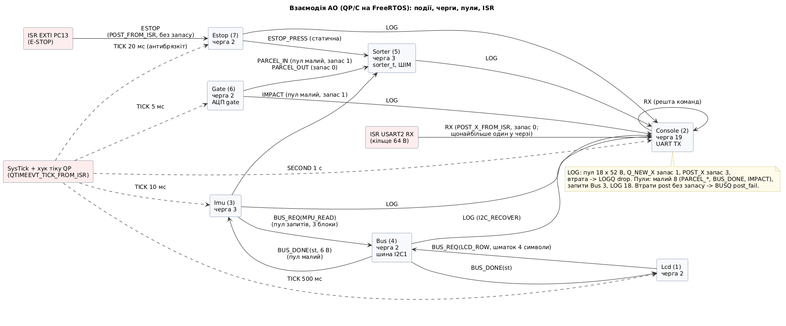
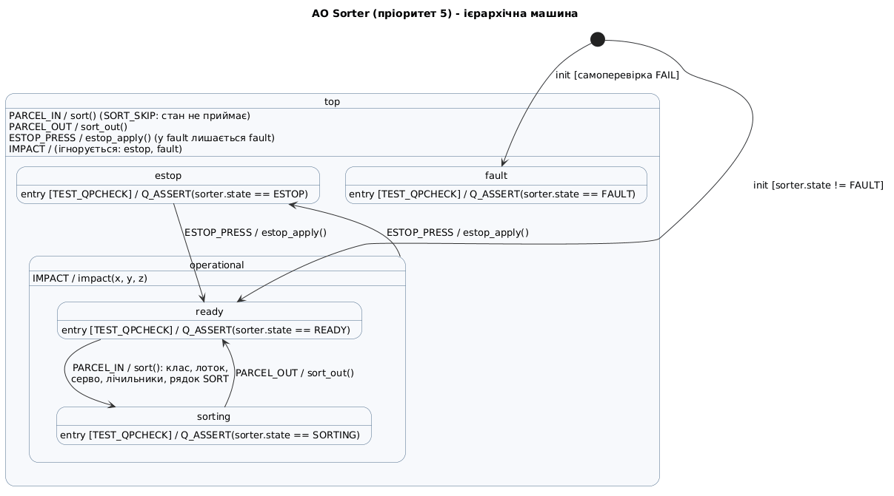
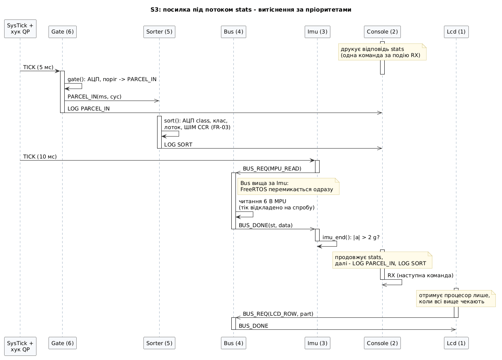
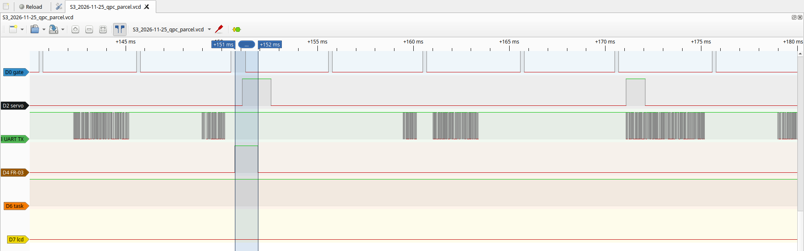

Міністерство освіти і науки України · Національний технічний університет України «Київський політехнічний інститут» · Факультет інформатики та обчислювальної техніки · Кафедра обчислювальної техніки

Лабораторна робота №5 з дисципліни «Системне програмування». Виконав: студент 4 курсу групи ІО-32 Кекух А.О. Перевірив: Гордієнко Н.Ю. 2026

# Лабораторна робота №5

**Активні об'єкти QP/C на FreeRTOS: машини станів, AO-власники ресурсів і порівняння трьох підходів**

**Мета:** реалізувати ті самі вимоги PRD, що в ЛР3 і ЛР4, на QP/C поверх FreeRTOS, з AO замість задач і AO-власниками замість м'ютексів, повторити ті самі вимірювання в тих самих сценаріях і звести фінальну таблицю трьох підходів - super loop, FreeRTOS, QP/C, - щоб числами обрати підхід для цього продукту.

Репозиторій: https://github.com/SPapor/lab1-stm32-sorter

PR-и ЛР5: [#26](https://github.com/SPapor/lab1-stm32-sorter/pull/26), [#27](https://github.com/SPapor/lab1-stm32-sorter/pull/27), [#28](https://github.com/SPapor/lab1-stm32-sorter/pull/28), [#29](https://github.com/SPapor/lab1-stm32-sorter/pull/29), [#30](https://github.com/SPapor/lab1-stm32-sorter/pull/30), [#31](https://github.com/SPapor/lab1-stm32-sorter/pull/31), [#32](https://github.com/SPapor/lab1-stm32-sorter/pull/32)

## 2. Завдання

1. Реалізувати FR-01...FR-10 на QP/C 8.1.6 поверх FreeRTOS V11.3.3 з тим самим командним інтерфейсом і тим самим набором вимірювань.
2. Перетворити кожну задачу ЛР4 на AO з власною машиною станів, кожен спільний ресурс передати AO-власнику; щонайменше одна машина ієрархічна.
3. Дотриматися принципів QP/C: події замість спільних змінних, run-to-completion без блокування, `post` із запасом там, де втрату можна полічити.
4. Повторити всі вимірювання ЛР4 тим самим методом у тих самих сценаріях; виконати сценарії QP/C (методичка 9.3).
5. Звести фінальну таблицю трьох підходів і обґрунтувати вибір.

Форма виконання: B (Wokwi). Усі часи - **симуляційні (сим.)**: Wokwi для VS Code (RFC2217, порт 4000), дії з `tools/wokwi/*.yaml` (кнопки, LDR, акселерометр) - мишею зі скрипта, бо квоти `wokwi-cli` немає. Три прошивки збираються з одного дерева: `make build ARCH=superloop|rtos|qpc LTO=1`, gcc 10.3.1 (образ `stm32-build:gcc10`).

## 3. Розподіл обов'язків

Роботу виконано одноосібно, тож усі ролі - мої.

| № | Роль (методичка, розділ 10) | Зона відповідальності | Артефакти | Відповідальний |
|---|---|---|---|---|
| 1 | Розробка на QP/C | порт QP/C на FreeRTOS, AO і машини станів, AO-власники Bus і Console, ISR, перенесення FR з ЛР4, обхід Wokwi для I²C | `firmware/Active/`, `firmware/Platform/qpc/`, docs/qp-design.md | Кекух А.О. |
| 2 | Моделювання | діаграми станів, взаємодії і послідовності, їхня відповідність коду, таблиця подій, таблиця заміни механізмів ЛР4 | docs/statecharts/, розділи 4.2-4.3 | Кекух А.О. |
| 3 | Метрики | ті самі метрики, що в ЛР4, для трьох прошивок; `post_fail`, `QMAX`, бюджет пам'яті після кожного AO | `App/perf.c`, `tools/stats_table.py`, docs/metrics/lab5/budget/ | Кекух А.О. |
| 4 | Тестування | сценарії 9.1-9.3 у Wokwi, логічний аналізатор, логи трьох прошивок, скрипти миші | `tools/scenarios/`, docs/metrics/lab5/, docs/captures/ | Кекух А.О. |
| 5 | Звіт | фінальна таблиця, перевірка висновків ЛР4, вибір підходу, журнал проблем, відео | docs/comparison.md, docs/journal.md, docs/limitations.md, цей звіт | Кекух А.О. |

## 4. Процес виконання

### 4.1. Журнал роботи

| Дата | Що зроблено | PR |
|---|---|---|
| 23.11 | Крок 1: інвентаризація ЛР4, схема AO (чернетка), бюджет пам'яті за зондом - QP/C у 32 КБ не влазить без рішень | #26 |
| 24.11 | Крок 2: тулчейн gcc 14 і назад на gcc 10 (на gcc 14 rtos ловить пачки тайм-аутів I²C, проблема 79), рішення за бюджетом | #27, #28 |
| 24.11 | Ядро QP/C 8.1.6 (сабмодуль, порт FreeRTOS, `qp_config.h`, BSP, `Q_onError`), ворота `TEST_QSTRESS` | #29 |
| 25.11 | Крок 3: AO по одному - Bus, Estop, Gate, Sorter (ієрархічний), Console; після кожного - збірка і рядок бюджету; розміри черг за виміром `QMAX` | #30 |
| 25.11 | Крок 4: лічильник `post_fail`, S1-S3 трьох прошивок, стеки за S3, 9.3 п. 4-5 | #31 |
| 25.11 | Доробка кроку 4: Lcd шматками, E-STOP у S1-S3 на трьох прошивках, удар, 6.2.x на QP/C, проблема 93 | #32 |

### 4.2. Схема AO

Сім AO, як сім задач ЛР4; пріоритет AO - пріоритет його задачі FreeRTOS (`QF_MAX_ACTIVE` = 7, `configMAX_PRIORITIES` = 8).

| AO | Пріор. | Задача ЛР4 | Чим володіє | Стани | Чому такий пріоритет |
|---|---|---|---|---|---|
| Estop | 7 | `estop` | лінія EXTI PC13 | `armed`, `debouncing` | FR-07: аварійна зупинка не чекає нікого |
| Gate | 6 | `gate` | канал АЦП gate | `clear`, `occupied` | FR-01, FR-03: відлік кожні 5 мс входить у 50 мс FR-03 |
| Sorter | 5 | `sort` + м'ютекс `sorter` | рішення, лічильники, ШІМ серво | `top` -> `operational` (`ready`, `sorting`), `estop`, `fault` | FR-03: від `PARCEL_IN` до CCR |
| Bus | 4 | м'ютекс `i2c` | шина I²C1 | `serving` | вищий за обох клієнтів (Imu 3, Lcd 1), нижчий за тих, хто шину не чіпає |
| Imu | 3 | `imu` | - | `idle`, `reading` | FR-04: період 10 мс, жорсткого дедлайну немає |
| Console | 2 | `cli` + `logger` | передавач UART, рядок команди | `run` | FR-10 і відповіді; один власник UART TX - один AO |
| Lcd | 1 | `lcd` | текст на екрані | `idle`, `drawing` | FR-06: раз на 500 мс, найменш термінове |

Події: `TICK` (одноразова часова подія кожного AO, перезапуск без дрейфу - проблема 86), `ESTOP` (ISR EXTI -> Estop), `ESTOP_PRESS` (Estop -> Sorter), `PARCEL_IN`/`PARCEL_OUT` (Gate -> Sorter), `IMPACT` (Imu -> Sorter), `BUS_REQ` (Imu, Lcd -> Bus; читання MPU або шматок рядка LCD з 4 символів), `BUS_DONE` (Bus -> клієнт), `RX` (ISR USART2 -> Console), `LOG` (усі -> Console), `SECOND` (часова, Console). Пули: малий 8 блоків (`PARCEL_*`, `BUS_DONE`, `IMPACT`), запити до Bus 3 блоки, `LOG` 18 блоків по 52 B. Діаграми (PlantUML, джерела і SVG - docs/statecharts/):

*Рисунок 1 - взаємодія AO: події, черги, пули, ISR*

*Рисунок 2 - ієрархічна машина Sorter*

| AO | Діаграма станів |
|---|---|
| Estop | [estop.svg](statecharts/estop.svg) |
| Gate | [gate.svg](statecharts/gate.svg) |
| Sorter | [sorter.svg](statecharts/sorter.svg) |
| Bus | [bus.svg](statecharts/bus.svg) |
| Imu | [imu.svg](statecharts/imu.svg) |
| Console | [console.svg](statecharts/console.svg) |
| Lcd | [lcd.svg](statecharts/lcd.svg) |

*Рисунок 3 - послідовність S3: посилка під потоком `stats`, витіснення за пріоритетами*

*Рисунок 4 - запис логічного аналізатора, фрагмент S3 на QP/C (`docs/captures/S3_2026-11-25_qpc_parcel.vcd`, вирізка 3,0-3,4 с з повного запису 157 с; PulseView, `~/lr5-video/pv.py`). D3 - UART TX: Console друкує відповідь `stats` пачками, між ними її витісняють вищі AO. На ~150,5 мс крок Gate (D0) довший, ніж звичайно, - 767 мкс проти ~200: вона бачить посилку і шле `PARCEL_IN`. D4 - маркер FR-03, курсори на його фронтах: від `PARCEL_IN` до запису CCR у Sorter - 1,21 мс (як `parcel_latency` 1,2 мс у S3). D2 - ШІМ серво: імпульс 1 500 мкс, наступний (171 мс) уже 1 000 мкс - лоток A. D6 майже весь час 1 (у S3 процесор зайнятий), Lcd (D7) процесора не отримує. Це та сама послідовність, що на рисунку 3: Gate -> Sorter -> ШІМ поверх Console.*

**Sorter - ієрархічна машина.** `ESTOP_PRESS` обробляється в одному місці - у суперстані `operational` (з `ready` і `sorting` - перехід у `estop`); `PARCEL_IN` у станах, де посилку не приймають, - у `top` (`SORT_SKIP`). Стан живе в `App/sorter.c` (його перевіряють хостові тести), стани QP його повторюють; у `TEST_QPCHECK` після кожного переходу `Q_ASSERT`, що стан QP == `sorter.state` (у продукті 0 B). Прогони `SORTER_QPCHECK_*` - без спрацювань.

### 4.3. Таблиця заміни механізмів ЛР4

| ЛР4 | ЛР5 | Примітка |
|---|---|---|
| задача `estop` + сповіщення з EXTI | AO Estop, `QACTIVE_POST_FROM_ISR` без запасу | одна подія на натискання (EXTI вимкнено до кінця антибрязкоту) |
| задача `gate`, `xTaskDelayUntil` 5 мс | AO Gate, одноразова часова подія з перезапуском на `due += period` | без дрейфу, і в черзі щонайбільше один тік (проблема 86) |
| черга `qParcel` (gate -> sort) | `PARCEL_IN`/`PARCEL_OUT` у чергу Sorter, запас 1 / 0, втрата -> `parcel_drop` | |
| м'ютекс `sorter` | стан у `App/sorter.c`, переходи - у Sorter; Lcd і Console читають `sorter_t` під зупинкою планувальника | **виняток**: подію `STATUS` для Lcd і `STATUS_REQ` для Console не зробив |
| м'ютекс `i2c` | AO-власник Bus | інверсії немає: клієнти чекають у черзі Bus, а не на м'ютексі |
| м'ютекс `uart`, задачі `cli` і `logger` | AO Console - один власник UART TX | мінус один стек і м'ютекс |
| черга `qLog` 16 записів | пул `LOG` 18 блоків, `Q_NEW_X` + `POST_X` із запасом 3, втрата -> `LOGQ drop` | у черзі Console завжди лишається місце для `RX` і `SECOND` (проблеми 87, 90) |
| потоковий буфер прийому 64 B | кільце 64 B в ISR + подія `RX` (щонайбільше одна в черзі) | |
| м'ютекс `adc` | зупинка планувальника в `tasks_lock` (АЦП читають і Gate, і Sorter) | **виняток**: АЦП не передано одному AO |
| `xTaskDelayUntil` у `imu`, `lcd` | часові події QP | |
| купа ОС `heap_4` | статичні стеки, черги, пули; купи немає (`HEAP arena=0`) | |

### 4.4. AO-власники ресурсів і перевірка принципів

**Bus** (шина I²C1). Клієнти - Imu (читання 6 байтів MPU) і Lcd (шматок рядка, 4 символи HD44780). Протокол: клієнт шле `BUS_REQ` з `reply_to` і переходить у `reading`/`drawing`; Bus виконує транзакцію (з повторами FR-09 у `i2c_hal`) і шле `BUS_DONE` зі статусом і даними; при помилці клієнт отримує `BUS_DONE` зі статусом помилки, ніхто не зависає (`IMU_ERR`, `LCD_ERR` у 6.2.4). Пріоритет 4 - вищий за обох клієнтів: щойно клієнт шле запит, FreeRTOS перемикається на Bus, тож одночасно існує щонайбільше один `BUS_REQ` (розділ 4.8, п. 5). Очікування Imu на Bus (`bus_wait`) - до 1,4 мс проти до 33,4 мс на м'ютексі `i2c` у ЛР4 (S2) і 64,1 мс на м'ютексі в тій самій прошивці (S3, розділ 4.8).

**Console** (UART TX і рядок команди). Клієнти - усі AO через `LOG`; прийом - ISR USART2 у кільце 64 B і одна подія `RX`. Одна подія `RX` виконує щонайбільше одну команду, решту Console шле собі (проблема 90: інакше під потоком `stats` крок тривав десятки секунд).

**Перевірка принципів (методичка 4.4).** AO не блокується в обробниках: в `Active/` немає `vTaskDelay`, очікування черги чи м'ютекса. Винятки: (1) `sorter_t` і АЦП спільні під зупинкою планувальника (розділ 4.3); (2) транзакція I²C у Bus - блокувальний виклик HAL до 5 мс (з тайм-аутом), бо драйвер з ЛР2 синхронний; на час спроби тік відкладається (обхід Wokwi, обмеження 11).

### 4.5. Методика

Ті самі сценарії, скрипти і метрики, що в ЛР4 (`tools/run_scenario.py`, `tools/stats_table.py`), ті самі ручки (`lcd_ms=500 imu_ms=10 log=2`), `LTO=1 PERF=1`. Усі три прошивки переміряні 25.11 на тому самому стенді; код super loop і FreeRTOS з ЛР4 не мінявся (крім `help` одним рядком і беззнакового ділення в гістограмі - однаково в трьох). E-STOP у S1 і S2 - окремі прогони тих самих сценаріїв з 30 натисканнями (`S1E`, `S2E`). Логи і відповідність хешів - docs/metrics/lab5/README.md.

У продукті QP/C - `Q_UNSAFE` (без перевірок QP, інакше flash не влазить, обмеження 10); перевірки - окремою збіркою `TEST_QPCHECK=1 PERF=0`. Втрати `post` без запасу (у продукті вони мовчазні) рахує `BUSQ post_fail=` - у всіх прогонах після проблеми 90 він 0.

### 4.6. Фінальна порівняльна таблиця

Джерело - docs/metrics/lab5/results.md, розділ 1 (там же - перелік логів для кожної колонки).

| Метрика | Сценарій | super loop | FreeRTOS | QP/C | Різниця QP/C - FreeRTOS | Вимога PRD | Хто кращий |
|---|---|---|---|---|---|---|---|
| FR-03: поява посилки -> ШІМ (оцінка), max | S2 | 81,50 мс | 26,26 мс | 34,37 мс | +8,11 мс | ≤ 50 мс | FreeRTOS ≈ QP/C |
| FR-03: поява посилки -> ШІМ (оцінка), max | S3 | 233,00 мс | 29,00 мс | 35,04 мс | +6,04 мс | ≤ 50 мс | FreeRTOS ≈ QP/C (super loop - не виконана) |
| PARCEL_IN -> запис CCR, max | S2 | 3,02 мс | 0,94 мс | 1,24 мс | +0,30 мс | частина FR-03 | FreeRTOS |
| посилок оброблено | S2 | 30 з 30 | 30 з 30 | 30 з 30 | 0 | кожна | ≈ |
| E-STOP: фронт PC13 -> реакція, max (зараховано з 30) | S1 | 41,21 мс (30) | 20,57 мс (30) | 28,83 мс (30) | +8,26 мс | не задано (FR-07) | FreeRTOS |
| E-STOP: фронт PC13 -> реакція, max (зараховано з 30) | S2 | 39,59 мс (26) | 20,29 мс (28) | 22,39 мс (26) | +2,10 мс | не задано (FR-07) | FreeRTOS ≈ QP/C |
| E-STOP: фронт PC13 -> реакція, max (зараховано з 30) | S3 | 91,30 мс (22) | 20,34 мс (24) | 29,27 мс (24) | +8,93 мс | не задано (FR-07) | FreeRTOS |
| E-STOP: медіана | S1 / S2 / S3 | 19,5 / 19,6 / 19,6 мс | 19,7 / 19,8 / 19,8 мс | 20,8 / 21,1 / 20,7 мс | +1 мс | - | FreeRTOS ≈ QP/C |
| gate: джитер старту, max | S1 | 38,53 мс | 0,32 мс | 0,88-7,85 мс * | +0,56...7,53 мс | ≤ 22,4 мс | FreeRTOS |
| gate: джитер старту, max | S2 | 53,48 мс | 0,33 мс | 8,13 мс * | +7,80 мс | ≤ 22,4 мс | FreeRTOS |
| gate: джитер старту, max | S3 | 204,98 мс | 3,07 мс | 8,78 мс * | +5,71 мс | ≤ 22,4 мс | FreeRTOS |
| gate: пропуски | S1 / S2 / S3 | 188 / 280 / 287 | 0 / 0 / 0 | 0-1 / 1 / 1 | +1 | 0 | FreeRTOS |
| imu: джитер старту, max | S1 | 33,08 мс | 0,32 мс | 8,87-10,00 мс | +8,6 мс | - | FreeRTOS |
| imu: пропуски (інтервал > 2 періодів) | S1 / S2 / S3 | 127 / 237 / 243 | 0 / 0 / 0 | 0 / 0 / 1 | +1 | - | FreeRTOS ≈ QP/C |
| imu: пропущені тіки (`BUSQ skip`) | S1 / S2 / S3 | - | - | 2-127 / 25 / 2 | - | - | - |
| удар 0,3 с, посилка в брак | удар | 3 з 3 | 2 з 3 ** | 3 з 3 | +1 | кожен (FR-04, FR-05) | super loop ≈ QP/C |
| перемальовка LCD, max | S1 | 37,34 мс | 95,69 мс | 98,86-129,79 мс | +3,2...34,1 мс | - | super loop |
| LCD у S3: перемальовок за 60 с / найдовша | S3 | 130 / 37,38 мс | 7 / 1 987 мс | 6 / 130 мс | - | - | super loop |
| команда -> відповідь, p99 | S1 | 175,55 мс | 439,69 мс | 616,55 мс | +176,9 мс | - | super loop |
| `uart_rx` (команда + відповідь), max | S3 | 194,47 мс | 973,33 мс | 779,26 мс | -194,1 мс | - | super loop |
| UART: загублено байтів | S3 | 68 | 3 | 25 | +22 | 0 | FreeRTOS |
| журнал: втрачено рядків (`LOGQ drop`) | S3 | - (без черги) | 1 201 | 33 | -1 168 | 0 | QP/C |
| втрати `post` без запасу (`post_fail`) | усі прогони | - | - | 0 | - | 0 | - |
| `I2C_RECOVER` | S1 / S2 / S3 | 0 / 0 / 0 | 0 / 18 / 77 | 23-30 / 9 / 36 | +23 (S1) | - | super loop |
| найдовша транзакція I²C | S1 | 0,71 мс | 0,82 мс | 1,85-11,20 мс * | - | - | super loop |
| LOAD у простої, медіана | S1 | 19 % | 37 % | 56 % (без обходу Wokwi - 37 %, розділ 2а) | +19 п. п. | - | super loop |
| LOAD, max | S3 | 55 % | 100 % | 100 % | 0 | - | super loop |
| flash (чисті збірки) | - | 21 228 B | 31 556 B | 32 404 B (`11d8512`) | +848 B | ≤ 32 768 B | super loop |
| RAM статично | - | 2 976 B | 11 328 B | 11 184 B (`11d8512`) | -144 B | ≤ 12 288 B | super loop |
| стек задач / AO: зарезервовано / використано | S3 | - | 4 480 / 3 452 B | 4 016 / 3 100 B | -464 / -352 B | - | QP/C (серед двох з ОС) |
| стек MSP: зарезервовано / використано | S3 | 1 024 / 672 B | 1 024 / 616 B | 1 024 / 584 B | -32 B | - | ≈ |

\* джитер gate, E-STOP і довжина транзакції I²C у QP/C - з приміткою обмеження 11 (розділ 4.10): тік ядра відкладається на час спроби I²C (обхід моделі I²C Wokwi), а спроба з NACK від MPU (проблема 91) триває ~3,9 мс, з повторами - до 11 мс. На залізі обходу немає.

\*\* FreeRTOS у сценарії удару: з 6,26 с після старту читання MPU раз у раз втрачає байт (`I2C_RECOVER ... err=0x20 isr=0x23`), один удар з трьох не зараховано; у S1 і S2 FreeRTOS такого немає.

**E-STOP у S3 і «н/в» у ЛР4.** У звіті ЛР4 E-STOP у S3 позначено «н/в» з поясненням, що під потоком `stats` Wokwi отримує натискання пачками. Це пояснення хибне: втрати давав мій скрипт миші, який при відставанні розкладу пропускав паузу «тримати 150 мс» (журнал, проблема 92). Після виправлення S3 мишею дає 22-24 зарахованих натискання з 30 на всіх трьох прошивках, і рядки E-STOP цієї таблиці закривають пропуск ЛР4.

**Чому LOAD і «команда -> відповідь» у QP/C гірші.** Секції обходу PRIMASK для Wokwi (`SIMCRIT`, ціна однієї секції - `TEST_CRITCOST` ЛР4):

| Прошивка | Секцій задач за секунду | Секцій ISR за секунду | Обхід, % процесора | LOAD, медіана | LOAD без обходу |
|---|---|---|---|---|---|
| FreeRTOS (`1049`) | 1 770 | 985 | 4,0 % | 37 % | 33,0 % |
| QP/C (`1043`) | 5 848 | 6 539 | 17,9 % | 52 % | 34,1 % |
| QP/C, шматки LCD (`1213`) | 6 379 | 6 614 | 18,7 % | 56 % | 37,3 % |

З 19 п. п. різниці LOAD у простої 14,7 - обхід симулятора: хук тіку QP 1 000 разів на секунду проходить по 8 часових подіях з критичною секцією на кожну. «Команда -> відповідь» (p99 - це `stats`, ~40 рядків) довша, бо Console витісняють AO вище неї: Gate + Bus + Imu - 50 % процесора проти 24 % над `cli` у FreeRTOS; різницю дає Bus, який тепер малює LCD з пріоритетом вищим за Console. Розбір з подіями за секунду по кожному AO - results.md, розділ 2а.

### 4.7. Сценарії 6.2.x на QP/C

Колонки super loop і FreeRTOS - з ЛР4 (19-22.11, той самий код).

| Метрика | Сценарій | super loop (ЛР4) | FreeRTOS (ЛР4) | QP/C | Вимога | Лог QP/C |
|---|---|---|---|---|---|---|
| gate: джитер / пропуски, `lcd_ms=100` | 6.2.1 | 43,26 мс / 333 | 0,32 мс / 0 | 2,70 мс / 0 * | ≤ 22,4 мс | `6.2.1_2026-11-25_1356.log` |
| LOAD, `lcd_ms=100`, медіана | 6.2.1 | 46 % | 84 % | 74 % | - | там само |
| LCD при `lcd_ms=100` | 6.2.1 | - | - | перемальовка до 115 мс > 100 мс, 56 пропусків Lcd | - | там само |
| E-STOP під довгою операцією: max, зараховано | 6.2.2 | 55,2 мс, 39 з 40 | 20,6 мс, 40 з 40 | 29,2 мс, 40 з 40 * | - | `6.2.2_2026-11-25_1413.log` |
| команд з паузами 0,5 с, пройшло | 6.2.3 | 13 з 20 | 20 з 20 | 18 з 20 | - | `6.2.3_2026-11-25_1358.log` |
| команд без пауз, пройшло | 6.2.3 | 1 з 50 і 1 з 50 | 11 і 10 з 50 | 7 і 7 з 50 | - | там само |
| байтів прийнято / загублено в кільці 64 B | 6.2.3 | - | 915 / 544 | 856 / 500 | - | там само |
| відмова I²C (`TEST_I2C_FAULT`, `sda_gnd` 2 с): gate джитер / пропуски | 6.2.4 | 112,06 мс / 125 | 1,44 мс / 0 | **30,40 мс / 130** * (`11d8512`); після `3c6ca79` - 28,90 мс / 4; після `f5c700e` - 5,45 мс / 1; після `5c96530` (рев'ю) - **8,46 мс / 1** | ≤ 22,4 мс | `6.2.4_2026-11-25_1415.log`, `_1543`, `_1550`, `_1955` |
| те саме: найдовша транзакція I²C, після відпускання | 6.2.4 | - | - | 96,1 мс; шина ожила (`i2c_ok`), `post_fail=0` | FR-09 | там само |
| точка зламу за LOAD | 6.2.5 | `lcd_ms=32` | `lcd_ms=50` | `lcd_ms=50` (LOAD 100 %), gate ≤ 1,3 мс, 0 пропусків | - | `6.2.5_2026-11-25_1359.log` |
| `imu_ms=5` / `2` / `1` | 6.2.5 | - | - | пропусків imu 209 / 1 860 / 3 617, gate ≤ 1,9 мс | - | там само |
| перший вимір gate / class / imu / lcd | 6.2.7 | 173,0 / 177,6 / 234,4 / 760,7 мс | 176,1 / 180,8 / 252,4 / 818,8 мс | 133,9 / 138,5 / 211,5 / 802,3 мс | - | `6.2.7_2026-11-25_1413.log` (`STARTUP`) |
| READY (`STATE`) від скидання | 6.2.7 | 222 мс | 226 мс | 184 мс | ≤ 500 мс | `6.2.7_2026-11-25_1523.log` |
| старт без MPU (FR-08) | 6.2.7-fault | `FAULT` на 201 мс (ЛР4) | `FAULT` на 203 мс (ЛР4) | `FAULT reason=MPU_NOT_FOUND` на 208 мс, LCD «FAULT: MPU not found», консоль жива (`status` - `fault=MPU_NOT_FOUND`), gate 0,52 мс | FAULT з причиною | `6.2.7-fault_2026-11-25_qpc.log` |
| купа за годину | 6.2.6 | 436 / 436 B (newlib) | купа ОС 6 944 / 6 944 B | `HEAP arena=0` (купи немає: пули й стеки статичні) | не росте | `6.2.6_2026-11-25_1417.log` |
| стеки AO за годину: найбільше використано | 6.2.6 | MSP 944 B, сталий | сталий у 60 замірах | за 60 замірів виросли лише Console 692 -> 720 з 832 B і Bus 580 -> 588 з 712 B, решта без змін, `overflow=0` | - | там само |
| gate / imu: джитер max, пропуски за ~65 хв | 6.2.6 | 76,10 / 72,47 мс, 11 213 / 7 981 | 1,00 / 3,59 мс, 0 / 0 | 8,49 / 10,81 мс, 10 / 6 * | ≤ 22,4 мс | `6.2.6-end_2026-11-25_1522.log` |
| LOAD за годину, медіана / max | 6.2.6 | 19 / 25 % | 36 / 44 % | 56 / 94 % | - | `6.2.6_2026-11-25_1417.log` |
| `I2C_RECOVER` за годину | 6.2.6 | 126 | 0 | 584 (пачки кожні ~48 с, проблема 91) | - | там само |
| `parcel_latency` після години, `post_fail` | 6.2.6 | 3,19-3,34 мс | 0,88-0,91 мс | 1,20-1,22 мс, 0 | ≤ 50 мс | `6.2.6-end_2026-11-25_1522.log` |

\* з приміткою обмеження 11.

### 4.8. Сценарії 9.3

**П. 3 (довгий RTC-крок)** виявився сам у першому S3 (проблема 90): обробник `RX` виконував команду за командою, поки в буфері були байти, і під потоком `stats` не виходив з одного кроку десятки секунд. Console при цьому не блокувалась, але `SECOND` губилися (`post_fail=51`), а журнал втратив 314 рядків. Після «одна команда за подію» - 0 і 0.

**П. 4 (переповнення черги)** - `TEST_Q93=estop/estopx`: брязкіт кнопки E-STOP (до ~200 фронтів на натискання), кожен фронт - `post` з ISR у чергу Estop на 2 місця. Без запасу (`QACTIVE_POST_FROM_ISR`) - `FATAL qp qf_port 630` на першому натисканні; із запасом 1 і лічильником - без `FATAL`, 74-90 втрачених фронтів на натискання. Яку поведінку обрано для кожного сигналу - таблиця в docs/qp-design.md («Сценарії 9.3 п. 4 і 5»): без запасу - `ESTOP`, `ESTOP_PRESS`, `BUS_*`, тіки (втрата неприпустима або неможлива за пріоритетами); із запасом і лічильником - `LOG`, `PARCEL_IN`, `IMPACT`, `RX`.

**П. 5 (вичерпання пулу)** - `TEST_Q93=pool/poolx`, пул запитів до Bus з 1 блоку. З пріоритетами продукту - жодної відмови за 25 с: Bus вища за клієнтів і звільняє подію раніше, ніж клієнт знову отримає процесор. Лише опустивши Bus нижче за клієнтів (Bus 1, Lcd 4): `Q_NEW` - `FATAL qp qf_dyn 630` на 0,66 с; `Q_NEW_X` із запасом 0 - ~10 відмов за секунду, клієнти отримують `BUS_DONE` з помилкою, ніхто не зависає. `Q_NEW_X_FROM_ISR` у продукті не потрібен: ISR шлють лише статичні події.

**Сценарії 9.2 і 9.3 п. 1, 2, 6, 7, 8** - тестові збірки `TEST_L5=<варіант>` (`2fd84df` і далі; продукт не змінено, у тестових збірках вимкнено `hist`, у `mutex` ще й рядки `TASK` і `SIMCRIT`, щоб влізти у flash). Порівняння - з продуктом того самого коду в той самий день.

| Сценарій | Що зроблено | Результат | Лог |
|---|---|---|---|
| 9.3 п. 1, м'ютекс проти AO-власника (S3; потік `stats` - це й конфігурація інверсії: Console з пріоритетом 2 між Lcd 1 і Imu 3) | `mutex`: Imu і Lcd ходять у шину самі під м'ютексом FreeRTOS, Lcd тримає його до кінця перемальовки (як `logger` у ЛР4) | очікування шини Imu max **64,1 мс** проти **1,3 мс** з Bus; джитер imu 55,6 проти 9,2 мс; пропусків imu 127 проти 0; але LOAD 45 % проти 100 % і 128 перемальовок LCD проти 3 - без подій через Bus процесор вільніший. Стек: без AO-власника драйвер I²C працює в стеках Imu і Lcd, з продуктовими 464 B обидві впали (`FATAL stack overflow in imu`, `... in lcd`), довелося 712 B, як у Bus | `L5_mutex_S3_2026-11-25_2052.log`, `S3_2026-11-25_2014.log` |
| 9.3 п. 2, блокування в обробнику Bus | `busblock`: `vTaskDelay(5 мс)` в обробнику `BUS_REQ` (S1) | очікування шини Imu до 14,9 мс (продукт 0,42 мс), 359 пропусків imu (продукт 0), `BUSQ skip=882`; gate не постраждала (0,36 мс) - вона вища за Bus | `L5_busblock_S1_2026-11-25_2004.log`, `S1_2026-11-25_1956.log` |
| 9.3 п. 2, блокування в обробнику Console | `logblock`: `vTaskDelay(1 мс)` на кожен `LOG` (S2) | у S2 рядків мало (~1 на секунду): черга не росла (`LOGQ max_used=4`, `drop=0`), `post_fail=0`; але Imu частіше пропускала тік (`skip=188` проти 25). FreeRTOS це дозволяє, бо для неї Console - звичайна задача; модель AO порушена: поки обробник спить, черга Console не розбирається | `L5_logblock_S2_2026-11-25_2025.log`, `S2_2026-11-25_1258.log` |
| 9.3 п. 6, неочікувана подія | `late`: Bus на кожне читання MPU шле Imu два `BUS_DONE` (S1) | 6 161 запит, 6 136 оброблених читань (`STAT imu n`), тобто кожен другий `BUS_DONE` прийшов у `idle` і там відкинувся: в `imu_idle` немає гілки для `BUS_DONE`, подія йде в `QHsm_top` і ігнорується (діаграма `imu.svg`). У super loop з прапорцем «відповідь готова» запізніла відповідь стала б відповіддю на наступний запит | `L5_late_S1_2026-11-25_2007.log` |
| 9.3 п. 7, відмова сенсора під час S2 | `sensor`: читання MPU з 30,0 до 32,0 с повертає помилку без звернення до шини | перший `IMU_ERR` - на 30,002 с, далі щоперіоду (200 за 2 с); відновлення - перше вдале читання на 32,003 с (`L5_SENSOR ok after=200`), тобто через 3 мс після кінця відмови. Стану `fault` у Imu немає (FR цього не вимагають): вона щоперіоду пробує знову. Інші AO не постраждали: 30 з 30 посилок, gate 7,6 мс, `post_fail=0` | `L5_sensor_S2_2026-11-25_2047.log` |
| 9.3 п. 8, збій шини | 6.2.4 (SDA на землі 2 с, `TEST_I2C_FAULT`) | Bus не зависає: кожен клієнт одразу отримує `BUS_DONE` з помилкою (`IMU_ERR`, `LCD_ERR`), після відпускання шина ожила (`i2c_ok`); gate 8,46 мс. Стану `fault` у Bus немає - вона просто відповідає помилкою на кожен запит | `6.2.4_2026-11-25_1955.log` |
| 9.2, переповнення стека | `stack`: стек gate 280 B при виміряних 404 B | `FATAL stack overflow in gate` на 19,3 с від старту без жодних дій, далі прошивка стоїть (хук `configCHECK_FOR_STACK_OVERFLOW 2` спрацював) | `L5_stack_boot_2026-11-25.txt` |
| 9.2, голодування | `starve`: Gate (пріоритет 6) з 30 до 35 с безперервно шле подію собі (S1) | 5 с без нижчих AO: джитер imu 4,99 с, з 27,2 до 36,2 с жодного рядка `LOAD` від Console; Gate - 191 ‰ процесора за вікно; після 35 с усе відновилось само | `L5_starve_S1_2026-11-25_2009.log` |
| 9.2, частота тіку 1000 і 200 Гц | `TICK_HZ=200` (S1) | LOAD 51 % проти 56 %: секцій обходу в ISR 131 924 проти 416 625 (хук тіку QP 200 разів на секунду); gate 0,46 мс, imu 5,7 мс проти 0,61 і 3,7 мс - роздільність часових подій 5 мс | `L5_tick200_S1_2026-11-25_2012.log`, `S1_2026-11-25_1956.log` |
| 9.2, інверсія пріоритетів | у QP/C м'ютекса на шині немає; конфігурація інверсії - рядок 9.3 п. 1 | - | - |
| 9.2, вичерпання черги і heap | п. 4 і 5 вище | - | - |

### 4.9. Метрики QP/C

| Метрика | Значення | Звідки |
|---|---|---|
| завантаження за AO, S1 (‰) | Gate 127, Bus 311, Imu 99, Console 15, Lcd 8, Estop 0, Sorter 0, IDLE 440 | `S1_2026-11-25_1213.log` |
| стеки AO: зарезервовано / найбільше використано (S1-S3, E-STOP, посилки в ESTOP, удар, 6.2.6) | estop 408/268, gate 504/404, sort 632/528, bus 712/588, imu 464/364, console 832/728, lcd 464/356 B; найменший запас 100 B | docs/qp-design.md, «Стеки і черга Console за S3»; results.md |
| черги AO: місць / найбільше заповнення (`QMAX`, `TEST_QPCHECK`) | estop 2/1, gate 2/1, sort 3/1, bus 2/1, imu 3/2, console 19/3, lcd 2/1 | `QMAX_mouse_2026-11-25_4531642.txt` |
| пули: найменше вільних (`QF_getPoolMin`) | малий 5 з 8, запити Bus 2 з 3, `LOG` 1 з 18 (S3, `max_used=17`) | `Q93_pool_81fdcbac.txt`, `S3_2026-11-25_1313.log` |
| очікування ресурсу (шина) | `bus_wait` max 1,4 мс (S1-S3) проти 33,4 мс на м'ютексі `i2c` у ЛР4 (S2) | results.md, docs/qp-design.md («AO Bus») |
| втрати `post` без запасу | 0 у всіх прогонах після проблеми 90 | `BUSQ post_fail=` |

### 4.10. Пам'ять і обмеження ЛР5

Бюджет - рядок після кожної зміни, docs/qp-design.md. Кінцеве: **flash 32 548 з 32 768 B (вільно 220 B), RAM 11 192 з 12 288 B** (`f5c700e`); FreeRTOS - 31 556 / 11 328 B, super loop - 21 228 / 2 976 B.

**Обмеження 10: повний QP/C з перевірками і вимірюваннями не вміщається в 32 КБ.** Продукт зібрано з `Q_UNSAFE`: помилки, що мали б зупинити прошивку з `FATAL qp <модуль> <номер>`, у продукті стають тихими втратами (їх рахує `post_fail`) або HardFault (`Q_NEW` у порожній пул). Перевіряю окремою збіркою `TEST_QPCHECK=1 PERF=0`.

**Обмеження 11: джитер gate у QP/C - від обходу моделі I²C Wokwi, а не від QP.** Модель I²C у Wokwi губить байт, якщо транзакцію перервати (проблеми 81, 86), тож тік ядра на час спроби I²C відкладається (`port_sim_tick_hold`), а з ним і часові події QP. Спроба з NACK від MPU - ~3,9 мс, тож gate у QP/C - 0,9-8,8 мс проти 0,3-3,1 мс у FreeRTOS. Порівнювати джитер gate і E-STOP з FreeRTOS - лише з цією приміткою; на залізі (`SIM_CRIT=0`) тік не тримається взагалі.

**Обмеження 12: відмова шини I²C у QP/C зупиняла тік до ~30 мс.** У 6.2.4 (SDA на землі 2 с, `TEST_I2C_FAULT`) спроба до відсутнього пристрою або при затиснутій SDA - тайм-аут HAL і очікування STOPF до 25 мс під утриманням тіку: gate 30,4 мс і 130 пропусків. Тепер тік не тримається, поки шина затиснута, і для адреси, де спроба впала з тайм-аутом і NACK або BUSY, до першої вдалої транзакції на неї (проблема 93): **8,46 мс і 1 пропуск**, вимога ≤ 22,4 мс виконана. Під утриманням лишається по одній спробі на кожен пристрій на початку відмови (~8-10 мс).

### 4.11. Метрики складності (методичка 8.5)

| Метрика | super loop | FreeRTOS | QP/C | Як рахував |
|---|---|---|---|---|
| рядків коду, специфічних для ARCH | 56 (`Platform/superloop/`) | 1 637 (`Tasks/sorter_tasks.*`, `Platform/rtos/rtos_hal.*`, `rtos_diag.c`, `FreeRTOSConfig.h`) | 1 696 (`Active/sorter_ao.c` 891, `Tasks/sorter_tasks.h`, `Platform/rtos/rtos_hal.*`, `rtos_diag.c`, `Platform/qpc/*`) + 193 у `main.c` | `wc -l`; у `sorter_ao.c` є й код тестових збірок (`TEST_QPCHECK`, `TEST_Q93`) |
| станів (із суперстанами) | неявні: `sorter.state` (4) і прапорці `parcel_pending`, `estop_pending`, `lcd_pending` | ті самі 4 стани `sorter_t` + стани задач ОС | 16: Estop 2, Gate 2, Sorter 6 (`sorter_top`, `operational`, `ready`, `sorting`, `estop`, `fault`), Bus 1, Imu 2, Console 1, Lcd 2 | функції `QState` у `sorter_ao.c` |
| переходів між станами (без початкових і внутрішніх) | неявні | неявні | 12 (`Q_TRAN(` - 20, з них 8 початкових в `ao_initial`) | `grep Q_TRAN(` |
| м'ютексів і семафорів у прикладному шарі | 0 | 4 м'ютекси (АЦП, I²C, сортувальник, UART) | 0 | `xSemaphoreCreate*` |
| інших об'єктів синхронізації | 2 `volatile` | 2 черги, потоковий буфер, сповіщення | 7 черг AO і 3 пули подій (QP); зупинка планувальника для `sorter_t` і АЦП (`tasks_lock`); утримання тіку на спробу I²C (лише Wokwi) | код `Tasks/`, `Active/` |
| змінних, спільних для кількох задач / AO або AO і ISR | `parcel_pending`, `estop_pending` + ручки | `sorter_t`, АЦП, шина I²C, UART, буфер прийому, `estop_pending`, ручки `set`, `log_level` | `sorter_t` (Sorter, Lcd через `lcd_format`, Console через `status`/`reset`), АЦП (Gate і Sorter), кільце прийому і `rx_posted` (ISR і Console), `estop_pending` (ISR і Estop), ручки `set` і `log_level` (Console пише, AO читають), лічильники (`count`) | за кодом |
| місць у коді для нової періодичної задачі / AO | 7 | 11 у 3 файлах | 14 у 4 файлах: `sorter_ao.c` - 8 (`T_` у переліку, рядок `task_def`, масив стека, рядок у `stk[]`, масив черги, рядок у `qsto[]`, функція стану, гілка в `ao_initial`), `sorter_tasks.h` - 2 (робота і ручка періоду в `tasks_ops_t`), `main.c` - 3 (функція роботи, два присвоєння в `task_ops`), `qp_config.h` - 1 (`QF_MAX_ACTIVE`); +1 (`configMAX_PRIORITIES`), якщо пріоритет вищий за 7 | за додаванням AO Lcd |

### 4.12. Статус FR

| FR | super loop | FreeRTOS | QP/C |
|---|---|---|---|
| FR-01 виявлення посилки | виконана (S2 30 з 30) | виконана (S2 30 з 30) | виконана (S2 30 з 30, 6.2.6 8 з 8) |
| FR-02 клас A / B / UNKNOWN | виконана | виконана | виконана (S2: 10 A, 10 B, 10 REJECT) |
| FR-03 заслінка ≤ 50 мс | не виконана в S3 (233 мс) | виконана (S3 29,0 мс) | виконана (S3 35,0 мс) |
| FR-04 удар > 2 g | виконана (3 з 3) | з обмеженням: 2 з 3 у сценарії удару (втрати байтів MPU) | виконана (3 з 3) |
| FR-05 брак: удар або UNKNOWN | виконана | виконана | виконана |
| FR-06 лічильники на LCD | виконана | виконана; у S3 перемальовка до 2 с | виконана; у S3 6 перемальовок за 60 с (Lcd найнижча) |
| FR-07 E-STOP | виконана, до 91 мс у S3 | виконана, 20,3-20,6 мс | виконана, медіана 21 мс, до 29 мс (обмеження 11); 6.2.2 40 з 40 |
| FR-08 самоперевірка, FAULT | виконана | виконана | виконана: READY 184 мс, без MPU `FAULT reason=MPU_NOT_FOUND` на 208 мс, консоль жива |
| FR-09 відновлення I²C | виконана | виконана (6.2.4) | виконана (6.2.4: шина ожила, `i2c_ok`) |
| FR-10 рядок на кожну подію | виконана | з обмеженням: S3 - 1 201 втрачений рядок | з обмеженням: S3 - 33, 6.2.4 - 305 втрачених рядків, усі пораховані (`LOGQ drop`) |

### 4.13. Проблеми та їх вирішення

Повний журнал ЛР5 - docs/journal.md, проблеми 71-93. Тут - сім, що найбільше вплинули на результат; п'ять із них специфічні для QP/C (84, 86, 87, 90, 93).

**Проблема 84: з `Q_UNSAFE` Imu назавжди застрягла в `reading`.** Симптом: `STAT imu n=0`, жодного `FATAL`. Причина: черга Imu на 2 місця, поки Imu чекає `BUS_DONE`, приходять тіки, і `BUS_DONE` уже нема куди класти; з перевірками це був би `Q_onError`, з `Q_UNSAFE` подія мовчки губиться. Фікс (`dcd83e9`): більші черги і сторож; висновок - з `Q_UNSAFE` потрібен лічильник мовчазних втрат (з'явився на кроці 4 як `post_fail`).

**Проблема 86: з перевірками QP Gate падала на переповненні черги тіків.** Симптом: `TEST_QPCHECK=1 PERF=0` - `FATAL qp qf_port 630` через 1,7-8,2 с. Причина: тік з хука QP у чергу Gate на 2 місця, а Bus 12 мс тримала `LOCK(I2C)`. Фікс (`6de5913`, `959cf53`): тіки Gate, Imu і Lcd - одноразові часові події з перезапуском без дрейфу (у черзі щонайбільше один тік), транзакція I²C - під `port_sim_tick_hold`, а не під зупинкою планувальника.

**Проблема 87: Console могла назавжди перестати приймати команди.** Знайдено рев'ю: після злиття `cli` і `logger` в один AO черга одна, а запаси лишились від двох окремих черг, і журнал міг зайняти місце `RX`. Фікс (`0f69f8e`): черга 19 місць, `LOG` із запасом 3.

**Проблема 90: у S3 губилися `SECOND` (`post_fail=51`), журнал втратив 314 рядків.** Причина - довгий RTC-крок: обробник `RX` виконував команду за командою, не виходячи з кроку. Дві гіпотези (застарілі `RX`, гонка в порту QP) я перевірив тимчасовими лічильниками і відкинув. Фікс (`8652507`): одна команда за подію, решту Console шле собі. Лічильник `post_fail` окупився з першого S3.

**Проблема 91: NACK від MPU пачками кожні ~48 с, лише в QP/C.** У S1, S2, S3 і за годину 6.2.6 - пачки `I2C_RECOVER err=0x04` на 54, 102, 150 с від старту; у FreeRTOS - жодного. Гіпотеза - биття двох періодичних процесів; апаратні годинники виключено (TIM17 і SysTick з 48 МГц без залишку). Не виправлено, вплив - обмеження 11.

**Проблема 92: E-STOP мишею під потоком `stats` - помилка скрипта, а не симулятора.** Див. розділ 4.6: це виправлення висновку звіту ЛР4.

**Проблема 93: при відмові I²C тік у QP/C стояв до 30 мс (6.2.4).** Три спроби виправлення: перевірка BUSY (не спрацювала після переініціалізації периферії), рівень SDA (у Wokwi читається хибно - 612 `I2C_RECOVER` у звичайному S1), «затиснута шина» з однією поганою адресою (28,9 мс). Четверта - гіпотеза з логу: одна комірка «поганої» адреси, яку перезаписувала 0x68. Фікс (`f5c700e`, `5c96530`): адреса позначається одразу після першої такої спроби, 4 комірки без витіснення; 6.2.4 - 8,46 мс. HAL не змінював.

### 4.14. Перевірка висновків ЛР4 (методичка 9.5)

#### Висновок 1 з ЛР4: gate і imu не залежать від довгих операцій
Що було в ЛР4: джитер gate 0,32 мс, imu 0,32 мс, 0 пропусків у S1 (`docs/metrics/lab4/S1_2026-11-19_1903.log`).
Механізм QP/C: часові події з перезапуском без дрейфу, пріоритети AO.
Результат: ЛР4 = 0,32 / 0,32 мс; ЛР5 = gate 0,88-7,85 мс, imu 8,9-10,0 мс, пропусків 0 (S1, три прогони, `S1_2026-11-25_1209/1211/1213`).
Вердикт: не змінилась за пропусками; джитер у Wokwi гірший - від утримання тіку на спробу I²C (обмеження 11), а не від QP.
Ціна: обхід моделі I²C Wokwi.

#### Висновок 2 з ЛР4: E-STOP за 20 мс навіть під довгою операцією
Що було в ЛР4: 6.2.2 - 40 з 40, 19,3-20,6 мс.
Механізм QP/C: AO Estop з найвищим пріоритетом, подія з ISR, часова подія антибрязкоту.
Результат: ЛР4 = 20,6 мс, ЛР5 = 29,2 мс, 40 з 40 (`6.2.2_2026-11-25_1413.log`); медіана в S1-S3 21 мс проти 20.
Вердикт: не змінилась (викиди - обмеження 11).
Ціна: -

#### Нова проблема ОС з ЛР4: інверсія пріоритетів на шині
Що було в ЛР4: очікування `imu` на м'ютексі `i2c` до 33,4 мс у S2 (`S2_2026-11-22_1640.log`), семафор замість м'ютекса - 121,9 мс (`INVERSION_sem_2026-11-19.log`).
Механізм QP/C: AO-власник Bus з пріоритетом вищим за клієнтів.
Результат: ЛР4 = 33,4 мс, ЛР5 = `bus_wait` до 1,4 мс (S1-S3); порівняння в тій самій прошивці - розділ 4.8, п. 1.
Вердикт: зменшилась.
Ціна: подія на кожен запит (LOAD), шматки LCD (8 запитів на перемальовку).

#### Нова проблема ОС з ЛР4: голодування нижчих пріоритетів
Що було в ЛР4: 6.2.5 `imu_ms=2` - `cli` і `lcd` голодують, LOAD ~100 %.
Механізм QP/C: той самий планувальник FreeRTOS, RTC-кроки.
Результат: ЛР5 6.2.5 `imu_ms=2` - 1 860 пропусків imu, gate без пропусків; Lcd у S3 - 6 перемальовок за 60 с (`S3_2026-11-25_1313.log`).
Вердикт: не змінилась.
Ціна: -

#### Нова проблема ОС з ЛР4: переповнення стека окремої задачі на рідкісному шляху
Що було в ЛР4: проблеми 46, 47, 66, 69 - high water mark росте з кожною новою рідкісною подією.
Механізм QP/C: стек AO за HWM після рідкісних подій + не менше 100 B.
Результат: ЛР5 - так само: gate 396 -> 404 B після одного перевірочного S3, стек довелося збільшити (`S3_2026-11-25_1104.log`).
Вердикт: не змінилась.
Ціна: стеки AO 4 016 B (у ЛР4 4 480 B).

#### Нова проблема ОС з ЛР4: мовчазні втрати в чергах
Що було в ЛР4: втрата в `qParcel` не рахувалась (проблема 63), у 6.2.4 - 327 втрат журналу (проблема 70), у S3 цього дня - 1 201.
Механізм QP/C: `post` із запасом і лічильником, `post_fail` для `post` без запасу, одна команда за подію `RX`.
Результат: ЛР5 - усі втрати полічені; `post_fail` знайшов проблему 90; журнал у S3 - 33 втрати, у 6.2.4 - 305.
Вердикт: зменшилась (S3), не змінилась (6.2.4), але тепер видно кожну.
Ціна: +60 B flash на `post_fail`.

#### Висновок 3 з ЛР4: пам'ять - запасу немає
Що було в ЛР4: flash 32,0 КБ (97,6 %), RAM 11,8 КБ (96 %).
Механізм QP/C: статичні пули і стеки замість купи ОС.
Результат: ЛР5 - flash 32 564 B (99,4 %), RAM 11 192 B (91 %).
Вердикт: з'явилась нова (flash ще тісніший, перевірки QP вимкнені - обмеження 10).
Ціна: `Q_UNSAFE` у продукті.

#### Висновок 4 з ЛР4: усе з низьким пріоритетом повільніше
Що було в ЛР4: перемальовка LCD і відповідь на команду в 2,6 раза повільніші, ніж у super loop.
Механізм QP/C: Console - один AO на прийом і журнал (пріоритет 2), LCD - через Bus (пріоритет 4).
Результат: команда -> відповідь p99 ЛР4 = 440 мс, ЛР5 = 617 мс (S1); журнал у S3 - 33 втрати проти 1 201.
Вердикт: для команд - гірше (Bus малює LCD вище за Console), для журналу - краще.
Ціна: -

#### Висновок 5 з ЛР4: ОС коштує процесора
Що було в ЛР4: LOAD у простої 36 % проти 19 % (обхід Wokwi - 4 п. п.).
Механізм QP/C: події через черги FreeRTOS, хук тіку QP.
Результат: ЛР5 = 56 %, з них обхід Wokwi 18,7 п. п., без нього 37 % (розділ 4.6).
Вердикт: не змінилась поза симулятором; у Wokwi - гірше.
Ціна: обхід PRIMASK у Wokwi на кожну критичну секцію QP.

#### Реєстр обмежень ЛР3: хто що розв'язав

| Обмеження super loop (ЛР3) | FreeRTOS | Модель AO додатково | Не розв'язав ніхто |
|---|---|---|---|
| 1. довга операція блокує все | так (пріоритети) | - | |
| 2. блокувальний вивід у UART | частково (`cli` і `logger` окремо) | журнал не блокується потоком `stats` (S3: 33 втрати проти 1 201) | |
| 3. прийом UART опитуванням | частково (RXNE + буфер) | - | байти під потоком без пауз губляться і далі (6.2.3: 500 у кільці) |
| 4. відмова I²C зупиняє цикл | так | клієнти не чекають на шині: `BUS_DONE` з помилкою (6.2.4) | |
| 5. коротке натискання E-STOP губиться | так | - | |
| 6. нерегулярне опитування imu | так | - | |
| 7. пам'ять | - | - | ні; QP/C ще тісніший |
| 8. модульність (місця для нової задачі) | частково (11 місць) | ні (14 місць) | так |
| 9. спільні дані ISR і циклу | частково (м'ютекси) | події замість спільних змінних, крім `sorter_t` і АЦП | `sorter_t`, АЦП |

## 5. Висновок

**Який підхід обрати для цього продукту.** За таблицею 4.6 QP/C і FreeRTOS однаково виконують усе, що має число в PRD: FR-03 у S3 35,0 і 29,0 мс при вимозі 50 (super loop - 233 мс), E-STOP з медіаною 21 і 20 мс (super loop - до 91 мс), FR-08 і FR-09 у сценаріях відмов. QP/C дає те, чого FreeRTOS не дала: жодного м'ютекса, власника в кожного ресурсу, крім `sorter_t` і АЦП (шина - очікування до 1,4 мс замість 33,4 мс на м'ютексі), 16 явних станів замість прапорців, полічені втрати подій (`post_fail`, `LOGQ drop`); журнал у S3 втратив 33 рядки замість 1 201. Ціна - пам'ять до межі: flash 32 548 з 32 768 B (вільно 220 B), перевірки QP у продукті вимкнені (`Q_UNSAFE`); і повільніше все, що нижче за Bus (відповідь на команду 617 проти 440 мс).

Для продовження розробки я обрав би **QP/C на FreeRTOS**, але на МК з більшим flash: на C031 після цього кроку не влізе вже нічого (ні наступний AO, ні перевірки QP), а вимкнені перевірки найбільше суперечать ідеї QP. На C031 як є - FreeRTOS: та сама реакція, 1,2 КБ запасу flash і `configASSERT` у продукті.

**Коли вибір змінився б.** Якби дедлайни були м'які (лише лічильник посилок без заслінки) - super loop: він виконує все, крім FR-03 під навантаженням, у третині RAM і з LOAD 19 % замість 56 %. Якби з'явились ще ресурси з кількома клієнтами (друга шина, SD-карта для журналу) - тим більше QP/C: кожен новий м'ютекс у FreeRTOS - ще одна можливість інверсії, а AO-власник - ще одна черга. Якби продукт працював на залізі, а не в Wokwi, різниця в LOAD і джитері gate між QP/C і FreeRTOS здебільшого зникла б (обмеження 11: 14,7 з 19 п. п. LOAD - обхід симулятора).

Навчився:
- ділити продукт на AO від ресурсів, а не від задач: м'ютекс `i2c` став AO, дві задачі UART - одним AO;
- міряти те, що в продукті мовчить: `post_fail` і `QMAX` знайшли проблеми, які без них виглядали б як «усе працює»;
- перевіряти метод, перш ніж списувати втрати на симулятор (проблема 92), і перевіряти гіпотезу логом, перш ніж міняти HAL (проблема 93).

## 6. Відповіді на контрольні питання

1. **AO і задача.** AO - об'єкт зі своєю чергою подій, машиною станів і потоком, який лише бере подію з черги і повністю її обробляє. Задача FreeRTOS у ЛР4 могла чекати будь-де (`xTaskDelayUntil`, м'ютекс, черга) і ділити дані з іншими під м'ютексом; AO чекає лише на своїй черзі, а дані в нього свої (власник ресурсу). У мене Bus - власник шини, Console - UART.
2. **Run-to-completion.** Подію AO обробляє до кінця, перш ніж брати наступну *свою*. Витісненню це не суперечить: вищий AO може перервати крок нижчого, але не крок самого себе, тож стан AO ніколи не видно «посередині». Проблема 90 - приклад, що буває з довгим кроком.
3. **Чому не блокуватися.** Поки обробник чекає, черга AO не розбирається: тіки, `SECOND`, `BUS_DONE` накопичуються, а `post` без запасу в повну чергу - `Q_onError`. FreeRTOS дозволяє `vTaskDelay`, бо для неї це звичайна задача. Сценарій 2 п. 9.3: 5 мс сну в обробнику Bus дали 359 пропусків imu і очікування шини до 14,9 мс замість 0,42 мс (розділ 4.8).
4. **Що замінило м'ютекс шини.** AO Bus. Він вищий за клієнтів, тож щойно клієнт шле `BUS_REQ`, FreeRTOS перемикається на Bus, і запит не чекає за клієнтом нижчого пріоритету. Інверсія з м'ютексом неможлива, бо м'ютекса немає; клієнт може чекати лише, поки Bus обслуговує попередній запит.
5. **Найдовше очікування клієнта** - найдовша транзакція Bus перед ним (шматок LCD ~8 мс, спроба з NACK ~3,9 мс) плюс витіснення Bus вищими AO. Міряв `bus_wait` (від `post` до початку обробки в Bus): до 1,4 мс проти 33,4 мс на м'ютексі `i2c` у ЛР4 (S2).
6. **Необроблена подія** йде в суперстан; якщо її не обробив ніхто до `QHsm_top`, вона ігнорується. У Sorter `ESTOP_PRESS` обробляє суперстан `operational` - один раз для `ready` і `sorting`; `PARCEL_IN` у `estop` і `fault` обробляє `top` (`SORT_SKIP`).
7. **Порядок дій.** QP виконує дію переходу, потім exit-дії від поточного стану до найменшого спільного предка, потім entry-дії до цільового. У UML дія переходу - між exit і entry; QP виконує її першою, до будь-якого exit.
8. **Статична і динамічна подія.** Статична (`estop_evt`, `rx_evt`) - константа без пулу; динамічна (`PARCEL_IN`, `LOG`) - з пулу, з лічильником посилань. Повертається в пул, коли лічильник падає до 0 - після того, як останній отримувач її обробив. Після `QACTIVE_POST` подія належить отримувачу, і її може бути вже повернено й видано знову.
9. **`POST` і `POST_FROM_ISR`.** Варіант для ISR кличе `xQueueSendToBackFromISR` і повертає ознаку перемикання для `portYIELD_FROM_ISR`; задачний кличе `xQueueSendToBack` і критичну секцію задачі. Задачний з переривання - порушення контракту FreeRTOS: у кращому разі `configASSERT`, у гіршому - зіпсовані списки ядра.
10. **Часові події і тік.** Хук тіку FreeRTOS (`vApplicationTickHook`) кличе `QTIMEEVT_TICK_FROM_ISR`; роздільність - один тік (1 мс), перше спрацювання - до одного тіку пізніше. Запускають в entry і зупиняють в exit, щоб подія не прийшла в стан, якому вона вже не потрібна (Estop: антибрязкіт лише в `debouncing`).
11. **`POST` і `POST_X`.** `POST` без запасу - там, де втрата неприпустима або неможлива за пріоритетами (`ESTOP_PRESS`, `BUS_*`, тіки); при нестачі місця - `Q_onError` (у продукті з `Q_UNSAFE` - мовчазна втрата, її рахує `post_fail`). `POST_X` із запасом - `LOG`, `PARCEL_IN`, `IMPACT`, `RX`: при нестачі `post` повертає `false`, подію повертає в пул, я рахую втрату.
12. **Відкладення подій.** Щоб стан, який подію зараз не може обробити, не загубив її, а повернувся до неї пізніше. У продукті не знадобилось: стани, що не приймають посилку, мають обробку в суперстані. Якщо черга відкладених заповниться - `QActive_defer` повертає `false` (або `Q_onError` без запасу).
13. **`QActive_getQueueMin`.** У порті FreeRTOS черга AO - черга FreeRTOS, а не `QEQueue`, тож мінімуму вільних місць QP не веде. Заповненість міряв trace-макросами FreeRTOS `traceQUEUE_SEND` у збірці `TEST_QPCHECK` (`QMAX`), пули - `QF_getPoolMin`.
14. **Переривання з QP.** EXTI4_15 (E-STOP, `QACTIVE_POST_FROM_ISR`), USART2 (`QACTIVE_POST_X_FROM_ISR`) і SysTick через хук тіку (`QTIMEEVT_TICK_FROM_ISR`). Пріоритети NVIC - як у ЛР4: EXTI і USART2 - 3, як SysTick і PendSV, щоб мітка часу в ISR не потрапила між входом у тік і його рахунком; на Cortex-M0+ без BASEPRI критична секція вимикає все.
15. **Вибір підходу** - розділ 5: super loop - якщо дедлайни м'які (FR-03 233 мс у S3, але третина RAM і LOAD 19 %); FreeRTOS - на C031 як є (FR-03 29 мс, 1,2 КБ запасу flash, `configASSERT`); QP/C - якщо ресурсів з кількома клієнтами більше і МК має більше flash (очікування шини 1,4 мс проти 33,4 мс, 0 м'ютексів, усі втрати полічені).

## 7. Матеріали та посилання

1. Методичні вказівки до ЛР5 «Активні об'єкти QP/C на FreeRTOS». Курс «Системне програмування вбудованих систем».
2. Quantum Leaps. QP/C 8.1.6, порт FreeRTOS. https://github.com/QuantumLeaps/qpc
3. M. Samek. Practical UML Statecharts in C/C++, 2nd ed.
4. FreeRTOS-Kernel V11.3.3. https://github.com/FreeRTOS/FreeRTOS-Kernel
5. STMicroelectronics. RM0490 Reference Manual: STM32C0 series. https://www.st.com
6. Wokwi для VS Code. https://docs.wokwi.com
7. Звіти ЛР3 і ЛР4: docs/lab3-report.md, docs/lab4-report.md; проєкт QP/C: docs/qp-design.md; реєстр обмежень: docs/limitations.md.

## Додаток А. Що не зроблено

- Події `STATUS`, `STATUS_REQ`/`RESET_REQ`, `SET_PERIOD` зі схеми не зроблені: Lcd і Console читають `sorter_t` напряму (виняток із розділу 4.3).
- Відео - після всього.
