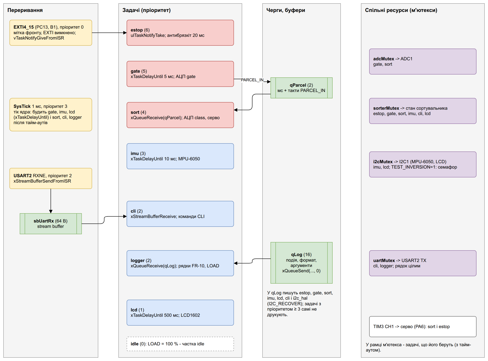

# Прошивка на FreeRTOS (ЛР4)

Тут я описую, як продукт з ЛР3 переходить на FreeRTOS: ядро і його конфігурація, де і чому відходжу від методички, база часу, бюджет пам'яті і перші заміри. Це крок 1: ядро підключене, а весь super loop крутиться в одній задачі `app`. Розбиття на задачі, черги і м'ютекс шини I²C - крок 2, метрики ОС (`tasks`, стек по задачах, heap ОС) - крок 3.

Обидві прошивки збираються з одного дерева, з тим самим кодом вимірювань:

| Команда | Що збирається |
|---|---|
| `make build` (`ARCH=superloop`) | super loop ЛР3 |
| `make build ARCH=rtos LTO=1` | FreeRTOS, тік 1000 Гц |
| `make build ARCH=rtos LTO=1 TICK_HZ=100` | FreeRTOS, тік 100 Гц (методичка 7.2, п. 6) |
| `LTO=0\|1` | `-flto` для всього образу, однаково для обох ARCH |

За замовчуванням `LTO=0`, як у брифі: так `make build` дає прошивку ЛР3. Але `ARCH=rtos` без `LTO=1` у flash не влазить (розділ 4), тож rtos завжди збираю з `LTO=1`, а для порівняння - і super loop теж.

`ARCH`, `LTO` і `TICK_HZ` пишуться в `firmware/build/build.cfg`, у рядки `BOOT` і `PERF` (`arch=... lto=... tick_hz=...`), а `tools/run_scenario.py` - у заголовок логу. У rtos `BOOT` ще має `kernel=V11.3.3 os_heap=5120`. Прошивка ЛР3 є й окремо - тег `lab3` (`c7a5470`).

## 1. Конфігурація ядра

| Що | Значення |
|---|---|
| Ядро | FreeRTOS-Kernel **V11.3.3** (реліз 30.10.2026), сабмодуль `firmware/Middlewares/FreeRTOS` з https://github.com/FreeRTOS/FreeRTOS-Kernel |
| Коміт | `89592801dd8b73329a7583719b7e3567b50910e5` (тег `V11.3.3`) |
| Порт | `portable/GCC/ARM_CM0` (`port.c`, `portasm.c`) |
| Heap | `heap_4.c`, `configTOTAL_HEAP_SIZE` = 5 120 B (поки стартове значення) |
| API | нативний FreeRTOS, без CMSIS-RTOS2 |
| Тік | SysTick від ядра 48 МГц, `configTICK_RATE_HZ` = `TICK_HZ` (1000, для 7.2 п. 6 - 100) |
| Що збирається | `tasks.c`, `queue.c`, `list.c`, `stream_buffer.c`, `heap_4.c`, `port.c`, `portasm.c`. `timers.c`, `event_groups.c`, `croutine.c` - ні, бо поки немає вимоги |

`firmware/Platform/rtos/FreeRTOSConfig.h` я написав одразу з усім, що вимагає ЛР4, щоб бюджет flash був чесним. Ось що відрізняється від типових значень ядра (`include/FreeRTOS.h`) і навіщо:

| Параметр | У мене | Типово | Навіщо |
|---|---|---|---|
| `configCPU_CLOCK_HZ` | `SystemCoreClock` (48 МГц) | немає | частота SysTick |
| `configTICK_RATE_HZ` | `TICK_HZ` з `app.mk` (1000) | немає, у шаблоні 100 | 1 мс - роздільність затримок як у super loop; 100 Гц - для 7.2 п. 6 |
| `configUSE_TIME_SLICING` | 1 | 1, у шаблоні 0 | задачі одного пріоритету ділять час |
| `configMAX_PRIORITIES` | 7 | немає, у шаблоні 5 | idle і шість робочих рівнів кроку 2; кожен рівень - список у RAM |
| `configMINIMAL_STACK_SIZE` | 48 слів | немає, у шаблоні 128 | стек idle: контекст PendSV з кадром винятку - 17 слів, 4 слова контрольного шаблону, прологи. Хука idle немає. На кроці 1 idle не виконується зовсім (`app` не блокується), тож high water mark idle поміряю на кроці 3 |
| `configMAX_TASK_NAME_LEN` | 8 | 16 | імена до 7 символів (`estop`, `logger`, `IDLE`), -8 B на TCB |
| `configTOTAL_HEAP_SIZE` | 5 120 B | немає | стартове; справжнє - за `xPortGetMinimumEverFreeHeapSize` після S3 |
| `configUSE_MUTEXES` | 1 | 0 | шина I²C (imu і lcd), методичка 7.2 п. 1 |
| `configUSE_COUNTING_SEMAPHORES` | 1 | 0 | облік кількох подій до обробки (методичка 4.4) |
| `configUSE_EVENT_GROUPS` | 0 | 1 | не потрібні, `event_groups.c` не збирається |
| `configUSE_TICK_HOOK` | 0 | обов'язковий | тіки для `perf_now` рахує `SysTick_Handler`, а не хук (розділ 3) |
| `configUSE_MALLOC_FAILED_HOOK` | 1 | 0 | `FATAL malloc` і зупинка (7.2 п. 5) |
| `configCHECK_FOR_STACK_OVERFLOW` | 2 | 0 | `FATAL stack overflow in <ім'я>` і зупинка (7.2 п. 2) |
| `configCHECK_HANDLER_INSTALLATION` | 1 | 1 | при старті ядро перевіряє, що вектори SVC і PendSV - з порту |
| `configGENERATE_RUN_TIME_STATS` | `PERF` (1) | 0 | завантаження за задачами (методичка 6.2) |
| `configRUN_TIME_COUNTER_TYPE` | `uint64_t` | `uint32_t` | 32 біти тактів переповнюються за 89,5 с, а S2 триває ~135 с |
| `configUSE_TRACE_FACILITY` | `PERF` (1) | 0 | `uxTaskGetSystemState` для команди `tasks` (крок 3) |
| `configUSE_STATS_FORMATTING_FUNCTIONS` | 0 | 0 | `vTaskList` і `vTaskGetRunTimeStats` тягнуть `sprintf`; рядки друкуватиму сам |
| `configASSERT` | свій, без `__FILE__` | немає | рядок і адреса виклику - у `.noinit`, `FATAL assert line=N pc=0x...`, зупинка, а після скидання - `ASSERT line=N pc=0x...` |
| `configENABLE_BACKWARD_COMPATIBILITY` | 0 | 1 | старі імена типів не потрібні |
| `configENABLE_MPU` | 0 | немає | порт ARM_CM0 вимагає явно |
| `INCLUDE_xTaskDelayUntil` | 1 | 0 | періодичні задачі (gate 5 мс, imu 10 мс). У V11 це нове ім'я `INCLUDE_vTaskDelayUntil`: зі старим разом ядро не збирається |
| `INCLUDE_uxTaskGetStackHighWaterMark` | 1 | 0 | стек кожної задачі (6.3) |
| `INCLUDE_xTaskGetIdleTaskHandle` | 1 | 0 | run-time і стек idle |
| `INCLUDE_xTaskGetCurrentTaskHandle` | 1 | 1 | без нього `stream_buffer.c` не збирається (`#error`) |
| `INCLUDE_vTaskSuspend`, `INCLUDE_vTaskDelay`, `INCLUDE_vTaskDelete`, `INCLUDE_xTaskResumeFromISR` і решта | 0 | частина 1 | не потрібні. Без `INCLUDE_vTaskSuspend` очікування `portMAX_DELAY` - не «назавжди», а 2³² - 1 тіків (49,7 доби при 1 кГц) |

`PERF=0` вимикає run-time stats і trace разом з вимірювальним модулем, а перевірки (`configASSERT`, стек, malloc) лишаються.

Діагностика (`Platform/rtos/rtos_diag.c`). Усі три хуки пишуть рядок прямо в USART2 з опитуванням TXE, без `printf`, і зупиняють програму: LD4 блимає 2 рази на секунду. Перевірив у Wokwi тимчасовими збірками:
- стек `app` 64 слова замість 256 - `1482 ... FATAL stack overflow in app`. Метод 2 перевіряє стек лише при перемиканні контексту, а задача `app` на кроці 1 майже не перемикається, тож до виявлення переповнення ~1,2 с псувало сусідню пам'ять (`ready_class t_us=1`). Це піде у сценарій 7.2 п. 2;
- `configASSERT(xTaskGetTickCount() < 1000)` у циклі - `1252 FATAL assert line=21 pc=0x80038FB`, `arm-none-eabi-addr2line` за цією адресою дає `app_task.c:21`.

Запис у `.noinit` має пережити скидання кнопкою, бо startup його не обнуляє, але в `wokwi-cli` це не перевірити: перезапуск симуляції обнуляє RAM. Секції `.noinit` у скрипті лінкера CubeMX немає, і ld ставить її як «сироту» з NOBITS одразу після `.bss`, перед `._user_heap_stack` (у map: `.noinit 0x20001c1c 0xc`, `_ebss = 0x20001c1c`). Окремий скрипт з `INSERT AFTER .bss` разом зі скриптом CubeMX не лінкувався (журнал, проблема 31).

## 2. Відхилення від методички через Cortex-M0+ і C0

| Методичка | У нас | Чому і скільки |
|---|---|---|
| порт `GCC/ARM_CM4F` | `GCC/ARM_CM0` | у C031 ядро Cortex-M0+ (ARMv6-M) без FPU |
| `DWT->CYCCNT` для run-time stats | `perf_now` (SysTick + лічильник тіків), 64 біти | DWT на M0+ немає. Роздільність та сама, що в ЛР3: 1 такт, 21 нс |
| `configMAX_SYSCALL_INTERRUPT_PRIORITY` | не визначено | на M0+ немає BASEPRI. Критична секція порту - `cpsid i`, вона маскує всі переривання, тож порт цей параметр не читає. `FromISR` можна викликати з переривання будь-якого пріоритету (контрольне питання 5) |
| `NVIC_PRIORITYGROUP_4` | немає | на M0+ немає груп пріоритетів (немає `AIRCR.PRIGROUP`), а рівнів лише 4 (`__NVIC_PRIO_BITS` = 2: 0, 64, 128, 192) |
| CubeMX → Middleware → FreeRTOS, CMSIS-RTOS2 | ядро сабмодулем, нативний API | у CubeMX для `STM32C031C(4-6)Tx` модуля FREERTOS немає, ST дає FreeRTOS для C0 лише пакетом X-CUBE-FREERTOS з CMSIS-RTOS2. Нативний API - на 1 788 B flash менше (замір на V10.0.1, docs/baseline-lab4.md, ризик b) |
| HAL переводять на інший таймер | HAL на TIM17, лише в `ARCH=rtos` | TIM3 зайнятий серво, TIM14 лишаю в резерві. У super loop база часу HAL - SysTick, як у ЛР3 |

**Обробники SVC, PendSV, SysTick.** Порт V11.3.3 для CM0 визначає їх одразу під іменами CMSIS (`portasm.h`, рядки 92 і 97; `port.c`, рядок 816), а CubeMX генерував у `stm32c0xx_it.c` свої порожні - разом вони не злінкувалися б. Тому в `firmware.ioc` я зняв «Generate IRQ handler» для System service call, Pendable request і System tick timer (у рядках `NVIC.SVC_IRQn`, `NVIC.PendSV_IRQn`, `NVIC.SysTick_IRQn` шосте поле `true` -> `false`) і перегенерував проєкт CubeMX 6.18.1 з командного рядка (`STM32CubeMX -q` зі скриптом `config load ... / project generate` у Xvfb). Diff перегенерованих файлів: з `stm32c0xx_it.c` і `stm32c0xx_it.h` зникли лише ці три обробники, у `Makefile` змінилася тільки дата в шапці, скрипт лінкера і `.mxproject` - без змін. Тепер:
- `ARCH=superloop` - `Platform/superloop/irq_superloop.c`: порожні SVC і PendSV і `SysTick_Handler` -> `HAL_IncTick()`, той самий код, що генерував CubeMX. Розмір збірки на цьому коміті (`f7fcf0a`) - 31 060 B flash і 3 288 B RAM, як у тегу `lab3`;
- `ARCH=rtos` - SVC і PendSV з порту, а SysTick - свій обробник, який передає тік порту (розділ 3).

**Пріоритети переривань** (прочитав з регістрів тимчасовою збіркою в Wokwi):

| Переривання | Пріоритет | Хто ставить | Примітка |
|---|---|---|---|
| SVC | 0 (найвищий) | порт, `SHPR2 = 0` | старт першої задачі |
| EXTI4_15 (E-STOP, PC13) | 0 | CubeMX, `gpio.c` | на кроці 2 викликатиме `vTaskNotifyGiveFromISR` - на M0+ це можна з будь-якого рівня |
| TIM17 (база часу HAL) | 3 | `TICK_INT_PRIORITY` | лише `HAL_IncTick`, API ядра не викликає |
| PendSV, SysTick | 3 (найнижчий) | порт, `SHPR3` | Wokwi читає `0xFF`, бо не маскує нереалізовані біти; на залізі було б `0xC0` |
| USART2, I2C1 | - | вимкнені | UART і I²C поки працюють опитуванням; переривання USART2 для stream buffer - крок 2 |

**Wokwi не враховує PRIMASK.** Це я знайшов на цьому кроці, і це важливо для всього ЛР4. Після `__disable_irq()` (PRIMASK = 1) обробники SysTick і TIM17 у Wokwi все одно виконуються. Відтворювана збірка `TEST_PRIMASK=1` (10 обертів SysTick з PRIMASK = 1, лічильник обертів - опитуванням `COUNTFLAG`) в обох ARCH дала `PRIMASK uwtick_delta=10 perf_tick_delta=10 pendst=0 wraps=10 primask=1`, а на залізі було б `0 0 1` (`docs/metrics/lab4/PRIMASK_*.log`, журнал, проблема 35). Що через це в ЛР4 недостовірне - там само. На залізі `cpsid i` маскує всі переривання, а в Wokwi критичні секції порту ARM_CM0 від переривань не захищають. На кроці 1 це нічого не ламає: API ядра з переривань ще ніхто не викликає, а тік ядро обробляє в SysTick з тим самим пріоритетом, що й PendSV. На кроці 2 (EXTI і USART викликають `FromISR`) теоретично можливі гонки, яких на залізі не буде. Що вже зроблено:
- `perf_now` більше не покладається на PRIMASK (розділ 3);
- зупинка в `FATAL` вимикає не лише PRIMASK, а й усі лінії NVIC і `TICKINT` SysTick. Інакше в Wokwi тік ядра далі перемикав би задачі.

**Стрес-тест ядра в Wokwi не пройдено (крок 2, ворота Б).** Збірка `TEST_KSTRESS=1` (`Tasks/kstress.c`, лише rtos): чотири задачі на пріоритетах 1-4 - `tick` (`xTaskDelayUntil` 1 мс і м'ютекс зі спільним лічильником), `pong` (черга з контрольною сумою кожного повідомлення), `ping` (обмін через дві черги), `mtx` (сповіщення від ISR і той самий м'ютекс), плюс ISR TIM14 на 2 кГц з `xQueueSendFromISR`, `vTaskNotifyGiveFromISR` і `portYIELD_FROM_ISR`. `configASSERT`, `configUSE_LIST_DATA_INTEGRITY_CHECK_BYTES 1`, перевірка стека 2. Лічильник вкладеності критичних секцій порту (`ulCriticalNesting`, `static` у `port.c`) читає `Platform/rtos/kstress/port_kstress.c`: це той самий `port.c`, включений `#include`, плюс геттер, і в цій збірці він замінює `port.c`. `traceTASK_SWITCHED_IN` рахує PendSV і перемикання при `ulCriticalNesting != 0`, а SysTick і TIM14 - переривання всередині критичної секції. Окремо ISR TIM14 раз на 5 с сам пише в регістр USART рядок `KSTRESS_ISR`: лічильники, поточна задача, PC з кадру PSP і вкладеність - видно навіть тоді, коли задачі стоять.

Прогін 18.11 у Wokwi в браузері (`4595468`; у лозі - `3439b99b`, стара історія до переписування дат, тег `lab4-step2-orig`; `docs/metrics/lab4/KSTRESS_2026-11-18_1411.log`), зупинив на 15,2 с часу МК:

| t, с | ISR | `tick` | `ping` | повідомлень ISR, прийнятих `pong` | м'ютекс `mtx` / `tick` | поточна задача, PC | `ulCriticalNesting` |
|---|---|---|---|---|---|---|---|
| 5,2 | 10 000 | 3 431 | 0 | 0 | 0 / 3 430 | `tick`, `mtx_round` (цикл утримання м'ютекса) | 1 |
| 10,2 | 20 000 | 6 863 | 0 | 0 | 0 / 6 862 | `tick`, той самий | 1 |
| 14,9 (`KSTRESS t_s=10`) | 29 232 сповіщень, `isr_drop=29224` | 10 000, `late=9999` | 0 | 0 | 0 / 10 000 | - | - |

`KSTRESS_CRIT t_s=10`: `switches=4 switches_in_crit=1 pendsv_in_crit=10000 isr_in_crit=43829`. Тобто за 10 с ядро перемкнуло задачу лише 4 рази, одне з цих перемикань сталося всередині критичної секції, і після нього `ulCriticalNesting` лишився 1 назавжди: у коді задачі між викликами API (цикл утримання м'ютекса) на залізі там завжди 0. Далі `ping`, `pong` і `mtx` не зробили жодного кроку, черга від ISR повна (`isr_drop` = усі, крім 8), `tick` не блокується (`xTaskDelayUntil` щоразу каже «запізнився», 9 999 з 10 000) і йде на ~690 Гц замість 1 кГц. `configASSERT`, контроль цілісності списків і стека не спрацювали, FATAL немає - це зависання планувальника, а не збій, який ловиться перевірками. `isr_in_crit` і `pendsv_in_crit` після цього завищені: вкладеність стоїть на 1, тож рахується кожне переривання.

Причина - та сама аномалія PRIMASK (журнал, проблеми 35 і 43). У порті ARM_CM0 вкладеність критичних секцій - одна глобальна змінна, у контекст задачі вона не зберігається: на залізі це коректно, бо PendSV і SysTick всередині `cpsid i` не виконуються, і перемикання завжди відбувається з вкладеністю 0. У Wokwi PendSV, відкладений усередині критичної секції (наприклад, `portYIELD_WITHIN_API` у коді черги), спрацьовує одразу, і задача покидає процесор з вкладеністю 1. Точний ланцюжок до зупинки планувальника без налагоджувача я не розклав, але і факт перемикання в критичній секції, і вкладеність 1 у коді задачі виміряні.

Після code review (`ae86c26`) тест трохи змінився, на висновок це не впливає: пульс `KSTRESS_ISR` друкується лише тоді, коли за 5 с ні `ping`, ні `pong` не просунулися (поки задачі йдуть, друк в ISR лише спотворював би лічильники), помилки винесені в окремий рядок `KSTRESS_ERR` (разом рядок не вміщувався в буфер 192 B), `ping` пропускає запізнілі відповіді (`stale`) замість безкінечного `seq_err`, а критичні секції до старту ядра в лічильники не потрапляють.

**Повтор з окремими лічильниками** (`d51ad94`; у лозі - `1baa13f6`, стара історія до переписування дат, тег `lab4-step2-orig`; `docs/metrics/lab4/KSTRESS_2026-11-18_1528.log`). Критичні секції задач (`taskENTER_CRITICAL`, обгортка `vPortEnterCritical`) і ISR (`taskENTER_CRITICAL_FROM_ISR`, обгортка `ulSetInterruptMask`) рахуються окремо - `Platform/rtos/kstress/port_kstress.c` і `port_kstress_asm.c` включають `port.c` і `portasm.c` порту без змін і перейменовують ці функції. До старту ядра (`ulCriticalNesting` = 0xaaaaaaaa + k, зокрема перше `traceTASK_SWITCHED_IN` у `vTaskStartScheduler`) нічого не рахується. Картина та сама, до числа:

| Лічильник (з моменту старту ядра) | t = 15,6 с (`t_s=10`) | t = 31,0 с (`t_s=20`) | Частота |
|---|---|---|---|
| перемикань задач усього | 3 | 3 | - |
| з них у критичній секції задачі | 1 | 1 | - |
| входів у `taskENTER_CRITICAL` | 30 008 | 60 008 | ~1 950 /с |
| PendSV у критичній секції задачі | 10 000 | 20 000 | кожен |
| тік SysTick у критичній секції задачі | 15 318 | 30 775 | ~1 000 /с, тобто кожен тік |
| TIM14 у критичній секції задачі | 30 634 | 61 541 | ~2 000 /с, кожне |
| входів у `taskENTER_CRITICAL_FROM_ISR` | 76 586 | 153 809 | ~5 000 /с |
| PendSV / перемикань / тіків у критичній секції ISR | 0 / 0 / 0 | 0 / 0 / 0 | - |
| TIM14 у критичній секції ISR (`SysTick` -> `xPortSysTickHandler`) | 0 | 631 | ~40 /с у другому вікні |
| `ping`, повідомлень ISR у `pong`, заходів `mtx` у м'ютекс | 0, 0, 0 | 0, 0, 0 | - |
| `*_err`, assert, FATAL | 0 | 0 | - |

Частку «у критичній секції» від усіх подій після зависання рахувати немає сенсу: вкладеність стоїть на 1 з першої мілісекунди, тож у «критичну секцію» потрапляє кожен тік, кожен PendSV і кожне переривання TIM14. Справжня частота - до зависання, а там подій лише кілька: усього 3 перемикання, і одне з них - усередині `taskENTER_CRITICAL`. Тобто аномалія PRIMASK зламала планувальник на третьому перемиканні після старту. Перемикань у критичних секціях ISR немає, а TIM14 усередині критичної секції `xPortSysTickHandler` - є (631 раз), на залізі теж неможливо.

**Чому це провал воріт, а не «помилок 0 - описати ризик».** Лічильники помилок (`sum_err`, `seq_err`, `mtx_err`, `notify_err`), `configASSERT`, контроль цілісності списків і HardFault справді дали 0. Але не тому, що ядро працює правильно: перевіряти не було чого - `ping`, `pong` і `mtx` не виконали жодної ітерації, черга від ISR повна з першої секунди. Зависання планувальника - те саме «падіння» з умови воріт, лише без FATAL. Щоб воно не ховалося за нулями, у звіті є лічильники прогресу (`ping`, `isr_msg`, `mtx`), а пульс з ISR друкується саме тоді, коли прогресу немає.

**Висновок: у формі B багатозадачне ядро в Wokwi без обхідного шляху непридатне.** Задачі, черги, сповіщення з ISR і м'ютекси кроку 2 упираються саме в це. Тому - обхід `SIM_CRIT` нижче.

### Обхід PRIMASK для Wokwi: `SIM_CRIT=1`

**Що це.** Збірка `SIM_CRIT=1` (за замовчуванням для `ARCH=rtos`; уся ЛР4 міряється у Wokwi) бере копію порту ARM_CM0 з `firmware/Platform/rtos/port_sim/` (`port.c`, `portasm.c`, `portasm.h`; `portmacro.h` - із сабмодуля). `SIM_CRIT=0` - порт із сабмодуля без змін; CI збирає обидва. Сабмодуль не змінено. Рівно, що відрізняється від офіційного V11.3.3, - `docs/port_sim-V11.3.3.patch` (тест `tools/tests/test_port_sim_patch.py` не дає йому розійтися з кодом).

**Як працює.** Критична секція порту - як і раніше `cpsid i` (на залізі цього досить), плюс програмне відкладання того, що Wokwi не маскує:
- переривання NVIC: кожен обробник (TIM17, EXTI4_15, TIM14 стрес-тесту, далі USART2) на вході питає `rtos_hal_irq_defer`. Усередині секції він лише вимикає свою лінію і запам'ятовує її, прапорець периферії лишається. Вихід із секції виставляє лінію в очікування (`ISPR`) і вмикає - обробник виконується одразу, як після `cpsie i`;
- тік ядра: `SysTick_Handler` усередині секції лише рахує тік (`perf_now` іде далі, `rtos_hal_ticks` не відкладається), а вихід проганяє `xTaskIncrementTick` стільки разів - так само `xTaskResumeAll` доганяє відкладені тіки;
- PendSV: обробник у `portasm.c` усередині секції лише ставить прапорець, вихід виставляє `PENDSVSET` знову;
- стан відкладання зберігається і відновлюється, як PRIMASK: `ulSetInterruptMask` повертає попередній стан, `vClearInterruptMask` його відновлює; секція задачі спершу блокує PendSV і тік, потім переривання; на виході переривання повертаються раніше за PendSV і тік, тож під час них перемкнути задачу нема чим.

**Чому це наближає Wokwi до заліза, а не навпаки.** На Cortex-M0+ `cpsid i` теж нічого не губить, а лише відкладає: переривання NVIC, SysTick і PendSV, що прийшли в секції, стають у стан очікування і виконуються одразу після `cpsie i`, у порядку пріоритетів. Обхід робить у Wokwi те саме програмно: подія не губиться (лінія NVIC - через `ISPR`, тік - лічильником, PendSV - прапорцем) і виконується на виході, а не всередині секції. Відмінність одна - ціна: на залізі відкладання безкоштовне (апаратне), у Wokwi - інструкції обходу (нижче). Без обходу Wokwi робить те, чого залізо не робить ніколи: виконує обробник посеред секції ядра.

**На залізі обхід не потрібен.** Там всередині `cpsid i` жоден обробник не виконується, тож прапорці відкладання завжди 0 на вході в обробники, і код обходу лише витрачає такти на вході й виході секції. Прошивку для плати варто збирати з `SIM_CRIT=0` (порт без змін); якщо зібрати з `SIM_CRIT=1`, вона працюватиме так само, лише повільніше на ціну обходу.

**Ворота Б з обходом пройдено** (`f8d7ee3`, `docs/metrics/lab4/KSTRESS_2026-11-18_1755.log`, 120 с часу МК). Тест той самий, що й без обходу, з двома поправками навантаження (журнал, проблема 44): м'ютекс тримається 20 мкс за `perf_now`, а не порожнім циклом; ISR TIM14 іде на 2 кГц і щоразу будить `mtx`, а в чергу кладе кожне 8-ме повідомлення (250 Гц), `ping` - раз на 4 мс.

| Що (за 120 с) | Значення | Критерій |
|---|---|---|
| помилки: контрольна сума, порядок, інваріант м'ютекса, сповіщення, тайм-аути, `stale` | 0 | 0 |
| `configASSERT`, цілісність списків, переповнення стека, HardFault | не спрацювали (FATAL немає) | 0 |
| події в критичній секції задачі (`crit_task`: PendSV / перемикання / тік / TIM14) | 0 / 0 / 0 / 0 | 0 |
| події в критичній секції ISR (`crit_isr`) | 0 | 0 |
| тіки ядра / тіки perf від старту (`ktick` / `ptick`) | 120 072 / 120 072 | рівні |
| відкладено тіків / PendSV / виходів із відкладеними перериваннями | 43 263 / 103 475 / 193 883 | робота обходу |
| лінія NVIC TIM17 вимкнена поза секцією (вибірки на кожному тіку) | 0 з 120 000 | 0 |
| час HAL (TIM17) на 120,3 с | 120 315 мс | без втрат |
| обмінів `ping`, повідомлень ISR у `pong`, заходів `mtx` / `tick` у м'ютекс | 30 000, 29 714, 65 528 / 120 000 | усі задачі працюють |
| перемикань задач | 358 208 | - |
| процесор: tick / pong / ping / mtx / idle, ‰ | 386 / 238 / 152 / 209 / 50 | idle > 0 |
| `isr_drop` (черга повна), `late` (tick не встиг до наступного тіку) | 285, 3 422 | не помилки: черга з 8 місць, а `late` - здебільшого після друку звіту на P4 |

Шлях до цього результату - чотири варіанти обходу (журнал, проблема 43): маска всіх ліній NVIC на всю секцію губила переривання і лишала лінії вимкненими під іншою задачею (`off_free` 1 790 з 10 000); глибина секцій, спільна для задач і ISR, давала перемикання всередині секції (6 за 10 с), а запис прапорців у неправильному порядку - переривання всередині неї (8 за 10 с). Остаточний варіант (`f8d7ee3`) - останній рядок таблиці журналу.

**Ціна обходу** (збірка `TEST_CRITCOST=1`, `Tasks/critcost.c`: 10 000 пар вхід + вихід з задачі, мітки `perf_now`; Wokwi у браузері, `f8d7ee3`; `docs/metrics/lab4/CRITCOST_sim*`):

| Пара, тактів (avg за вирахуванням порожнього виміру; min) | `SIM_CRIT=0` | `SIM_CRIT=1` | Ціна обходу |
|---|---|---|---|
| порожній вимір (`perf_now` двічі) | 550,1; 529 | 543,0; 530 | - |
| `taskENTER_CRITICAL` + `taskEXIT_CRITICAL` | 279,6; 276 | 974,1; 924 | +694,5 такту = 14,5 мкс |
| `taskENTER_CRITICAL_FROM_ISR` + `..._EXIT_...` | 84,8; 85 | 774,2; 734 | +689,4 такту = 14,4 мкс |

Це такти моделі Wokwi: вона виконує код у кілька разів повільніше, ніж залізо на 48 МГц (журнал, проблема 44), тож і обхід, і саме ядро в мікросекундах тут дорожчі, ніж були б на платі; на платі обходу немає зовсім. У стрес-тесті 10 851 секція задачі і 2 250 секцій ISR на секунду, тобто обхід там забирає ~9,1 млн тактів на секунду - ~19 % процесора. Скільки секцій на секунду в продукті (S1 rtos) - розділ «Задачі» і крок 3: там «вартість ОС» (тік, перемикання, ISR -> задача) подаю двома числами - виміряне і за вирахуванням ціни обходу (кількість секцій за вікно × 694 і 689 тактів).

Flash: `SIM_CRIT=1` - +444 B проти `SIM_CRIT=0` (25 368 проти 24 924 B без зонда), RAM +40 B.

## 3. База часу

| Лічильник | ARCH=superloop | ARCH=rtos |
|---|---|---|
| SysTick | тік HAL, 1 кГц, `SysTick_Handler` -> `HAL_IncTick` | тік ядра, `TICK_HZ`; вектор - `SysTick_Handler` з `Platform/rtos/rtos_hal.c` |
| `HAL_GetTick` (тайм-аути I²C і UART, `HAL_Delay`, `period_due`) | `uwTick` від SysTick | `uwTick` від TIM17: 1 МГц (PSC з `HAL_RCC_GetPCLK1Freq`), ARR = 999, пріоритет 3 |
| номер тіку для `perf_now` (`perf_tick_count()`) | `uwTick` | `rtos_hal_ticks` з `SysTick_Handler` |

`perf_now` однаковий в обох ARCH (`Platform/perf_hal.c`), відрізняється лише `perf_tick.h` у `Platform/<arch>/`:

```
perf_now()      = tick * (SysTick->LOAD + 1) + (SysTick->LOAD - SysTick->VAL)
perf_now_us64() = tick * мкс_у_тіку + (LOAD - VAL) / 48
perf_now_cyc64() - те саме, що perf_now, але 64 біти (лічильник run-time stats)
```

Тактів на тік я беру з `SysTick->LOAD + 1`, а не з `SystemCoreClock / 1000`: при `TICK_HZ=100` тік - 480 000 тактів (10 мс). Арифметика винесена в `App/perf.h` (`perf_tick_cyc`, `perf_tick_us64`, `perf_tick_cyc64`, `static inline`), і тести на хості перевіряють її і для 1 кГц, і для 100 Гц, з переповненням 32 біт (`tests/test_perf.c`).

**SysTick з самого `HAL_Init`.** BOOT, самоперевірка і READY gate/class відбуваються в `main` до старту ядра, і `perf_now` потрібен уже там. Тому в rtos `HAL_InitTick` (його викликають `HAL_Init` і `HAL_RCC_ClockConfig`) налаштовує і TIM17 для HAL, і SysTick з тим LOAD, який поставив би порт. Отже `perf_now` рахує від того самого моменту, що й у super loop. Порт при старті викликає `vPortSetupTimerInterrupt` - моя версія не перезапускає SysTick (це обнулило б VAL посеред тіку, і час стрибнув би назад), а перевіряє LOAD і з цього моменту передає тіки ядру. Є одна тонкість, яку знайшов code review (журнал, проблема 38). Поки `vTaskStartScheduler` тримає переривання вимкненими, SysTick може перейти через 0, і після `cpsie i` у `vStartFirstTask` обробник порту виконався б раніше, ніж `svc` запустить першу задачу. Якщо ядро попросить перемикання, PendSV зберіг би контекст у ще не налаштований PSP. Порт цього уникає тим, що запускає SysTick саме тут, з повного тіку. Тому в `vPortSetupTimerInterrupt` такий тік рахується лише для `perf_now` і знімається з очікування, а якщо до переходу через 0 лишилося менше 256 тактів (~5 мкс), спершу дочікуємося його (коміт `7bc596a`).

Run-time stats теж рахують від старту ядра, а не від скидання: `portCONFIGURE_TIMER_FOR_RUN_TIME_STATS` запам'ятовує базу `perf_now_cyc64`, а `portGET_RUN_TIME_COUNTER_VALUE` її віднімає. Інакше BOOT і самоперевірка (~0,23 с) дісталися б першій задачі, що поступиться процесором (журнал, проблема 40).

**До старту ядра переривання вимкнені.** Порт ARM_CM0 починає з `ulCriticalNesting = 0xaaaaaaaaUL` (`port.c`, рядок 369), а `vPortExitCritical` вмикає переривання, лише коли лічильник дійде до 0 (рядки 803-812). Обнуляє його тільки `xPortStartScheduler` (рядок 1327). Отже, перший же виклик API з критичною секцією - `xTaskCreate` (`prvAddNewTaskToReadyList` -> `taskENTER_CRITICAL`, `tasks.c`, рядок 2044), `xQueueCreate`, `xSemaphoreCreate...` - вимикає переривання до старту ядра. Після нього не тікають ні TIM17 (`HAL_GetTick` стоїть, `HAL_Delay` і тайм-аути HAL чекали б вічно), ні SysTick. Тому в `ARCH=rtos`:
- уся ініціалізація з `HAL_Delay` і тайм-аутами HAL (самоперевірка FR-08, `lcd1602_init` з паузами 50 + 5 + 1 + 1 + 2 мс, MPU, I²C) - у `main` до першого виклику API ядра або всередині задачі;
- перший виклик API - `xTaskCreate` в `app_task_start` (`main`, секція `USER CODE BEGIN WHILE`), а одразу за ним `vTaskStartScheduler`. На кроці 2 створення задач, черг і м'ютексів так само має йти останнім перед стартом;
- у Wokwi цього не видно: PRIMASK там не діє (розділ 2), і `HAL_Delay` після `xTaskCreate` у симуляції не зависне, а на залізі зависне. Тож правило тримається на порядку в коді, а перевіряти його прогоном у Wokwi не можна.

Вікно від першого виклику API до старту першої задачі має бути коротшим за тік: за цей час `PENDSTSET` зберігає щонайбільше один тік, і `vPortSetupTimerInterrupt` його дораховує. Для заміру рядок `STARTUP` у rtos має ще два ключі: `os_api_us` - перед `xTaskCreate`, `os_start_us` - у `vPortSetupTimerInterrupt`, тобто вже після створення idle, перед `svc` першої задачі (коміт `1de6be6`). Поміряти ще не встиг: хвилини CI Wokwi скінчилися (журнал, проблема 41). Моя оцінка за кодом - близько 0,1 мс: виділення і заповнення шаблоном стеків `app` (1 КБ) і idle (192 B), ініціалізація списків ядра.

Як це співвідноситься з доповненням до брифу:

| Доповнення | Як зроблено | Чому так |
|---|---|---|
| SysTick з тим самим LOAD і перериванням ще до ініціалізації HAL | SysTick налаштовує `HAL_InitTick` у rtos, тобто в `HAL_Init`, з `LOAD = SystemCoreClock / TICK_HZ - 1` | у super loop SysTick стартує там само (`HAL_InitTick` з HAL), тож початок шкали `perf_now` однаковий в обох ARCH |
| у `SysTick_Handler` до старту - лише лічильник perf, після (`xTaskGetSchedulerState`) - обробник порту, а тік perf рахує `vApplicationTickHook` | `SysTick_Handler` рахує кожен тік завжди, а обробнику порту (`xPortSysTickHandler`) передає після прапорця з `vPortSetupTimerInterrupt` | хук ядро не викликає, поки `xTaskResumeAll` доганяє відкладені тіки (`tasks.c`, 5000-5012, 4151-4171): тік, що прийшов тоді, загубився б (журнал, проблема 34). Прапорець ставиться пізніше, ніж `xSchedulerRunning = pdTRUE` (`tasks.c`, 3798), - уже після створення idle, і без `INCLUDE_xTaskGetSchedulerState` |
| перевизначити `vPortSetupTimerInterrupt`, щоб не обнуляв VAL | перевизначено: у порту V11 для CM0 вона `weak` (`port.c`, рядок 616), `configOVERRIDE_DEFAULT_TICK_CONFIGURATION` тут немає | LOAD лише перевіряється, VAL не чіпається; тік, що чекає, дораховується (проблема 38) |
| вікно до старту коротше за тік, поміряти | ключі `os_api_us`, `os_start_us` у `STARTUP` | замір - з наступним прогоном |

Неперервність шкали від скидання має одне місце, і воно є в обох ARCH і в ЛР3: `HAL_RCC_ClockConfig` після перемикання на 48 МГц знову викликає `HAL_InitTick`, а `SysTick_Config` обнуляє VAL. Частка тіку на 12 МГц до цього моменту губиться, раз і до рядка `BOOT`. Замір `TEST_BOOTMARK` (розділ 5): super loop губить 161 мкс, rtos - 281 мкс, бо в першому `HAL_InitTick` ще налаштовує TIM17 на 12 МГц. Інтервали це не зачіпає, абсолютні мітки старту - так.

**Чому тіки рахує `SysTick_Handler`, а не хук тіку.** Бриф пропонував лічильник у `vApplicationTickHook`. Я перевірив `tasks.c` V11.3.3. Хук справді викликається і при призупиненому планувальнику (`xTaskIncrementTick`, рядки 5062-5072):

```c
    else
    {
        xPendedTicks += 1U;

        /* The tick hook gets called at regular intervals, even if the
         * scheduler is locked. */
        #if ( configUSE_TICK_HOOK == 1 )
        {
            vApplicationTickHook();
        }
        #endif
    }
```

Але при працюючому планувальнику - лише тоді, коли немає відкладених тіків (рядки 5000-5012):

```c
        #if ( configUSE_TICK_HOOK == 1 )
        {
            /* Guard against the tick hook being called when the pended tick
             * count is being unwound (when the scheduler is being unlocked). */
            if( xPendedTicks == ( TickType_t ) 0 )
            {
                vApplicationTickHook();
            }
```

А `xTaskResumeAll` доганяє відкладені тіки циклом і обнуляє `xPendedTicks` лише після нього (рядки 4151-4171). Якщо справжнє переривання SysTick прийде, поки цикл іде, хук для нього не викликається, і тік для `perf_now` губиться. На залізі цикл іде в критичній секції, і тік просто чекає. У Wokwi PRIMASK не діє (розділ 2), тож тік губиться.

Я на це наступив. Перша версія запускала SysTick у `HAL_InitTick` і одразу призупиняла планувальник (`vTaskSuspendAll`), щоб до старту ядра `xTaskIncrementTick` лише відкладав тіки і викликав хук. Тимчасова збірка в Wokwi показала: перед стартом `xTaskResumeAll` доганяв 233 тіки близько 2,5 мс, за цей час прийшли 3 справжні тіки (лічильник викликів `xTaskIncrementTick` 233 -> 469 замість 466, HAL 234 -> 237), а хук не побачив жодного. `perf_now` після старту відставав від `HAL_GetTick` на 2-3 мс (журнал, проблема 34). На залізі це були б 2,5 мс з вимкненими перериваннями при кожному старті.

Тепер вектор SysTick - мій `SysTick_Handler`: `rtos_hal_ticks++`, а після старту ядра - `xPortSysTickHandler()`. Це обробник порту: у `port.c` його ім'я `SysTick_Handler` перейменоване макросом `-DSysTick_Handler=xPortSysTickHandler` лише для `port.o` (`app.mk`). `configCHECK_HANDLER_INSTALLATION` перевіряє лише SVC і PendSV, а SysTick методика FreeRTOS дозволяє перенаправляти (коментар у `xPortStartScheduler`). Призупинення до старту більше немає. Хук тіку не потрібен (`configUSE_TICK_HOOK 0`), а вартість тіку на кроці 3 можна міряти в цьому ж обробнику, разом з усім `xTaskIncrementTick`.

**`perf_now` і довгий обробник тіку.** Перший прогін S1 на rtos (`docs/metrics/lab4/S1_2026-11-17_1852.log`) дав `STAT gate max_us=89477591`, тобто -0,9 мс як беззнакове число, і `imu min_us=36` при ~1 мс роботи. Час іноді йшов назад. Причина та сама: у Wokwi обробник SysTick виконується посеред читання пари «номер тіку + VAL». У ЛР3 це ловив guard (`PERF_RELOAD_GUARD`, 128 тактів): після короткого `HAL_IncTick` від початку тіку минало менше 128 тактів, і пара читалася ще раз. Обробник тіку FreeRTOS довший, і guard його пропускав. Тепер номер тіку читається до і після VAL, і якщо він змінився, пара читається знову, незалежно від довжини обробника (коміт `04e7809`, журнал, проблема 36). Код той самий для обох ARCH: `now_cyc` виріс з 434 до 526 тактів, і тепер вимір дорожчий на ~2 мкс в обох архітектурах однаково.

**Перевірка бази часу:**
- тимчасова збірка друкувала щосекунди `HAL_GetTick() * 1000 - perf_now_us64()`: спершу 986, 835, 937, 911, 929 мкс за 5 с. Дрейфу немає, але HAL був на ~1 мс попереду. Я спершу записав це на фазу між TIM17 і SysTick, а це був зайвий тік HAL: при другому `HAL_InitTick` (після перемикання тактування) `UG` давав переривання, бо UIE ще стояв (журнал, проблема 39). Після виправлення (коміт `7bc596a`): -46, -149, -172, -173, -244 мкс - тепер `perf_now` на частку мілісекунди попереду, рівно на стільки, скільки прохід циклу доходить до перевірки, а `BOOT` друкується на HAL-мітці 2, а не 3;
- у S1 за 63 вікна `LOAD` поспіль сума `win_cyc` (час за `perf_now`) і різниця міток `<мс>` (час HAL) розходяться на -0,11 мс у super loop і на -1,35 мс у rtos, тобто 0,0002 % і 0,002 % при допуску 0,1 %. Решту дає те, коли саме друкується рядок `LOAD`. Отже, TIM17 у Wokwi рахує правильно.

**Обмеження бази часу:**
- без tickless idle: SysTick має йти безперервно, інакше `perf_now` зупиниться;
- `TICK_HZ` не нижче 16 Гц і має ділити 1 000 000: `perf_tick_us64` вимагає цілих мкс у тіку і `us_per_tick` < 2¹⁶ (24-бітний LOAD SysTick сам дав би межу 48 МГц / 2²⁴ ≈ 3 Гц). Інакше `rtos_hal.c` не збирається (`#error`). На практиці - 100 і 1000 Гц;
- у Wokwi PRIMASK не діє, тож пара в `perf_now` захищена повторним читанням, а не критичною секцією;
- `perf_now` у перериванні з вищим пріоритетом, яке прийшло в перші такти обробника SysTick, до `rtos_hal_ticks++`, може дати час на 1 тік назад - як і в ЛР3.

## 4. Бюджет пам'яті

Усе - `--print-memory-usage` збірок з коміту `38f2289` (FLASH 32 768 B, RAM 12 288 B). RAM включає резерв купи newlib 512 B і стека MSP 1 024 B зі скрипту лінкера, у rtos - ще heap ОС 5 120 B (`ucHeap` у `.bss`).

| Збірка | FLASH, B | Вільно flash, B | RAM, B | Вільно RAM, B |
|---|---|---|---|---|
| тег `lab3` (`c7a5470`) | 31 060 (94,8 %) | 1 708 | 3 288 | 9 000 |
| `ARCH=superloop LTO=0` | 30 944 (94,4 %) | 1 824 | 3 288 | 9 000 |
| `ARCH=superloop LTO=1` | 27 028 (82,5 %) | 5 740 | 3 288 | 9 000 |
| `ARCH=rtos LTO=0` | 34 796 (106,2 %) | **не влазить, -2 028** | 8 752 | 3 536 |
| `ARCH=rtos LTO=1` | **30 600 (93,4 %)** | **2 168** | 8 752 (71,2 %) | 3 536 |
| `ARCH=rtos LTO=1 TICK_HZ=100` | 30 584 | 2 184 | 8 752 | 3 536 |
| `ARCH=rtos LTO=1 PERF=0` | 25 040 | 7 728 | 7 784 | 4 504 |
| `ARCH=rtos LTO=1 TEST_I2C_FAULT=1` | 30 728 | 2 040 | 8 752 | 3 536 |
| `ARCH=superloop LTO=1 TEST_I2C_FAULT=1` | 27 168 | 5 600 | 3 288 | 9 000 |

`ARCH=superloop LTO=0` менший за тег `lab3` на 116 B: +88 B - нові поля `arch= lto= tick_hz=` у `BOOT` і `PERF` (рядки форматів і аргументи в `main`), +12 B - `cyc_per_tick` з `SysTick->LOAD` і `us_per_tick` у `perf_hal_init`, +12 B - повторне читання номера тіку в `perf_now` (розділ 3), -228 B - коротший `help` (захід б, нижче). На коміті збірки (`f7fcf0a`, до цих змін) розміри збігаються з тегом `lab3` до байта: 31 060 / 3 288.

**Ціна ОС зараз** (обидві з LTO): flash +3 572 B (27 028 -> 30 600), RAM +5 464 B. З RAM 5 120 B - heap ОС, з якого зайнято 1 456 B: стек `app` 1 024 B з TCB і idle 192 B з TCB (тимчасова збірка, `xPortGetFreeHeapSize` = 3 664). Решта RAM - статичні дані ядра (308 B: списки готових задач на 7 пріоритетів, затримані, поточна задача, лічильники) і Platform/rtos (25 B, разом з 12 B `.noinit` і 8 B бази run-time stats).

Внесок по об'єктних файлах (`tools/map_summary.py --objects`, збірка `LTO=0`: з LTO код генерується в лінкері, і в map замість файлів - `ltrans.o`). Поміряно на коміті `04e7809`; виправлення після code review додали до `rtos_hal.o` ~0,1 КБ:

| Об'єкт | Flash, B | RAM, B | З повним API кроків 2-3, flash |
|---|---|---|---|
| `tasks.o` | 1 505 | 276 | 4 345 |
| `queue.o` | 0 (ще ніхто не викликає) | 0 | 1 808 |
| `stream_buffer.o` | 0 | 0 | 922 |
| `heap_4.o` | 528 | 5 148 | 552 |
| `port.o` + `portasm.o` | 472 + 170 | 4 | 642 |
| `list.o` | 28 | 0 | 104 |
| **ядро разом** | **2 703** | **5 428** | **8 373** |
| `rtos_diag.o` (assert, хуки, рядок FATAL) | 492 | 12 | 492 |
| `rtos_hal.o` (TIM17, SysTick, старт ядра) | 370 | 5 | 370 |
| `app_task.o` | 72 | 4 | 88 |
| libgcc `__aeabi_lmul` (64-бітний лічильник run-time stats) | 92 | 0 | 92 |

«Повний API» - тимчасовий зонд, який викликає все, що знадобиться на кроках 2-3: `xQueueCreate/Send/Receive/SendFromISR`, м'ютекс, двійковий і лічильний семафори, `vTaskNotifyGiveFromISR`, `ulTaskNotifyTake`, `xStreamBufferSendFromISR/Receive`, `xTaskDelayUntil`, `uxTaskGetStackHighWaterMark`, `uxTaskGetSystemState`, `xPortGetFreeHeapSize`, `xPortGetMinimumEverFreeHeapSize`. Без нього `--gc-sections` викидає все невикликане, і бюджет виходить занадто оптимістичним. Сам зонд - 353 B flash.

Що коштує кожне з налаштувань розділу 1 (`LTO=1`, різниця з повною конфігурацією; збірка з усім тим самим, крім одного параметра; поміряно на коміті `04e7809`):

| Налаштування | Зараз, flash | З повним API, flash | RAM |
|---|---|---|---|
| `configCHECK_FOR_STACK_OVERFLOW 2` | 104 B | 108 B | 0 |
| run-time stats разом (`configGENERATE_RUN_TIME_STATS`, лічильник 64 біти) | 176 B | 316 B | 24 B / 16 B |
| - з них 64 біти тактів замість 32 | 152 B | 228 B | 16 B / 40 B (8 B на TCB) |
| - 64 біти в мкс (`perf_now_us64`) замість 64 біт тактів | -100 B | -152 B | 0 |
| `configUSE_TRACE_FACILITY` | ~0 B (ніхто не викликає) | у зонді без нього не збирається; `uxTaskGetSystemState` + `vTaskGetInfo` = 212 B | 8 B на TCB |
| `configASSERT` разом з `configCHECK_HANDLER_INSTALLATION` | 480 B | 864 B | 0 |
| - з них перевірка векторів SVC і PendSV | 44 B | 44 B | 0 |
| `configUSE_MALLOC_FAILED_HOOK` | 32 B | 36 B | 0 |

Лічильник run-time stats я лишив 64-бітним у тактах: 32 біти переповнюються за 89,5 с (S2 триває ~135 с), а такти - ті самі одиниці, що й у `perf_now` і в рядках `STAT`. Варіант у мкс дешевший на 100-152 B, але з роздільністю 1 мкс.

**Висновок по бюджету.**
- Без LTO rtos не влазить (34 904 B). Тому захід (а) - `LTO=1` для обох ARCH. Збірки для порівняння ЛР3 і ЛР4 мають бути з LTO обидві, а базу ЛР3 треба переміряти з `LTO=1` на кроці прогонів, а не брати числа ЛР3 без LTO (методичка 7.1: «переміряйте ЛР3, а не підганяйте ЛР4»). LTO змінює часи задач: у S1 gate (середнє) 115 -> 94 мкс, imu 1 038 -> 1 018 мкс, lcd (мінімум, без NACK) 38,1 -> 37,3 мс (ЛР3 `S1_2026-11-12_1306` проти `S1_2026-11-17_1856`, де ще й вимір на ~2 мкс дорожчий, розділ 3).
- На коміті `04e7809` з LTO було вільно 2 060 B, і захід (б) я не застосовував. Виправлення після code review (розділ 3, журнал, проблеми 38-40) додали 124 B, вільно лишилося 1 936 B, тобто менше 2 КБ. Тому застосував і (б): `help` лише з синтаксисом команд, без описів (коміт `a3d0186`), -228 B. Команди і формат вимірювальних рядків не змінилися. Тепер вільно 2 168 B, а після ключів старту ядра в `STARTUP` (`1de6be6`, +80 B) - 30 680 B, вільно 2 088 B.
- Але з повним API кроків 2-3 rtos не влазить і з LTO: **35 252 B, не вистачає 2 484 B**, і це ще без коду самих задач і команд метрик. Запас 2 КБ з брифу на кроки 2-3 замалий: одне лише ядро з потрібним API - +4,7 КБ з LTO (разом із самим зондом) і +5,7 КБ без LTO. (а) + (б) цього не закривають, тож тут я зупиняюсь і віддаю рішення: свій форматер замість stdio newlib (оцінка -4...-6 КБ з 7 592 B `libc_nano`, не поміряно) або урізаний набір перевірок (`configASSERT` -864 B, перевірка стека -108 B, run-time stats у мкс -152 B).
- RAM вистачає: 8 752 B з 12 288, вільно 3,5 КБ під heap для задач кроку 2.

### Форматер замість stdio newlib (крок 2)

Рішення після кроку 1: свій форматер в обох ARCH (коміт `14abfb5`), а перевірки ядра лишаються в продукті - хук переполнення стека, run-time stats і malloc-хук потрібні для методички 6 і 7.2.

**Що форматується.** Увесь вивід прошивки - `main.c` (USER CODE) і `Platform/i2c_hal.c` (`I2C_RECOVER`); у Platform/rtos (`FATAL`) свій вивід без форматування, у Devices/, App/ і Tasks/ виводу немає. Специфікатори в рядках форматів (крім закоментованого шаблону CubeMX):

| Специфікатор | Де | Скільки місць |
|---|---|---|
| `%lu` | мітка часу кожного рядка, лічильники, мкс | 59 |
| `%u` | дрібні лічильники, прапорці, `tick_hz` | 42 |
| `%s` | імена подій, станів, задач | 38 |
| `%ld` | джитер (`jit_min_us`), межі гістограми | 8 |
| `%d` | `PERF_HIST_STEP_US`, стан MPU у телеметрії ЛР2 | 4 |
| `%02X` | адреси I²C, `who`, `rb` | 17 |
| `%08lX` | `isr=`, `pc=` | 4 |
| `%02lX` | `err=` у `I2C_RECOVER` | 1 |
| `%09lu` | молодша частина 64-бітного `t_us` у `EVT` | 1 |
| `%4u`, `%5ld`, `%6d` | лише телеметрія ЛР2 (`LAB2_CAP=1`) | 2 + 3 + 3 |

`%-16s`, `%-8s`, `%-5lu`... є лише в коментарі `lcd_run`: рядки LCD форматує `lcdfmt` ще з ЛР3. Тому `App/fmt.c` вміє `%d %i %u %x %X %c %s %%`, модифікатор `l`, ширину і прапорці `0` та `-`; точності, `%llu` і плаваючої коми немає. Це чиста функція без HAL (як `vsnprintf`: обрізає до `cap - 1`, завжди `\0`, повертає повну довжину). Тести (`tests/test_fmt.c`, 12) порівнюють її з `vsnprintf` хоста байт у байт: усі специфікатори з таблиці, 0, макс. uint32, `INT_MIN`, `LONG_MIN`, від'ємні з нулями, порожній рядок, ширина більша й менша за значення, обрізання при різних `cap`. Окремий тест бере 26 рядків з реальних логів ЛР3 і ЛР4 (`BOOT`, `KNOBS`, обидва `PERF`, `SELFTEST`, `STATE`, `STACK`, `HEAP`, `EVT` з 64-бітним `t_us`, `STARTUP` з `os_api_us`, `STAT` з від'ємним джитером, `LOAD`, `UART`, усі три види `HIST`, `STATUS`, `I2C_RECOVER`, `LOG`, `STATS`, `CLI`) і форматує їх тими самими форматами й аргументами, що в прошивці: текст збігається з логом символ у символ, тож `stats_table.py` і `evt_latency.py` бачать те саме. На логах нової прошивки (`FMT_BOOTMARK_*`) обидва скрипти відпрацювали без змін.

**Шлях у UART.** Рядок збирається в буфер `Platform/uart_hal.c` (192 B разом з `\r\n`; `uart_hal_line_add`, `uart_hal_line_vadd`, `uart_hal_line_pad`, `uart_hal_line_end`) і йде одним `HAL_UART_Transmit`, як і решта байтів (`con_write` -> `uart_hal_write`). Раніше newlib без буфера stdout робив виклик на кожен символ. `_write` і `setvbuf` прибрані, у map немає `vfprintf`, `_vfprintf_r`, `__sfvwrite_r`, `__sfp`/`findfp`, `setvbuf`, `_printf_i`, `_malloc_r`. Від libc лишилося 900 B: `memset`, `memcpy`, `strcmp`, `strlen` і `_mallinfo_r` для рядка `HEAP`. Купу newlib тепер ніхто не використовує, тож `HEAP arena=0 used=0 free=0` (було 436 - буфер stdio).

**Ціна символу** (збірка `TEST_BOOTMARK=1`, мітки `b` і `e` навколо рядка `BOOT`, Wokwi у браузері, `docs/metrics/lab4/FMT_BOOTMARK_*.log`):

| | super loop | rtos |
|---|---|---|
| stdio newlib (`cad75f82`): рядок + `\r\n` | 7 742,7 мкс / 82 B = 94,4 мкс | 9 516,5 мкс / 100 B = 95,2 мкс |
| форматер (`6a698b4`, у лозі `8c895f3d`): рядок + `\r\n` | 10 023,6 мкс / 105 B = 95,5 мкс | 10 206,6 мкс / 105 B = 97,2 мкс |

Байт не подешевшав: +1,1 і +2,0 мкс, бо тепер рядок спершу форматується весь (і з доповненням до 96), а вже потім передається, і це в мітки входить. Окремі виклики `HAL_UART_Transmit` на символ, виходить, коштували мало. Зміна однакова для обох ARCH, а базу ЛР3 я все одно переміряю з LTO на кроці прогонів. `STAT uart_line` (старт, 36 рядків): avg 6 121 мкс у super loop і 6 260 у rtos. Стек MSP після старту: 608 B у super loop (було 864) і 544 B у rtos (було 792) - глибокий ланцюжок `vfprintf` зник.

**Бюджет** (`--print-memory-usage`, `LTO=1`, чисті збірки; «до» - `b9488b3`, «після» - `6a698b4`, FLASH 32 768 B, RAM 12 288 B):

| Збірка | Flash до | Flash після | Різниця | Вільно після | RAM після |
|---|---|---|---|---|---|
| `ARCH=superloop` | 27 104 | 21 272 | -5 832 | 11 496 | 3 488 (+200) |
| `ARCH=rtos` | 30 744 | 24 808 | -5 936 | 7 960 | 8 960 (+200) |
| `ARCH=rtos` + зонд повного API (`TEST_APIPROBE=1`) | 35 408* (не влазить, -2 640) | **29 464** | -5 944 | **3 304** | 9 280 |
| `ARCH=superloop LTO=0` | 30 944 | 25 120 | -5 824 | 7 648 | 3 488 |
| `ARCH=rtos LTO=0` | 34 796 (не влазить) | 29 072 | -5 724 | 3 696 | 8 960 |

\* зонд на `b9488b3` зібраний з `-dirty` (+8 B у рядку хеша). +200 B RAM - буфер рядка 192 B і його довжина.

Зонд тепер - збірка `TEST_APIPROBE=1` (коміт `6a698b4`, `Tasks/api_probe.c`, лише rtos): той самий набір викликів, що в тимчасовому зонді кроку 1, тож бюджет можна перемірювати після кожної зміни.

**Ворота А пройдено:** rtos із зондом повного API лишає вільними 3 304 B (поріг 3 072 B) на код задач і команди метрик кроку 3. `configASSERT` і `configCHECK_HANDLER_INSTALLATION` тоді лишилися в продукті, і збірка `ASSERT=1` не знадобилася. Запас невеликий: код задач кроку 2 (розділ «Задачі») піде з цих 3,3 КБ, тож бюджет перемірюю після реалізації. Після рядка FATAL для HardFault (`e0203f0`, +100 B) і виправлень з code review rtos - 24 924 B, з зондом - 29 584 B, вільно 3 184 B, поріг усе ще виконано.

**Після обходу `SIM_CRIT` ворота А довелося пройти другим кроком брифу.** Копія порту з обходом (розділ 2) додала 444 B, і rtos із зондом стало 30 072 B - вільно 2 696 B, менше порогу. Тому `configASSERT` і `configCHECK_HANDLER_INSTALLATION` винесені в збірку `ASSERT=1` (CI її збирає; `TEST_KSTRESS` вмикає їх завжди, бо перевіряє саме ядро), у продукті їх немає. Переповнення стека (метод 2), malloc-хук і HardFault лишаються - вони потрібні для 6 і 7.2:

| Збірка (`LTO=1`, `SIM_CRIT=1`) | Flash, B | Вільно, B |
|---|---|---|
| `ARCH=rtos` (продукт) | 24 912 | 7 856 |
| `ARCH=rtos ASSERT=1` | 25 372 | 7 396 |
| `ARCH=rtos TEST_APIPROBE=1` (повний API, продукт) | **29 224** | **3 544** |
| `ARCH=rtos TEST_APIPROBE=1 ASSERT=1` | 30 072 | 2 696 |
| `ARCH=rtos SIM_CRIT=0` (порт без змін, для плати) | 24 464 | 8 304 |

Ворота А пройдено: 3 544 B ≥ 3 072 B.

## 5. Smoke S1: super loop і FreeRTOS в одній задачі

Прогін `python3 tools/run_scenario.py tools/scenarios/S1.yaml --wokwi tools/wokwi/S1.yaml --vcd --out docs/metrics/lab4`, обидві збірки `cedabba3` з `LTO=1` (у логах - хеш прошивки зі старої історії до переписування дат комітів, тег `lab4-step1-orig`; той самий код - коміт `04e7809`), той самий день і той самий `wokwi-cli` 0.27.1. Задача `app` (пріоритет 1, стек 1 КБ) - той самий прохід циклу, що й `while (1)` у super loop.

| Метрика (S1, 60 с) | super loop | FreeRTOS, одна задача | Різниця |
|---|---|---|---|
| лог | `S1_2026-11-17_1856` | `S1_2026-11-17_1857` | |
| STARTUP: boot / gate / class / imu / lcd, мкс | 9 867 / 169 909 / 174 546 / 231 613 / 755 392 | 11 680 / 171 890 / 176 532 / 234 283 / 751 709 | +1 813 / +1 981 / +1 986 / +2 670 / -3 683 |
| `STATE state=READY`, мс (HAL) | 218 | 222 | +4 |
| `STAT gate` min / avg / max, мкс | 93 / 94 / 100 | 93 / 95 / 111 | +0 / +1 / +11 |
| `STAT gate` jit_max, мкс / miss | 37 571 / 154 | 102 694 / 165 | NACK, див. нижче |
| `STAT imu` min / avg / max, мкс | 1 018 / 1 018 / 1 028 | 975 / 1 018 / 33 743 | avg той самий |
| `STAT lcd` min / avg / max, мкс | 37 330 / 37 332 / 37 339 | 30 625 / 37 290 / 103 590 | NACK |
| `STAT loop` min / avg / max, мкс | 31 / 46 / 38 561 | 30 / 46 / 103 714 | avg той самий |
| `LOAD` медіана / max | 19 % / 34 % | 19 % / 34 % | 0 |
| `PERF` now_cyc / pair_cyc | 526 / 1 298 | 525 / 1 356 | -1 / +58 |
| `STACK` used, B (у rtos - лише MSP) | 864 | 792 | -72 |
| `HEAP` (newlib) arena, B | 436 | 436 | 0 |
| `UART` rx / ore | 22 / 0 | 22 / 0 | 0 |
| `I2C_RECOVER` після старту | 0 | 13 | Wokwi |
| D7 (lcd_task) за VCD, min / max, мс | 37,37 / 37,43 | 30,71 / 103,68 | збігається з `STAT lcd` |

Що з цього видно:
- **Ціна ОС на кроці 1 мала, бо ОС майже нічого не робить.** Задача одна і ніколи не блокується, тож PendSV не викликається зовсім, а idle не отримує процесора. Лишається тік: обробник SysTick з `xTaskIncrementTick` замість `HAL_IncTick` плюс переривання TIM17 для HAL. Це видно лише в максимумі коротких задач: gate max +11 мкс, коли тік потрапляє в задачу. Середні gate, imu і loop однакові до 1 мкс, `LOAD` однаковий. Точну вартість тіку поміряю на кроці 3.
- **Старт пізніший на 1,8 мс, і ОС тут ні до чого.** Рядок `BOOT` у rtos довший на 18 символів (`kernel=V11.3.3 os_heap=5120` проти коротших `fw=` і `arch=`), а це 18 × 86,8 мкс = 1,56 мс друку при 115200. Ще 0,25 мс набігає до рядка `BOOT`: якщо відняти друк самого рядка (80 і 98 символів), rtos починає його на 3,17 мс, а super loop - на 2,92 мс. Замір `TEST_BOOTMARK` (нижче) показав: 0,18 мс з них - те, що символ `BOOT` коштує 96,8 мкс, а не 86,8, 0,03 мс - форматування двох додаткових аргументів, і лише 0,037 мс rtos справді довше йде до `BOOT` (TIM17). Після `BOOT` зсув сталий: `i2c_fail` 36 831 -> 38 790 мкс, `ready_gate` +1 981 мкс. Тобто до старту ядра самоперевірка йде так само. `ready_imu` пізніший ще на ~0,7 мс, але він квантований по `HAL_GetTick` (перший запуск imu через 10 мс після кінця ініціалізації), а `ready_lcd` раніший, бо перша перемальовка LCD у rtos потрапила на NACK і тривала 30,7 мс. Для порівняння старту на кроці 4 рядок `BOOT` треба мати однакової довжини в обох ARCH, інакше 1,6 мс друку підуть у «ціну ОС» - зроблено в `5093914` (розділ «Рядок `BOOT` однієї довжини» нижче).
- **Максимуми в rtos зіпсовані NACK на I²C, а не ОС.** У rtos-прогоні після старту 13 відновлень I²C (`I2C_RECOVER ... err=0x24`), у super loop - 0, у S1 ЛР3 (без LTO) - 7. Це той самий артефакт Wokwi, що й у ЛР3 (журнал, проблема 15). Транзакція з NACK триває ~33 мс (`i2c_xfer max` 33 413 мкс, у ЛР3 - 33 692), звідси lcd до 103,6 мс, gate jit_max 102,7 мс і loop 103,7 мс. Симуляція детермінована, тож кількість NACK залежить від того, де саме між транзакціями I²C падають переривання, а в rtos їх більше і вони довші. На кроці 4 S1 треба повторити кілька разів або порівнювати максимуми окремо з NACK і без них.
- `pair_cyc` +58 тактів: LTO по-різному вбудовує `perf_add` у двох різних образах. `now_cyc` однаковий.
- `STACK` у rtos - це вже лише MSP: до старту ядра - `main` із самоперевіркою, після - тільки переривання. Стек задачі `app` команда `stack` не показує. Тимчасова збірка дала запас 58 слів з 256 через 3 с роботи (high water mark), а стек кожної задачі - крок 3.
- Час HAL (TIM17) і `perf_now` (SysTick) за 63 с розходяться на 0,002 % (розділ 3).

Перші два прогони (`S1_2026-11-17_1850` - super loop, `S1_2026-11-17_1852` - rtos) зібрані з `cc2c3a84` (стара історія до переписування дат комітів, тег `lab4-step1-orig`; той самий код - `ccc0299`), тобто до виправлення `perf_now` у `04e7809`. У rtos там `gate max_us=89477591`: час ішов назад (журнал, проблема 36). Логи лишив як доказ, записи аналізатора до них не зберігав.

**Після code review** (коміти `7bc596a`...`38f2289`) я повторив S1 для super loop (`S1_2026-11-17_1942`, `a84b069e` - стара історія до переписування дат комітів, тег `lab4-step1-orig`, той самий код - `38f2289`): STARTUP boot 9 864 мкс, gate 94 / 95 мкс avg / max, imu 1 018, lcd 37 332, LOAD 19 % / 32 %, D7 37,37-37,43 мс - те саме, що на `cedabba3`, до 3 мкс. Повторити rtos не вдалося: два прогони обірвалися на 52-й і 66-й с часу МК (`connection failed`), а далі `wokwi-cli` відповів `You have used up your Free plan monthly CI minute quota` (журнал, проблема 41). Тож rtos у таблиці вище - ще `cedabba3` (`04e7809`), з зайвим тіком HAL (проблема 39): HAL-мітки там на 1 мс попереду, звідси частина `STATE state=READY` +4 мс. Мітки `perf_now` (STARTUP, STAT, LOAD) він не зачіпає. Пару на поточній історії я прогнав пізніше в wokwi.com (нижче).

### S1 на `cad75f82` (wokwi.com)

18.11 я повторив S1 для обох ARCH на `cad75f82` - це вже історія гілки після переписування дат, і код прошивки той самий, що в `38f2289` (між ними лише збірки `TEST_*` під `#ifdef` і документи). Хвилин CI немає, а Wokwi для VS Code не запустився (журнал, проблема 41), тож прогони йшли в Wokwi у браузері: wokwi.com, «Upload Firmware and Start Simulation», схема - `diagram.json` без логічного аналізатора, команди S1 набрані в моніторі порту, текст скопійований з монітора. VCD тут немає. Симуляція йшла повільно (3-55 % реального часу залежно від того, чи вкладка на екрані), тож `stats` я надіслав пізніше: вікно від `stats reset` до `stats` - 69,4 і 66,7 с часу МК, а не 60. На середні це не впливає, на `n` і максимуми - трохи.

| Метрика (S1) | super loop | FreeRTOS, одна задача | Різниця |
|---|---|---|---|
| лог | `S1_2026-11-18_0011` | `S1_2026-11-18_1147` | |
| вікно `stats reset` -> `stats`, с | 69,4 | 66,7 | |
| STARTUP: boot / gate / class / imu / lcd, мкс | 9 864 / 169 912 / 174 544 / 231 534 / 755 413 | 11 681 / 171 890 / 176 532 / 234 307 / 751 718 | +1 817 / +1 978 / +1 988 / +2 773 / -3 695 |
| STARTUP: os_api / os_start, мкс | - | 232 513 / 233 078 | вікно старту 565 мкс |
| `STATE state=READY`, мс (HAL) | 218 | 221 | +3 |
| `STAT gate` min / avg / max, мкс | 93 / 94 / 95 | 93 / 95 / 111 | 0 / +1 / +16 |
| `STAT gate` jit_max, мкс / miss | 36 480 / 155 | 75 762 / 155 | NACK |
| `STAT imu` min / avg / max, мкс | 1 018 / 1 018 / 1 023 | 975 / 1 007 / 1 050 | див. нижче |
| `STAT lcd` min / avg / max, мкс | 37 329 / 37 332 / 37 336 | 30 629 / 36 457 / 70 591 | NACK |
| `STAT loop` min / avg / max, мкс | 31 / 46 / 37 632 | 30 / 46 / 70 730 | avg той самий |
| `LOAD` у вікні: медіана / max | 19 % / 21 % | 18 % / 22 % | -1 / +1 |
| `LOAD` max за весь лог (з виводом `stats`) | 31 % | 32 % | +1 |
| `PERF` now_cyc / pair_cyc | 526 / 1 298 | 525 / 1 356 | -1 / +58 |
| `STACK` used, B (у rtos - лише MSP) | 864 | 792 | -72 |
| `HEAP` (newlib) arena, B | 436 | 436 | 0 |
| `I2C_RECOVER` після старту | 0 | 11 | Wokwi |

Що нового порівняно з `cedabba3`:
- **Числа відтворились.** Super loop проти `_1856`: STARTUP boot, gate і class - до 3 мкс, lcd - 21 мкс, imu - 79 мкс (він квантований по `HAL_GetTick`), avg gate, imu, lcd і loop - ті самі. Rtos проти `_1857`: STARTUP - до 24 мкс, avg gate і loop - ті самі, `pair_cyc` і STACK - точно. Тобто прогони в браузері дають ті самі числа, що й `wokwi-cli`, і їх можна ставити поруч.
- **`STATE state=READY` +3 мс замість +4**: тут уже немає зайвого тіку HAL (проблема 39), лишається зсув через довший рядок `BOOT` (розділ «Різниця 0,25 мс до `BOOT`» нижче). Після `5093914` рядок `BOOT` однакової довжини, і цього зсуву вже немає (розділ «Рядок `BOOT` однієї довжини»).
- **Вікно старту ядра 565 мкс**: від першого виклику API (`xTaskCreate`, `os_api_us`) до запуску таймера тіку в `vPortSetupTimerInterrupt` (`os_start_us`). На залізі в цьому вікні переривання вимкнені (`ulCriticalNesting = 0xaaaaaaaa`, розділ 3), у Wokwi - ні, бо PRIMASK не маскує (розділ 2). Це вже після самоперевірки (`imu_us` пізніший за `os_start_us` на 1,2 мс), тож на STARTUP gate і class ядро не впливає.
- **NACK на I²C знову лише в rtos**: 11 відновлень після старту проти 0, звідси максимуми lcd 70,6 мс, loop 70,7 мс і gate jit_max 75,8 мс. Висновок той самий: максимуми rtos на кроці 1 зіпсовані артефактом Wokwi, а не ОС.
- **imu у rtos у середньому коротша на 11 мкс, min 975 мкс.** Імовірно, це ті самі NACK: транзакція з NACK обривається раніше (`i2c_xfer min_us` 61 у rtos проти 244 у super loop), і такий прохід imu коротший за звичайний. Ціна ОС зробила б imu довшою, а не коротшою. Перевірю на кроці 3, коли imu буде окремою задачею зі своїм STAT.
- Gate max +16 мкс (у `cedabba3` +11): це той самий тік, що потрапляє в задачу, плюс TIM17 для HAL. Avg gate і loop однакові до 1 мкс, `LOAD` у вікні - до 1 %.

### Які сценарії можна гнати без `wokwi-cli`

17.11 скінчилися хвилини CI безкоштовного плану Wokwi (журнал, проблема 41). На сторінці цін число для безкоштовного плану не вказане, у Pro - 2 000 хв на місяць. Wokwi для VS Code хвилин CI не витрачає, але дії там робить людина: `run_scenario.py` без `--wokwi` лише підказує («Натисни B1...»), а `set-control` з `tools/wokwi/<S>.yaml` (кнопки, люкси LDR, акселерометр, `sda_gnd`) виконує тільки `wokwi-cli`. Тож «ті самі дії» в VS Code є лише там, де дій немає або це команди UART.

Хвилини - реальний час сеансу `wokwi-cli`: час МК за логами ЛР3 поділений на швидкість симуляції (17.11 вона була ~0,85 від реального часу, 12.11 - ~0,45) плюс ~0,3 хв на старт, і помножений на 2 прошивки.

| Сценарій | VS Code | Чому | `wokwi-cli`, хв на обидві прошивки |
|---|---|---|---|
| S1 простій | можна | дій немає, лише команди | 4,4-7,6 |
| S2 номінальний | лише `wokwi-cli` | 30 посилок: LDR gate і class за розкладом кожні 3 с (`set-control`), руками того самого не повторити | 6,4-11,6 (з 0,45 - понад 5 хв на сеанс, обрив безкоштовного плану) |
| S3 найгірший | лише `wokwi-cli` | 30 натискань B1 по 150 / 450 мс (seed 33) разом з посилками і потоком `stats` | 4,2-7,6 і ще 2,1-3,8 на rtos з `TICK_HZ=100` (7.2 п. 6) |
| 6.2.1 довга операція | можна | лише `set lcd_ms 100` | - |
| 6.2.2 E-STOP під LCD | лише `wokwi-cli` | 40 натискань B1 з паузами 0,3-2 с (seed 622) | 4,0-7,0 |
| 6.2.3 потік команд | можна | лише UART | - |
| 6.2.4 відмова I²C | лише `wokwi-cli` для тих самих дій | `sda_gnd` на 2 с з 20,5 с; руками можна, але з похибкою ~0,5 с; збірка `TEST_I2C_FAULT=1` | 2,8-4,6 |
| 6.2.5 точка зламу | можна | лише команди `set` | - |
| 6.2.6 година | лише VS Code | 60 хв часу МК, сеанс `wokwi-cli` обривається через 5 хв; 3-5 посилок на початку і в кінці руками, як у ЛР3 | - |
| 6.2.7 старт | можна | дій немає; скрипт запускається раніше за симуляцію | - |
| 6.2.7-fault без MPU | лише `wokwi-cli` | `drop_part: [imu]` - `run_scenario.py` без `--wokwi` такий сценарій не запускає, а схему без MPU будує лише для `wokwi-cli` | 1,2-1,8 |
| удар | лише `wokwi-cli` | акселерометр X = 2 g, Z = 1 g на 0,3 с перед посилками (`set-control`) | 2,4-4,0 |
| удар 20 мс | лише `wokwi-cli` | імпульс 20 мс руками не зробити | 2,6-4,4 |

Разом на `wokwi-cli` для обох прошивок - ~26-45 хв без S1 і ще 4-8 хв, якщо і S1 ганяти без вікна. Плюс сценарії 7.2 (крок 5), частина з них - теж з діями. Решту (S1, 6.2.1, 6.2.3, 6.2.5, 6.2.6, 6.2.7) можна в VS Code, як і в ЛР3, але тоді немає VCD без натискання Stop у вікні.

### Різниця 0,25 мс до `BOOT`

Поміряв збіркою `TEST_BOOTMARK=1` (коміт `6a0c445`) в обох ARCH з `LTO=1`, Wokwi у браузері, 18.11 (`docs/metrics/lab4/BOOTMARK_*.log`). Мітки - номер тіку і `SysTick->VAL`/`LOAD`: перед кожним перезапуском SysTick у `HAL_InitTick` (`i`), після `HAL_Init` (`h`), після `SystemClock_Config` (`c`), після `MX_*_Init` (`m`), перед і після рядка `BOOT` (`b`, `e`). Час - у мкс за шкалою `perf_now` (до перемикання тактування SysTick іде на 12 МГц, `LOAD` = 11 999, після - на 48 МГц, `LOAD` = 47 999):

| Відрізок | super loop | rtos | Різниця |
|---|---|---|---|
| старт SysTick у першому `HAL_InitTick` -> після `HAL_Init` (12 МГц) | 44,0 | 162,0 | +118 - налаштування TIM17 у першому `HAL_InitTick` |
| -> перед перезапуском SysTick у другому `HAL_InitTick` (частка тіку, що губиться) | 161,3 | 281,3 | +120 - ті самі 118 мкс плюс 2 мкс; у шкалу `perf_now` вони не потрапляють |
| перезапуск -> після `SystemClock_Config` (48 МГц) | 6,5 | 36,5 | +30 - TIM17 у другому `HAL_InitTick` |
| -> після `MX_*_Init` | 1 631,0 | 1 664,0 | +3 на відрізку - переривання TIM17 |
| -> перед `BOOT` | 2 140,5 | 2 177,5 | +4 на відрізку; разом до `BOOT` - **+37** |
| друк `BOOT` | 7 742,7 (80 символів) | 9 516,5 (98 символів) | 96,8 і 97,1 мкс на символ |

Отже, 0,25 мс складаються так:
- 0,18 мс - моя помилка в розрахунку. Я брав 86,8 мкс на символ (115200 8N1), а символ рядка `BOOT` коштує 96,8 мкс (94,4 мкс на байт, якщо рахувати і `\r\n`). 18 додаткових символів - це 1 742 мкс, а не 1 562. Причину я пояснив тим, що stdout без буфера і newlib шле кожен символ окремим `HAL_UART_Transmit`, але замір після форматера (розділ 4, «Форматер замість stdio newlib») це спростував: з одним `HAL_UART_Transmit` на рядок байт коштує стільки ж, 95,5 мкс. Надбавка ~9 мкс на байт - усередині самого `HAL_UART_Transmit` або в моделі UART Wokwi, цим заміром її не розкласти;
- 0,03 мс - форматування двох додаткових аргументів rtos у `BOOT` (`kernel=`, `os_heap=`);
- 0,037 мс - справжня різниця до `BOOT`: TIM17 у другому `HAL_InitTick` (30 мкс) і його переривання.

Розрив шкали при перемиканні тактування не однаковий в обох ARCH: rtos губить на 120 мкс більше, бо в першому `HAL_InitTick` ще налаштовує TIM17 на 12 МГц (118 мкс). Ці 118 мкс реального часу ховаються в загубленій частці тіку і в `boot_us` не видні. Без `kernel=`/`os_heap=` у `BOOT` (і з тим самим `fw=`) старт rtos відрізнявся б від super loop лише на ~0,04 мс до `BOOT`.

### Рядок `BOOT` однієї довжини

З коміту `5093914` обидві ARCH доповнюють текст рядка `BOOT` пробілами до 96 символів (`BOOT_WIDTH` у `main.c`): `ev_vprint` бере кількість символів, яку повернув `vprintf`, і дописує решту перед `\r\n`. Поля ті самі, `kernel=` і `os_heap=` лишилися в rtos, парсери (`run_scenario.py`, `stats_table.py`) беруть значення до пробілу, тож пробіли в кінці їм не заважають. 96 - найдовший рядок rtos: хеш з `-dirty`, `TICK_HZ` і `os_heap` до 4 цифр. Довший рядок друкується без доповнення, і тоді довжини знову різні. Ціна - 80 B flash у rtos і 7 + 25 символів друку (~0,6 і ~2,4 мс) на старті, однаково для обох ARCH відносно ширини 96.

Перевірка 18.11 у Wokwi в браузері, `50939149`, `LTO=1`, лише старт і `stats` (`docs/metrics/lab4/BOOTWIDTH_*.log`):

| STARTUP, мкс | super loop | rtos | Різниця | Було (S1 на `cad75f82`) |
|---|---|---|---|---|
| довжина рядка `BOOT` без CRLF | 103 | 103 | 0 | 80 / 98 |
| boot | 12 079 | 12 300 | +221 | +1 817 |
| gate | 172 913 | 172 893 | -20 | +1 978 |
| class | 177 544 | 177 536 | -8 | +1 988 |
| imu | 234 530 | 235 302 | +772 | +2 773 |
| lcd | 758 391 | 752 715 | -5 676 | -3 695 |
| os_api / os_start | - | 233 506 / 234 074 | вікно 568 мкс | 565 мкс |

Зсув старту на ~2 мс зник. Лишилося +0,22 мс у `boot_us`: це 0,037 мс справжньої різниці до `BOOT` (TIM17, розділ вище), форматування двох додаткових аргументів і різна ціна символу (у super loop 25 символів з 96 - пробіли через `con_write`, у rtos - лише 7). Окремо цю частину я не розкладав: вона менша за тік, і самоперевірка її поглинає. Перше очікування самоперевірки йде по тіку (`HAL_Delay` і тайм-аути HAL), і різниця, менша за тік, на ньому зникає: перший `i2c_fail` - 39 824 і 39 799 мкс (до вирівнювання - 36 827 і 38 788, тобто на 2 тіки). Тому `gate` і `class` в обох ARCH збігаються до 20 мкс. imu і lcd і далі квантовані: imu - першим запуском по `HAL_GetTick`, lcd - NACK на першій перемальовці (у rtos вона коротша). Для кроку 4 порівнювати старт треба по `gate` і `class`, а `boot`, `imu` і `lcd` - з цими застереженнями.


## 6. Задачі

Крок 2: super loop ЛР3 розбито на сім задач FreeRTOS (`ARCH=rtos`; `ARCH=superloop` не змінюється). Відштовхувався від методички 5.1-5.2 і схеми з брифу; відхилення - нижче, з причинами. Логіка - ті самі чисті функції з `App/` (gate, classify, sorter, impact, lcdfmt) і ті самі функції роботи задач з `main.c`, що й у super loop; шар `Tasks/` додає лише очікування (`xTaskDelayUntil`, сповіщення, черги) і захист спільних даних.



*Рисунок - задачі, переривання і механізми взаємодії (як методичка 5.2). Джерело: [`lab_4/img/tasks.drawio`](lab_4/img/tasks.drawio).*

### Таблиця задач

| Задача | Запуск | Пріоритет | Механізм | Дедлайн (PRD) | Час роботи в ЛР3, avg / max | Стек, слів (B), старт | FR / обмеження |
|---|---|---|---|---|---|---|---|
| `estop` | сповіщення з EXTI4_15 (PC13); антибрязкіт - `xTaskDelayUntil` 20 мс від пробудження | 6 | сповіщення задачі | не задано (FR-07); гіпотеза ЛР3 - ≤ 22 мс від натискання | 6,1 / 13,4 мс разом із рядками (S3); у rtos рядки - через `qLog` | 128 (512); high water mark 360 B | FR-07; обм. 2, 5 |
| `gate` | `xTaskDelayUntil` 5 мс | 5 | АЦП під `adcMutex`; PARCEL_IN - повідомлення в чергу `qParcel` задачі `sort` | через FR-03: від появи посилки до ШІМ ≤ 50 мс | 94 / 100 мкс (S1) | 128 (512); 352 B | FR-01; обм. 1 |
| `sort` | повідомлення в `qParcel` | 4 | АЦП під `adcMutex`; серво; стан сортувальника під `sorterMutex` (прапорець удару від `imu`) | FR-03: CCR серво ≤ 50 мс від PARCEL_IN | PARCEL_IN -> CCR 3,1 / 3,2 мс; уся робота з рядками 17,6 / 18,5 мс (S2); у rtos рядки - через `qLog` | 160 (640); 448 B | FR-02...FR-06 |
| `imu` | `xTaskDelayUntil` 10 мс (`set imu_ms`) | 3 | I²C під `i2cMutex` на кожну транзакцію; удар - `sorter_impact` під `sorterMutex` | через FR-04/05: удар має потрапити в рішення про посилку | 1 018 / 1 028 мкс (S1) | 192 (768); 560 B після 4 `I2C_RECOVER` | FR-04; обм. 6 |
| `cli` | потоковий буфер `sbUartRx` з ISR USART2 (RXNE) | 2 | відповіді друкує сама під `uartMutex` | немає | команда з відповіддю до 207 мс (`stats`, S3) | 192 (768); 620 B | CLI; обм. 3 |
| `logger` | черга `qLog` (записи: мітка мс, подія, формат, до 7 аргументів) | 2 | форматує й друкує під `uartMutex`; раз на 1 с - рядок `LOAD` | немає | рядок 6,1 / 12,9 мс (S2) | 160 (640); 472 B | FR-10; обм. 2 |
| `lcd` | `xTaskDelayUntil` 500 мс (`set lcd_ms`) | 1 | I²C під `i2cMutex` на кожну транзакцію (136 записів за перемальовку) | немає | 37,3 мс (S1) | 160 (640); 412 B | FR-06; обм. 1, 4 |
| idle | автоматично | 0 | - | - | - | 48 (192); 84 B | LOAD = 100 % - частка idle |

Пріоритети - за жорсткістю дедлайну (методичка 5.1): E-STOP найвищий, періодичні gate і imu за періодом (5 і 10 мс, rate-monotonic), sort - одразу під gate, бо отримує подію від неї й має вкластися в FR-03; cli і logger - фонові, LCD - найдовша операція, на найнижчому. Час роботи - `STAT` super loop: S1 - `docs/metrics/lab4/S1_2026-11-17_1856.log` (`LTO=1`), S2 і S3 - `docs/metrics/S2_2026-11-12_1904.log`, `S3_2026-11-12_1908.log` (ЛР3); у rtos задачі з пріоритетом ≥ 3 рядків не друкують, тож їхній час буде меншим на час друку.

**Стеки - стартова оцінка зі статичного аналізу** (`tools/stack_graph.py --root <функція>`, збірка `ARCH=superloop LTO=0`, найглибший ланцюжок): `adc_hal_read` - 96 B, `mpu6050_read_accel_raw` - 376 B, `lcd_run` - 448 B, `cli_reply` - 256 B, `stat_line` - 328 B, `ev_log` - 256 B. У трьох останніх і в обох драйверах I²C найглибша частина однакова: форматер (`ev_vprint` -> `fmt_vbuf`, 232 B), бо в super loop кожна транзакція I²C веде лічильник і може надрукувати `EVT`. До цього додаються кадр самої задачі, 32 B регістрів r4-r11, які PendSV кладе в стек задачі, і 36 B кадру переривання (на M0+ воно йде в стек задачі, що працювала). Справжній розмір - за high water mark (`uxTaskGetStackHighWaterMark`, команда `stack`) після S1-S3; переповнення ловить `configCHECK_FOR_STACK_OVERFLOW 2` (рядок FATAL).

### Механізми

| Від | До | Механізм | Що передається |
|---|---|---|---|
| ISR EXTI4_15 (PC13) | `estop` | `vTaskNotifyGiveFromISR` | факт фронту (мітка часу - у змінній, яку ISR пише лише тоді, коли EXTI вимкнено, як у ЛР3) |
| `gate` | `sort` | черга `qParcel` (2 записи) | копія: мс і такти `perf_now` моменту PARCEL_IN |
| ISR USART2 (RXNE) | `cli` | потоковий буфер `sbUartRx` (64 B) | прийняті байти |
| `estop`, `gate`, `sort`, `imu`, `lcd`, `cli`, `i2c_hal` | `logger` | черга `qLog` (16 записів) | запис FR-10: мітка мс, подія, формат, аргументи; `xQueueSend` з тайм-аутом 0, переповнення - лічильник `log_drop` |
| тік ядра | `gate`, `imu`, `lcd` | `xTaskDelayUntil` | пробудження з періодом |
| `gate`, `sort` | АЦП | м'ютекс `adcMutex` з тайм-аутом | право перетворення |
| `imu`, `lcd` (і `cli` для `cap`) | I²C1 | м'ютекс `i2cMutex` з тайм-аутом, на кожну транзакцію; збірка `TEST_INVERSION=1` - двійковий семафор (без успадкування пріоритету, методичка 7.2, п. 1) | право транзакції |
| `estop`, `gate`, `sort`, `imu`, `lcd`, `cli` | стан сортувальника | м'ютекс `sorterMutex` | лічильники, стан, прапорець удару |
| `cli`, `logger` | USART2 TX | м'ютекс `uartMutex` (на кожен рядок, `uart_hal`) | право рядка |

Правила (методичка 5.2): ISR лише фіксує подію і будить задачу; задачі з пріоритетом ≥ 3 не друкують, а кладуть запис у `qLog` без блокування; спільні дані - лише через черги/сповіщення або під м'ютексом; м'ютекси - з тайм-аутом і лічильником тайм-аутів.

### Відхилення від схеми брифу і чому

- **`gate` -> `sort` - черга, а не сповіщення.** Подія PARCEL_IN несе два значення (мс для `lat_ms` у рядку SORT і такти `perf_now` для затримки FR-03), а значення сповіщення - одне 32-бітне. Черга дає копію обох (методичка 5.2: «дані між задачами - через черги»), і друга посилка до обробки першої не перезапише мітки.
- **Стан сортувальника - під окремим `sorterMutex`.** Його міняють `estop`, `gate` (PARCEL_OUT), `sort`, `imu` (удар) і `cli` (`reset`), читають `lcd` і `cli` (`status`). У схемі брифу цього об'єкта немає, а без захисту інваріант «стан + лічильники» рвався б. Утримання - мікросекунди.
- **USART2 TX - `uartMutex` усередині `uart_hal`.** Друкують лише `cli` і `logger`, але рядок збирається в одному буфері `uart_hal`, тож м'ютекс береться на початку рядка і віддається після передачі. Рядки `cli` і `logger` не перемішуються посеред рядка, лише між рядками.
- **`I2C_RECOVER` з `i2c_hal` - теж через `qLog`.** Відновлення шини трапляється в `imu` (пріоритет 3), а друкувати там не можна.
- **`set lcd_chars` у rtos не діє.** Порційна перемальовка LCD - обхід super loop для обмеження 1; у rtos LCD витісняють і так. Команда приймається (CLI та сама), значення в `KNOBS` видно.
- **Рядок `STAT loop`** у rtos - з `n=0`: циклу немає (docs/perf.md).
- **LOAD** у rtos = 100 % мінус частка idle за те саме вікно 1 с (run-time stats ядра в тактах `perf_now`), а не сума часу задач, як у ЛР3; рядок і ключі ті самі (docs/perf.md).

### Службові піни

D6 у rtos - «працює будь-яка задача, крім idle» (`traceTASK_SWITCHED_IN`), а не обгортка кожної роботи, як у ЛР3. Окремі канали для `estop` і `gate` (docs/baseline-lab4.md, розділ 4: у ЛР4 треба окремий канал) - PB15 і PB12: у [UM] табл. 12 обидва - просто «I/O», є лише на morpho (CN10), у моделі плати Wokwi обидва є (PB12 - як `PB12.1`, docs/pinout.md). На аналізаторі вони замість I²C на D0 і D1: I²C для ЛР4 не міряю, а `wokwi-cli` ці канали й так не писав (буфер змін). У super loop ті самі піни виставляють ті самі роботи `estop` і `gate` - поведінка не змінюється.

### Реалізація (частина Г)

Код - `Tasks/sorter_tasks.c` (задачі, черги, м'ютекси, обробник USART2, рядки звітів) і робота задач у `Core/Src/main.c` (`*_work` викликають ті самі `*_run`, що й super loop, з обліком `TASK_RUN`). `Tasks/app_task.c` лишився лише для тестових збірок `TEST_KSTRESS` і `TEST_CRITCOST`. Що вийшло не так, як у плані вище, і чому:

- **Антибрязкіт `estop` - `xTaskDelayUntil` 20 мс, а не тайм-аут `ulTaskNotifyTake`.** EXTI вимкнений до кінця обробки, тож нових сповіщень не буде, а `vTaskDelay` у конфігурації вимкнений (`INCLUDE_vTaskDelay 0`, бюджет). Перший прохід задачі - одразу: фронт міг прийти ще до старту ядра, і тоді EXTI лишився б вимкненим назавжди.
- **М'ютекси чекають із тайм-аутом і повторюють.** Тайм-аут (АЦП і сортувальник 50 мс, I2C 150 мс, UART 500 мс) лише рахується в рядку `MTX`, а операція все одно виконується: пропустити відлік АЦП чи транзакцію через довге очікування гірше, ніж дочекатися. Найдовше очікування - `wait_max_us` у тому самому рядку; для `TEST_INVERSION=1` (крок 3) це й буде видно.
- **UART - вкладене взяття з тієї самої задачі.** Рядок бере право першим `uart_hal_line_*add`, а `uart_hal_line_end` всередині ще раз пише в UART; `ev_vprint` тримає право і на облік `uart_line`.
- **Записи `qLog` - аргументи, а не готовий рядок.** `fmt_vargs` (App/fmt.c) копіює до 7 аргументів, `logger` форматує їх `fmt_abuf`; запис 44 B замість ~100 B готового тексту. Що жоден виклик `ev_log` не має більше 7 аргументів, перевіряє `tools/tests/test_fmt_specs.py`.
- **LOAD** - вікно `perf_load` на 1 мс коротше за секунду: `logger` будиться за тіками ядра, і секунда за `perf_now` іноді виходить на кілька тактів меншою. `win_cyc` у рядку - справжня довжина вікна.
- **Переривання USART2** вмикає задача `cli` на старті, а не `main`: до старту ядра потокового буфера ще немає.
- **Стеки `sort` і `imu` збільшено після перевірки.** Після першої посилки в `sort` лишалося 72 B з 512 (рядок `SORT` із сімома аргументами проходить форматер ще в задачі, на копіюванні аргументів), після чотирьох `I2C_RECOVER` в `imu` - 80 B з 640. Тепер 160 і 192 слова (журнал, проблема 47). Ще раніше `stats` переповнював стек `cli`, бо `stat_line` клав на нього копії статистики (проблема 46).

Купа ядра - 7 424 B: стеки 4 480 B, TCB, `qLog` (16 × 44 B), `qParcel`, потоковий буфер 64 B, чотири м'ютекси; після старту вільно 480 B (`OSHEAP min_free=480`, далі нічого не виділяється).

### Бюджет після кроку 2

`--print-memory-usage`, чисті збірки з `134b06e9` (FLASH 32 768 B, RAM 12 288 B):

| Збірка (`LTO=1`) | Flash, B | Вільно, B | RAM, B |
|---|---|---|---|
| super loop | 21 632 | 11 136 | 3 488 |
| rtos, сім задач (`SIM_CRIT=1`, продукт у Wokwi) | **31 532** | **1 236** | 11 800 |
| rtos, `SIM_CRIT=0` (порт без змін, для плати) | 30 844 | 1 924 | 11 728 |
| rtos, `PERF=0` | 23 816 | 8 952 | 10 392 |
| rtos, `ASSERT=1` | 32 516 | 252 | 11 800 |
| rtos, `TEST_INVERSION=1` | 31 564 | 1 204 | 11 800 |

Проти кроку 1 (одна задача `app`, 24 912 B, розділ 4) продукт виріс на 6,6 КБ. Зонд воріт А оцінював API кроків 2-3 (черги, м'ютекси з успадкуванням пріоритету, потоковий буфер, сповіщення, run-time stats) у 4,3 КБ, тож на `Tasks/sorter_tasks.c`, звіти `TASK`/`MTX`/`LOGQ`/`SIMCRIT` і шлях журналу через чергу припадає ~2,3 КБ - це те, що ворота А й залишали (3,5 КБ). Вільно 1,2 КБ: на команди метрик кроку 3 це мало, тож там першими кандидатами на винесення в окрему збірку будуть звіти `stats` (за потреби). RAM - 96 %, з резервом MSP 1 КБ і купою newlib 512 B зі скрипту лінкера.

### Перевірка в Wokwi (частина Д)

`docs/metrics/lab4/MANUAL_rtos_2026-11-18_2146.log`, `134b06e9`, wokwi.com у браузері (квоти `wokwi-cli` немає до грудня), схема S1 без аналізатора, швидкість симуляції 99 %:

| Що | Результат |
|---|---|
| старт до READY | `SELFTEST_END ok=4 warn=1 fail=0` (MPU у SLEEP - WARN, як у ЛР3), `STATE READY` на 226 мс; `ready_lcd` 814 мс від скидання |
| 5 посилок (class 500/100/10/500/10 лк) | A, REJECT (UNKNOWN), B, A, B - 5 з 5; PARCEL_IN -> CCR 0,86-0,89 мс (`parcel_latency`), у ЛР3 - 3,1 мс: рядок журналу більше не в цьому шляху |
| 4 E-STOP (B1 400, 400, 120, 120 мс) | ESTOP / READY / ESTOP / READY - 4 з 4, включно з двома короткими; `estop_irq -> estop_react` 19,6-20,2 мс (20 мс антибрязкоту) |
| `status`, `stats`, `stack`, `heap` | усі відповіли; `STATUS total=5 a=2 b=2 reject=1` |
| FATAL, ASSERT | немає |
| LOAD | 35 % у простої (super loop ЛР4 S1 - 19 %): ціна обходу `SIM_CRIT` і перемикань (нижче), idle 639 ‰ |
| м'ютекси | тайм-аутів 0; найдовше очікування I2C 1,06 мс (`lcd` тримає шину на транзакцію), UART 14,7 мс (рядок `logger` чекав відповідь `stats`) |
| черга журналу | `max_used=4` з 16, `drop=0`, `trunc=0`; прийом `rx_drop=0`, `ore=0` |
| критичні секції (`SIMCRIT`) | у простої 20,25 с: 1 786 секцій задач і 907 секцій ISR на секунду; за весь прогін 98,98 с: 1 784 і 905 |

Ціна обходу в продукті: 1 786 × 694 + 907 × 689 ≈ 1,86 млн тактів на секунду, тобто ~3,9 % процесора з 35 % LOAD. Щоб у кроці 3 «вартість ОС» мала два числа (розділ 2), цю поправку рахую з рядка `SIMCRIT` того самого прогону.


## 7. Метрики ОС (крок 3)

Методичка ЛР4, розділ 6: ті самі метрики ЛР3 тим самим кодом (рядки `STAT`, `LOAD`, `EVT` не змінились), плюс специфічні для ОС - завантаження за задачами (6.2), стек кожної задачі (6.3), heap ОС (6.4), вартість ОС (6.5), а з 7.2 - інверсія пріоритетів. Що вже було з кроку 2 і що додалось:

| Методичка | Як зроблено | Де |
|---|---|---|
| 6.2: команда TASKS, частка CPU за задачами (`vTaskGetRunTimeStats`) | команда `tasks`: рядок `TASK` на задачу - ім'я, базовий пріоритет, стан, частка CPU в ‰ і час у задачі в мс від `stats reset`, найменший вільний стек. `vTaskGetRunTimeStats` не беру: вона форматує через `sprintf` (stdio, розділ 4) і робить те саме | продукт |
| 6.3: стек кожної задачі (`uxTaskGetSystemState`, high water mark) | `STACK name=<задача>` (команда `stack`) і `stack_free` у `TASK`; переповнення - `FATAL stack overflow in <задача>` (крок 2, проблеми 46-47) | продукт |
| 6.4: heap ОС | `OSHEAP total= free= min_free=` (команда `heap`); використано = total - min_free | продукт |
| 6.5: вартість ОС | збірка `OSMETRICS=1`: рядки `STAT os_*` нижче | `OSMETRICS=1` |
| 6.5: розмір ядра з map-файла | `make map-summary` після збірки (внесок `tasks.o`, `queue.o`, `list.o`, `stream_buffer.o`, `port.o`, `heap_4.o`) | розділ 4 |
| 7.2, п. 1: інверсія пріоритетів | збірка `TEST_INVERSION=sem` і `=mutex`, `STAT inv_imu_wait` | нижче |

### Вартість ОС: що і як міряю

Кожен вимір - пара міток `perf_now` (той самий лічильник, що в ЛР3) і рядок `STAT` того самого формату. Збірка окрема (`OSMETRICS=1`), бо мітки в тіку і в кожному перемиканні самі коштують процесора (~2 × 500 тактів на подію), а продукт має лишитись таким, як у порівнянні з ЛР3.

| Рядок `STAT` | Від | До | Методичка 6.5 |
|---|---|---|---|
| `os_tick` | вхід у тік ядра в `SysTick_Handler` (після рахунку тіку для `perf_now`) | повернення `xPortSysTickHandler` (`xTaskIncrementTick` і виставлений PendSV) | «обробник тіку» |
| `os_select` | `traceTASK_SWITCHED_OUT` | `traceTASK_SWITCHED_IN` - вибір наступної задачі всередині `vTaskSwitchContext`, без збереження й відновлення регістрів у PendSV | перемикання через trace-макроси |
| `os_ctxsw` | `xTaskNotifyGive` з `cli` (пріоритет 2) | перша інструкція `estop` (6) після `ulTaskNotifyTake` | «перемикання контексту» - саме так, як у методичці |
| `os_isr_estop` | колбек EXTI E-STOP, перед `vTaskNotifyGiveFromISR` | `estop` після `ulTaskNotifyTake` (до антибрязкоту) | «ISR -> задача» |
| `os_isr_cli` | кінець ISR USART2 (байт у потоковому буфері) | `cli` після `xStreamBufferReceive`, лише коли `cli` справді чекала на порожньому буфері | «ISR -> задача» |
| `os_queue` | `gate` перед `xQueueSend(qParcel)` | `sort` після `xQueueReceive` | - (шлях PARCEL_IN) |
| `os_mutex` | перед `xSemaphoreTake` | після `xSemaphoreGive`, м'ютекс сортувальника без конкуренції | - |

`os_ctxsw` і `os_mutex` дає команда `osbench` (1 000 вимірів кожного: `cli` будить `estop` і бере м'ютекс), решту - звичайна робота (тік, посилки, E-STOP, команди).

**Два числа на кожну метрику.** Рядок `os_X_nosim` - той самий вимір мінус ціна обходу PRIMASK для Wokwi (розділ 2): скільки критичних секцій задач і ISR відбулося між двома мітками (лічильники `port_sim`), помножене на 694 і 689 тактів (`TEST_CRITCOST`). На залізі обходу немає, тож `_nosim` - оцінка того, скільки це коштувало б на платі з тим самим (повільним) кодом моделі Wokwi. З `SIM_CRIT=0` обидва рядки однакові. Похибка: ціна пари - середнє з 10 000, окрема секція може коштувати інакше (min 924, max більший), тож `_nosim` для одиничного виміру наближене, для середнього - точніше.

**Очікування до прогону** (Wokwi, 48 МГц, такти моделі; KSTRESS і CRITCOST дали порядок величин):
- `os_tick`: `xTaskIncrementTick` з 8 задачами, з них на тік будиться щонайбільше одна-дві (gate 5 мс, imu 10 мс) - ~1 000-2 000 тактів, тобто 20-40 мкс, з них обхід - одна секція ISR (~14 мкс), тож `_nosim` ~10-25 мкс;
- `os_select`: лише вибір у списках готових задач - кілька сотень тактів, 5-15 мкс;
- `os_ctxsw`: `xTaskNotifyGive` (критична секція задачі) + PendSV (вибір, збереження і відновлення регістрів) + вихід з `ulTaskNotifyTake` (ще секція) - ~3 000 тактів, 60-80 мкс, `_nosim` на ~30 мкс менше;
- `os_isr_estop`, `os_isr_cli`: те саме від ISR + час до PendSV - 50-100 мкс; більше, якщо в момент переривання працювала задача з вищим пріоритетом, ніж `estop`/`cli` (для `cli` це майже завжди: gate, imu, sort);
- `os_queue`: `gate` після `xQueueSend` ще друкує `PARCEL_IN` у чергу журналу і завершує роботу (пріоритет 5 вищий за `sort` 4) - ~0,2-0,5 мс;
- `os_mutex`: дві секції задачі - ~2 000 тактів, 40 мкс, `_nosim` ~10 мкс.

### Інверсія пріоритетів: дослід і розрахунок

Збірка `TEST_INVERSION=sem|mutex` (методичка 7.2, п. 1): `lcd` (пріоритет 1, низький) бере шину I2C на всю перемальовку (довга операція, у продукті - на кожну транзакцію) і одразу будить `hog` (2, середній), який займає процесор `HOG_MS` = 50 мс активним очікуванням. `imu` (3, високий) кожні 10 мс хоче шину. Вимірюю, скільки `imu` чекає шину: `STAT inv_imu_wait` (кожне очікування) і `MTX name=i2c wait_max_us`. На аналізаторі - три задачі на трьох каналах: D0 - `imu`, D1 - `hog`, D7 - `lcd` (`traceTASK_SWITCHED_IN`, процесор у задачі), D6 - не idle. `sem` - шина під двійковим семафором (без успадкування пріоритету), `mutex` - під м'ютексом.

Розрахунок (перемальовка під шиною `L` = 57-73 мс за `lcd_update` кроку 2, `HOG_MS` = 50 мс, `imu` пробує шину не пізніше ніж через 10 мс після того, як `lcd` її взяв):
- **`sem`**: `lcd` узяв шину, `hog` витіснив `lcd` на всі 50 мс, `imu` блокується на семафорі, і ніщо не піднімає пріоритет `lcd`. `imu` чекає залишок `hog` плюс усю перемальовку: **до ~50 + 73 ≈ 120 мс**, мінімум ~40 + 57 ≈ 100 мс. На аналізаторі: D1 50 мс суцільно, D7 і D0 мовчать, потім D7 ~60-70 мс, потім D0.
- **`mutex`**: щойно `imu` блокується на м'ютексі, `lcd` успадковує пріоритет 3 і витісняє `hog`; `imu` чекає лише перемальовку (і те, що `hog` встиг до блокування `imu`, ≤ 10 мс): **до ~10 + 73 ≈ 80 мс**, тобто на ~40-50 мс менше, ніж `sem`. На аналізаторі: D1 коротко, D7 до кінця перемальовки, D0, і лише тоді знову D1.
- В обох варіантах `imu` пропускає періоди (`miss` у `STAT imu`), бо 80-120 мс ≫ 10 мс; у продукті (шина на транзакцію) найдовше очікування було 1,06 мс (розділ 6). Різниця `sem` - `mutex` ≈ `HOG_MS` мінус час до першої спроби `imu` - це і є внесок інверсії.

### Бюджет кроку 3

| Збірка (`LTO=1`, чисті збірки з `6193161`) | Flash, B | Вільно, B | RAM, B |
|---|---|---|---|
| rtos, продукт (з командою `tasks`) | 31 824 | 944 | 11 832 |
| rtos, `OSMETRICS=1` (без `hist`) | 32 560 | 208 | 12 240 |
| rtos, `SIM_CRIT=0` (для плати) / з `OSMETRICS=1` | 31 088 / 31 760 | 1 680 / 1 008 | 11 760 / 12 168 |
| rtos, `TEST_INVERSION=sem` / `mutex` | 32 164 / 32 132 | 604 / 636 | 11 872 |
| rtos, `TEST_APIPROBE=1` (без `hist`) | 32 564 | 204 | 12 152 |
| rtos, `ASSERT=1` (без `hist`) | 32 456 | 312 | 11 832 |
| super loop | 21 660 | 11 108 | 3 488 |

Продукт виріс на 292 B проти кроку 2 (31 532 B): команда `tasks`, стан і час задачі, канали трасування. Метрики вартості ОС у продукт не вміщалися б (`OSMETRICS` з `hist` - 32 840 B, на 72 B більше за flash), тож вони - окремою збіркою, як і дозволяє бриф; продукт, що порівнюється з ЛР3, - без них. У тісні тестові збірки (`OSMETRICS`, `TEST_APIPROBE`, `ASSERT=1`) не входить команда `hist` (−356 B): там вона не потрібна, а без неї `OSMETRICS` і `ASSERT=1` переповнювали flash на 72 і 44 B. RAM у `OSMETRICS` - 12 240 з 12 288 B: статистика `os_*` - 336 B.

### Результати (Wokwi у браузері)

**Вартість ОС** - `docs/metrics/lab4/OSMETRICS_2026-11-19.log` (`0e1c9ffa`, `OSMETRICS=1`): `stats reset`, `osbench`, 5 посилок, 8 E-STOP, команди; вікно 57,3 с часу МК. `tools/stats_table.py --os`:

| Метрика | n | avg / max, мкс | без обходу avg / max, мкс | Очікував | Чому інакше |
|---|---|---|---|---|---|
| тік: SysTick -> `xTaskIncrementTick` | 56 433 | 44 / 107 | 30 / 93 | 20-40 / 10-25 | у межах, трохи більше: тік з пробудженням задачі довший |
| вибір задачі (`os_select`) | 37 933 | 54 / 65 | - | 5-15 | між `traceTASK_SWITCHED_OUT` і `_IN` ядро ще читає лічильник run-time stats (64-бітний `perf_now_cyc64`) і перевіряє шаблон на дні стека (`configCHECK_FOR_STACK_OVERFLOW 2`) - обидва моніторингові, на кожне перемикання |
| перемикання `cli` -> `estop` (методичка 6.5) | 1 000 | 196 / 804 | 163 / 717 | 60-80 | те саме плюс сповіщення, PendSV і мітки самого виміру; модель Wokwi виконує код у рази повільніше (журнал, проблема 44) |
| ISR EXTI -> `estop` | 16 | 262 / 1 260 | 229 / 1 217 | 50-100 | 16 = 8 натискань і 8 фронтів брязкоту відпускання; max - коли фронт прийшов під час роботи `estop` |
| ISR USART2 -> `cli` | 4 | 503 / 565 | 388 / 436 | 50-100+ | `cli` (2) чекає, доки допрацюють вищі задачі; мало вимірів - лише перший байт команди |
| черга `gate` -> `sort` | 5 | 559 / 572 | 487 / 500 | 200-500 | після `xQueueSend` `gate` (5) ще кладе `PARCEL_IN` у чергу журналу й допрацьовує |
| `take` + `give` м'ютекса | 1 000 | 95 / 1 751 | 64 / 1 621 | 40 / 10 | max - пара, яку витіснила задача вищого пріоритету |

**Межі методики.** `osbench` не ізольований: `cli` (пріоритет 2) витісняють `gate`, `sort`, `imu` і переривання, тож максимум `os_ctxsw` і `os_mutex` - це «перемикання + чужа робота», а показові min і avg (max `os_mutex` 1 751 мкс при avg 95). `_nosim` - нижня оцінка: кожен вхід у критичну секцію між мітками віднімається як повна пара 694/689 тактів, разом із вкладеними входами і секціями задач, що витіснили вимірювану, тож поправка буває більшою за справжню, і вимір обрізається до 0 (`os_mutex_nosim min=0`). Повтор `osbench` на `ba0dd272` після виправлень code review: `os_ctxsw` 164 / 167 / 276 мкс (min / avg / max), `os_mutex` 71 / 75 / 719 мкс - min той самий, max менший, бо цього разу перемикань не перебили посилки.

Ціна обходу `SIM_CRIT` у цих метриках - від 14 мкс (тік, одна секція ISR) до 115 мкс (`os_isr_cli`), тобто 13-33 % виміряного; решта - робота ядра в моделі Wokwi. У тому самому прогоні: E-STOP 8 з 8, `estop_latency` 19,50-20,40 мс без хвоста на +1 тік (проблема 45 закрита: EXTI на пріоритеті SysTick), PARCEL_IN -> CCR 0,94-0,99 мс (у продукті кроку 2 - 0,86-0,89: мітки `os_*` у тіку й перемиканнях), LOAD 37 % (продукт - 35 %), критичних секцій 1 874 задач і 985 ISR на секунду. Збірка `OSMETRICS` сама впливає на систему (проблема 51), тож її числа - лише для вартості ОС; порівняння з ЛР3 - на продукті.

**Інверсія пріоритетів** - `INVERSION_sem_2026-11-19.log` і `INVERSION_mutex_2026-11-19.log` (`16f67200`, по ~15 с після `stats reset`, без дій):

| | `sem` (двійковий семафор) | `mutex` (м'ютекс) | Розрахунок до прогону |
|---|---|---|---|
| `imu` чекала шину, max (`inv_imu_wait`) | **121,9 мс** | **45,2 мс** | до ~120 / до ~80 мс |
| `imu` чекала шину, avg (n = 3 096 / 3 114) | 0,92 мс | 0,49 мс | - |
| час роботи `imu`, max (`STAT imu`) | 123,1 мс | 46,4 мс | - |
| пропущених періодів `imu` (`miss`) | 30 за 15 с | 30 за 15 с | раз на перемальовку |
| перемальовка під шиною (`lcd_update`, avg / max) | 46,5 / 79,1 мс | 44,2 / 44,3 мс | 57-73 мс |
| `hog`: час роботи за 15 с | 1 345 мс (87 ‰) | 210 мс (13 ‰) | - |

Висновок: з двійковим семафором `imu` (високий пріоритет) чекає не лише `lcd` (низький), а й `hog` (середній), що до шини не має жодного стосунку: 121,9 мс = ~50 мс `hog` + перемальовка, яку `hog` і задачі пріоритету 2 ще й розтягнули (до 79 мс). З м'ютексом `lcd` на час очікування `imu` успадковує пріоритет 3, `hog` її не витісняє, і `imu` чекає рівно одну перемальовку (45,2 мс ≈ 44,2 мс). Різниця 77 мс - більша за оцінку 40-50 мс, бо в `sem` перемальовку витісняють ще й `logger` і `cli` (пріоритет 2). Те, що `hog` з м'ютексом працює лише 210 мс, - не втрата роботи: він чекає 50 мс за годинником HAL, і за цей час процесор забирає `lcd` з успадкованим пріоритетом. `miss` в обох варіантах однаковий: період `imu` 10 мс, а будь-яке очікування понад 20 мс - пропуск; успадкування скорочує очікування, але не прибирає його - для цього шину треба брати на транзакцію, як у продукті (найдовше очікування там 1,06 мс). Запис аналізатора (D0 `imu`, D1 `hog`, D7 `lcd`) у браузері не зробити (аналізатор пише VCD лише у Wokwi для VS Code) - на кроці 4.
